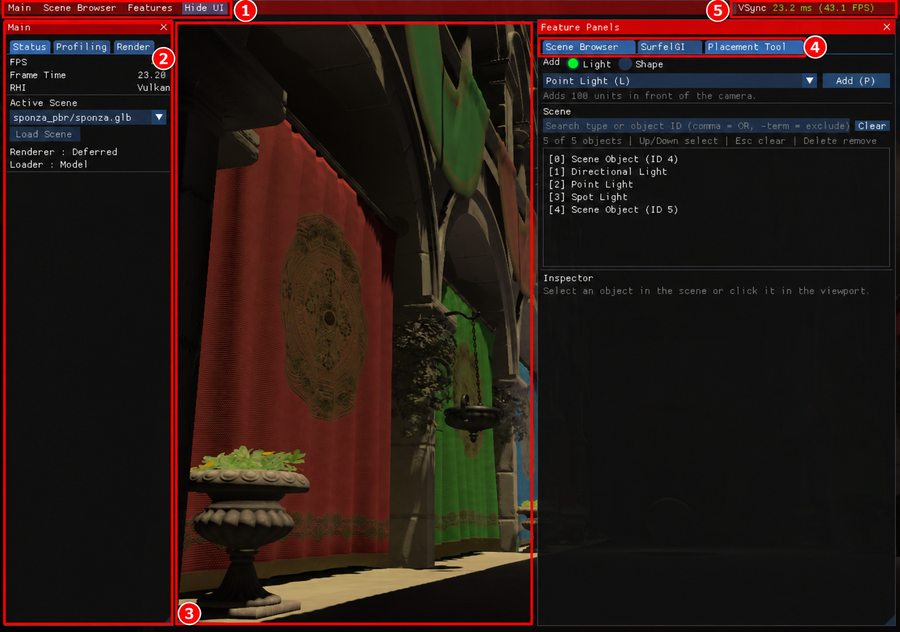

# 1. 시작하기

[목차](README.md) · [다음: 화면과 카메라 →](02-screen-camera.md)

이 장의 목표는 엔진을 실행하고, 중앙에 장면이 그려지는지 확인하는 것입니다. 명령은 **저장소 최상위 폴더**에서 시작합니다. 이 폴더에는 `README.md`, `CMakeLists.txt`, `scripts/`가 있습니다.

## macOS Apple Silicon에서 실행

Xcode Command Line Tools와 Homebrew가 준비된 환경에서 처음 한 번 실행합니다.

```sh
./scripts/setup-macos.sh
./scripts/run-macos.sh
```

첫 명령은 의존성과 DXC 셰이더 컴파일러를 준비하고 엔진을 빌드합니다. 처음에는 시간이 걸릴 수 있습니다. 다음부터 소스를 고쳐 다시 빌드할 때는 다음 명령을 사용합니다.

```sh
./scripts/build-macos.sh
./scripts/run-macos.sh
```

실행 스크립트는 리소스 경로가 맞도록 작업 폴더를 `jEngine/`으로 바꾸고 Vulkan을 선택합니다. macOS의 Vulkan은 MoltenVK를 통해 Metal에서 동작합니다. macOS에서는 `-dx12`를 사용하지 않습니다.

이미 준비된 검증용 실험 드라이버 대신 Homebrew의 안정 드라이버로 실행하려면 다음과 같이 실행하세요.

```sh
JENGINE_RUNTIME=stable ./scripts/run-macos.sh
```

안정 드라이버에서는 실험용 Inline GI를 사용할 수 없습니다. 먼저 기본 화면을 확인한 뒤 [SurfelGI 안내](05-surfelgi.md)에서 실험 기능을 살펴보세요.

## Windows에서 실행

Visual Studio 2026 C++ 도구, CMake 4.2 이상, Python 3이 필요합니다. 저장소 최상위 폴더의 PowerShell에서 실행합니다.

```powershell
./scripts/ci/setup-windows-dxc.ps1
cmake --preset windows-vs2026
cmake --build --preset windows-debug
```

그다음 리소스가 있는 `jEngine/` 폴더에서 실행합니다.

```powershell
Set-Location jEngine
..\build\windows-vs2026\Debug\jEngine.exe -dx12
```

Vulkan을 사용할 때는 마지막 인수만 `-vulkan`으로 바꿉니다. `-dx12`와 `-vulkan`을 동시에 지정하면 실행되지 않습니다. 생성된 솔루션은 `build/windows-vs2026/`에 있으며, 기존 `jEngine/jEngine.sln`도 사용할 수 있습니다.

실행 파일만 다른 폴더로 옮기면 장면·이미지·셰이더를 찾지 못할 수 있습니다. 개발 빌드는 리소스까지 포함한 독립 설치 프로그램이 아닙니다.

## 첫 화면 확인하기



1280×900 실제 실행 원본에 빨간 번호 주석을 추가한 그림입니다. [원본 보기](images/raw/01-overview.png)

1. 그림의 **② `Main`** 패널을 찾습니다. `Status`에서 `RHI`, `FPS`, `Frame Time`이 표시되는지 확인합니다.
2. **③ 중앙 뷰포트**에서 장면을 확인합니다. 그림의 Sponza는 예시이며, 보유한 리소스와 마지막으로 불러온 장면에 따라 화면이 달라집니다.
3. 장면을 고르려면 **① `Scene Browser` 메뉴** 또는 **④ `Scene Browser` 탭**을 엽니다. [장면 불러오기](03-scene-browser.md)의 순서대로 진행합니다.

**예상 결과:** 엔진 창이 열리고 `Main`에 현재 그래픽 API와 프레임 상태가 표시됩니다. 장면을 불러왔다면 중앙에 해당 장면이 나타납니다.

## 시작할 때 알아둘 점

- 장면 목록은 `jEngine/Resource/` 아래의 지원 파일을 사용합니다. 해당 장면 파일과 텍스처가 있어야 그림과 같은 결과를 볼 수 있습니다.
- 창이 잠깐 열렸다 닫힌다면 [문제 해결](07-troubleshooting.md)에서 실행 경로와 로그를 확인하세요.
- 창의 닫기 버튼으로 종료합니다. `Esc`는 선택 해제나 콘솔 닫기에 사용되며 앱 종료 안내로 사용하지 않습니다.
- UI 패널 상태와 마지막으로 불러온 장면 설정은 일부 기억하지만, **배치·변형을 저장하는 기능은 아닙니다.**

[← 목차](README.md) · [다음: 화면과 카메라 →](02-screen-camera.md)
