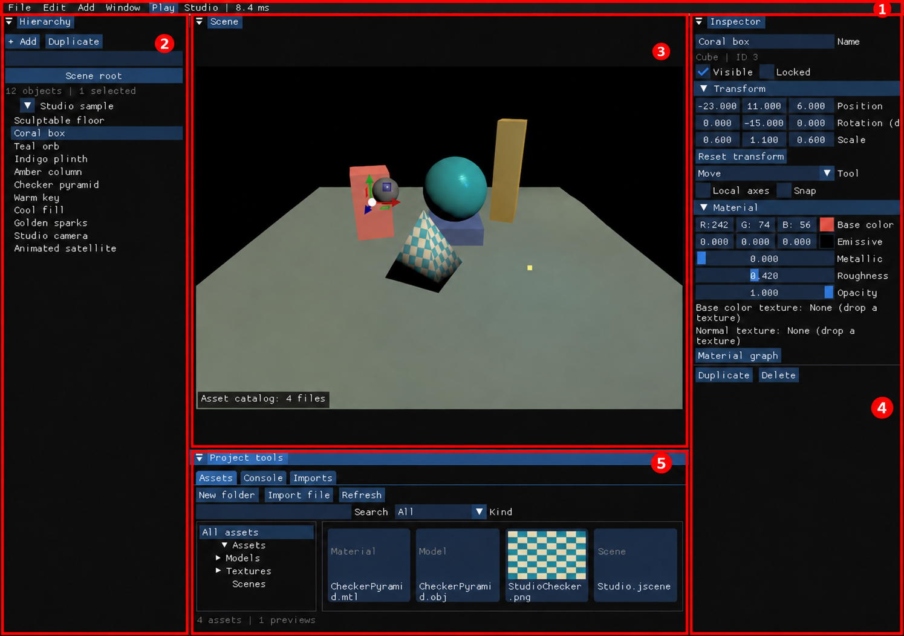

# 1. 시작하기

[목차](README.md) · [다음: 화면과 카메라 →](02-screen-camera.md)

이 장의 목표는 엔진을 실행하고 **첫 프로젝트와 장면 파일을 저장하는 것**입니다. 명령은 `README.md`, `CMakeLists.txt`, `scripts/`가 있는 저장소 최상위 폴더에서 시작합니다.

## macOS Apple Silicon에서 실행

Xcode Command Line Tools와 Homebrew가 준비된 환경에서 처음 한 번 실행합니다.

```sh
./scripts/setup-macos.sh
./scripts/run-macos.sh
```

첫 명령은 의존성과 DXC 셰이더 컴파일러를 준비하고 엔진을 빌드합니다. 다음부터 다시 빌드할 때는 다음 명령을 사용합니다.

```sh
./scripts/build-macos.sh
./scripts/run-macos.sh
```

실행 스크립트는 작업 폴더를 `jEngine/`으로 바꾸고 Vulkan을 선택합니다. macOS의 Vulkan은 MoltenVK를 통해 Metal에서 동작합니다. 안정 드라이버를 명시하려면 다음과 같이 실행합니다.

```sh
JENGINE_RUNTIME=stable ./scripts/run-macos.sh
```

안정 드라이버에서 기본 렌더링을 확인한 뒤 [SurfelGI](05-surfelgi.md)의 실험 Inline GI 조건을 살펴보세요. macOS에서는 `-dx12`를 사용하지 않습니다.

## Windows에서 실행

Visual Studio 2026 C++ 도구, CMake 4.2 이상, Python 3이 준비된 PowerShell에서 실행합니다.

```powershell
./scripts/ci/setup-windows-dxc.ps1
cmake --preset windows-vs2026
cmake --build --preset windows-debug
Set-Location jEngine
..\build\windows-vs2026\Debug\jEngine.exe -dx12
```

Vulkan을 사용할 때는 마지막 인수만 `-vulkan`으로 바꿉니다. `-dx12`와 `-vulkan`을 함께 지정하면 실행되지 않습니다. 생성된 솔루션은 `build/windows-vs2026/`에 있으며 기존 `jEngine/jEngine.sln`도 사용할 수 있습니다.

개발 실행 파일만 다른 폴더로 옮기면 리소스를 찾지 못할 수 있습니다. 이동 가능한 실행 폴더는 [패키지 만들기](09-extensions-packaging.md)에서 다룹니다.

## 첫 화면 확인하기



1280×900 실제 GPU 실행 원본에 빨간 상자·번호를 더한 확대 주석본입니다. [원본 보기](images/raw/06-workspace.png)

기본 화면 상단에는 `File`, `Edit`, `Add`, `Window`, `Play`가 있습니다. 왼쪽 `Hierarchy`는 물체 목록, 중앙 `Scene`은 장면, 오른쪽 `Inspector`는 선택한 물체, 아래 `Project tools`는 자산·콘솔·가져오기 상태입니다.

1. **② Hierarchy**와 **④ Inspector**가 보이는지 확인합니다.
2. **③ Scene**에 시작 장면이 표시되는지 확인합니다. 그림은 함께 제공하는 Studio 예제이며, 보유한 리소스나 시작 설정에 따라 내용이 다를 수 있습니다.
3. 패널을 잃어버렸다면 **① `Window → Reset layout`**을 누릅니다. 아래의 **⑤ Project tools**에서 자산과 로그를 찾습니다.

**예상 결과:** 새 저작 화면에서 장면과 네 개의 기본 패널을 볼 수 있습니다. `F10`을 누르면 클래식 렌더링 패널로 바뀌며, 다시 누르면 돌아옵니다.

## 첫 프로젝트와 장면 만들기

**진입 경로:** `File → New project`.

이미 열린 장면에 미저장 변경이 있으면 먼저 저장 확인 창이 나옵니다. 보관할 내용은 Save로 저장하고, 버려도 되는 시작 예시일 때만 Discard로 계속하세요.

1. `Create project folder` 창의 `Path`에 새 프로젝트 폴더의 전체 경로를 넣습니다. 예: macOS `/Users/사용자/Projects/MyProject`, Windows `C:/Projects/MyProject`.
2. `Project name`을 입력하고 `Apply`를 누릅니다. 경로를 직접 쓰는 입력 창이며 운영체제 파일 선택 창은 아닙니다.
3. `Add → Cube`를 누릅니다. 새 큐브가 목록에 추가되고 선택됩니다.
4. `Inspector → Transform → Position`의 값을 조금 바꿉니다. 보이지 않으면 선택한 상태에서 `F`로 카메라 초점을 맞춥니다.
5. `File → Save As`의 `Path`를 프로젝트 안의 `Scenes/First.jscene` 전체 경로로 지정하고 `Apply`를 누릅니다.

**예상 결과:** 프로젝트 폴더에 `project.jproject`, 작성한 장면에 `First.jscene`이 생깁니다. 장면 이름 옆의 `*`는 저장하지 않은 변경을 뜻하며 저장하면 사라집니다. 프로젝트 안에 장면을 저장하면 그 파일이 프로젝트 시작 장면으로 기록됩니다.

`File → New scene`, 다른 파일 열기, 프로젝트 교체나 창 닫기에서 저장하지 않은 변경이 있으면 `Unsaved scene`을 표시합니다. `Save`는 저장 후 계속, `Discard`는 변경을 버리고 계속, `Cancel`은 현재 작업에 머무릅니다. Play 중에는 먼저 `Stop`을 누르고 저장하세요.

## 저장한 프로젝트로 바로 실행하기

macOS는 저장소 최상위에서 다음과 같이 실행할 수 있습니다. 예시 경로를 실제 파일 경로로 바꾸세요.

```sh
./scripts/run-macos.sh --project /absolute/path/MyProject/project.jproject
```

프로젝트의 기본 시작 장면 대신 다른 장면을 지정하려면 함께 넘깁니다.

```sh
./scripts/run-macos.sh --project /absolute/path/MyProject/project.jproject --scene /absolute/path/MyProject/Scenes/First.jscene
```

Windows도 실행 파일 뒤에 같은 `--project`, `--scene` 인수를 붙입니다. 공백이 있는 경로는 따옴표로 감싸세요. 모델·텍스처 등 참조 파일은 프로젝트 안의 상대 경로로 있어야 합니다.

[← 목차](README.md) · [다음: 화면과 카메라 →](02-screen-camera.md)
