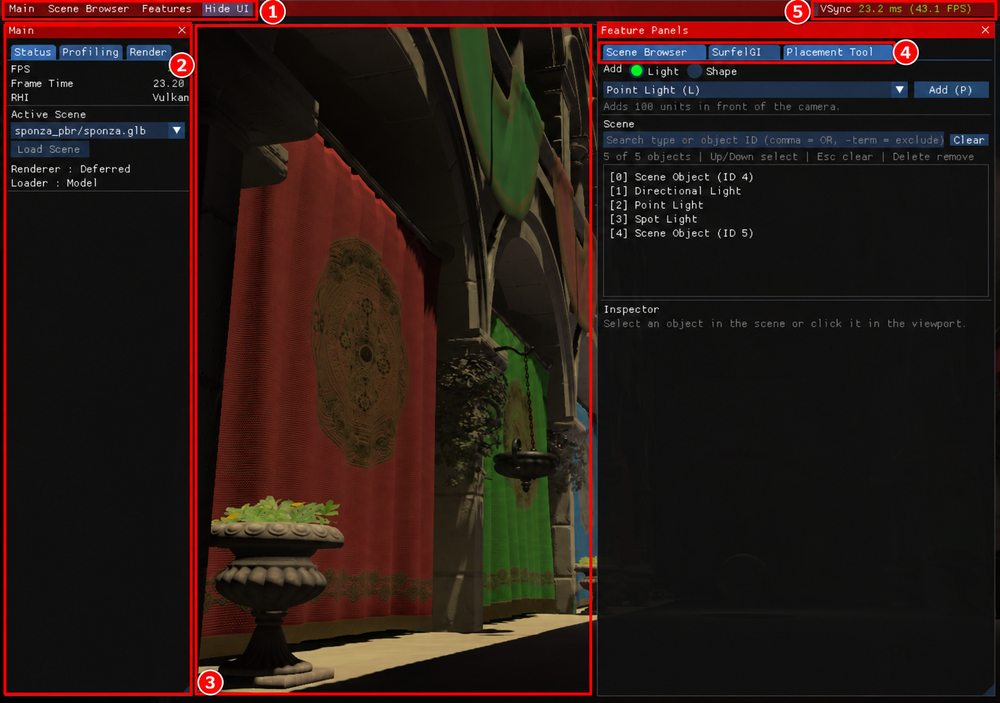

# 2. 화면과 카메라

[← 이전: 시작하기](01-getting-started.md) · [목차](README.md) · [다음: 장면 불러오기 →](03-scene-browser.md)

중앙 화면은 장면을 보는 **뷰포트**, 양옆은 상태와 기능을 조절하는 패널입니다. 처음에는 장면 이동과 패널 열기만 익혀 보세요.

1280×900 실제 실행 원본에 빨간 번호 주석을 추가한 그림입니다. [원본 보기](images/raw/01-overview.png)

## 화면의 다섯 영역

| 번호 | 화면 라벨 | 하는 일 |
| --- | --- | --- |
| ① | `Main`, `Scene Browser`, `Features`, `Hide UI` | 패널을 열거나 전체 UI를 숨깁니다. |
| ② | `Main` | `Status`에서 현재 장면·API·프레임 상태, `Profiling`에서 CPU/GPU 프로파일을 확인합니다. |
| ③ | 중앙 뷰포트 | 장면을 보고 카메라를 이동합니다. 배치 도구가 열려 있으면 물체 선택도 가능합니다. |
| ④ | `Feature Panels`의 탭 | `Scene Browser`, `Placement Tool`, `SurfelGI` 등 열린 기능을 선택합니다. |
| ⑤ | `VSync`, 프레임 시간, FPS | 수직 동기화 여부와 현재 프레임 표시를 확인합니다. |

## 패널을 열고 다시 찾기

1. **① `Features`** 메뉴를 누릅니다.
2. 사용할 항목의 체크를 켭니다. 예를 들어 `Placement Tool`을 켭니다.
3. **④ `Feature Panels`**에서 같은 이름의 탭을 클릭합니다.

**예상 결과:** 오른쪽 패널의 탭 내용이 선택한 기능으로 바뀝니다. 한 패널의 여러 탭 중 현재 선택한 탭만 표시됩니다.

패널을 닫았거나 UI를 숨겼다면 다음 라벨을 찾으세요.

| 보이는 상태 | 다시 여는 방법 |
| --- | --- |
| UI 전체를 숨김 | 남아 있는 `UI >` 버튼 클릭 |
| `Main`을 닫음 | `Main >` 또는 상단 `Main → Open` |
| 기능 패널이 접힘 | `< Features` 버튼 클릭 |
| 특정 기능 탭을 닫음 | 상단 `Features`에서 해당 항목을 다시 켜기 |

패널 경계로 너비를 조절할 수 있습니다. 드래그해서 임의 위치에 도킹하는 편집기는 제공하지 않습니다.

## 카메라를 움직여 보기

텍스트 입력과 콘솔을 마친 뒤 **③ UI가 덮지 않은 뷰포트**에서 조작합니다.

1. 빈 뷰포트에서 **왼쪽 마우스 버튼을 누른 채 드래그**해 바라보는 방향을 바꿉니다.
2. `W`를 짧게 눌러 앞으로, `S`를 눌러 뒤로 이동합니다.
3. `A`와 `D`로 왼쪽·오른쪽으로 이동합니다.
4. 너무 느리면 `+`/`=` 키를, 너무 빠르면 `-` 키를 짧게 누릅니다.

**예상 결과:** 장면 속 카메라의 위치와 시선이 바뀝니다. 물체 자체를 이동하는 조작은 아닙니다.

| 입력 | 동작 |
| --- | --- |
| `W` / `S` | 시선 방향의 앞 / 뒤 이동 |
| `A` / `D` | 옆으로 왼쪽 / 오른쪽 이동 |
| 뷰포트에서 왼쪽 드래그 | 카메라 시선 회전 |
| `+` / `=` / 숫자패드 `+` | 이동 속도 증가 |
| `-` / 숫자패드 `-` | 이동 속도 감소, 최저 0 |

**알아둘 점:** 마우스 휠은 UI 목록 스크롤에 사용됩니다. 카메라 줌이나 우클릭 회전을 안내하는 일반적인 3D 도구 조작법과 다릅니다. 별도의 위·아래 이동 키도 현재 연결되어 있지 않습니다.

입력칸이나 콘솔이 키보드를 사용하는 동안에는 카메라 키 입력을 막습니다. 배치 기즈모 위에서 드래그하거나 기즈모를 조작하는 동안에는 카메라 회전을 막습니다. 카메라를 돌릴 때는 축 손잡이에서 떨어진 곳을 드래그하세요.

## 프레임 숫자 읽기

**⑤ FPS**가 높을수록 초당 표시하는 프레임 수가 많고, `ms`가 낮을수록 프레임 하나에 걸린 시간이 짧습니다. `VSync`와 장면, 드라이버가 값에 영향을 줍니다. 효과를 비교할 때는 카메라와 장면, `VSync` 설정을 같게 유지하세요.

[← 이전: 시작하기](01-getting-started.md) · [목차](README.md) · [다음: 장면 불러오기 →](03-scene-browser.md)
