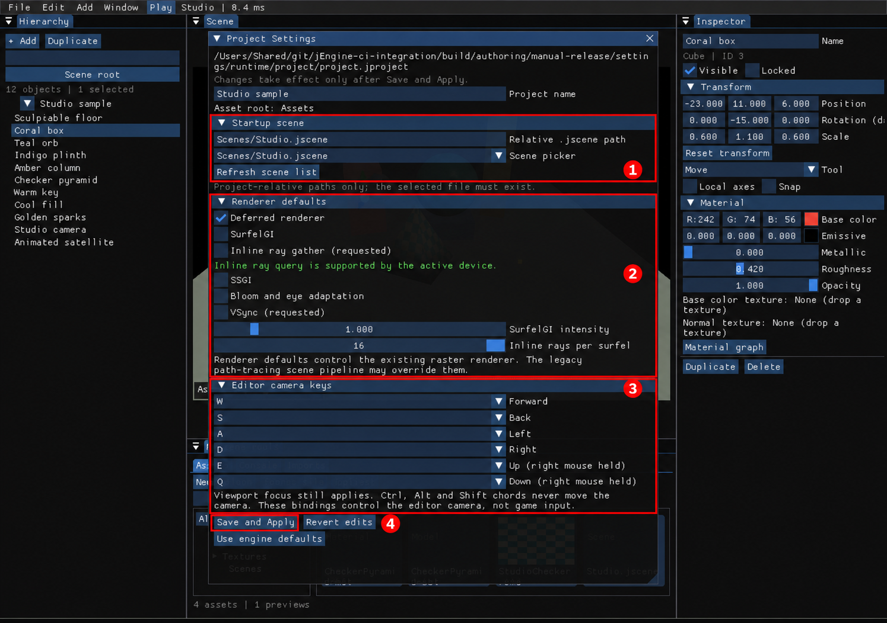
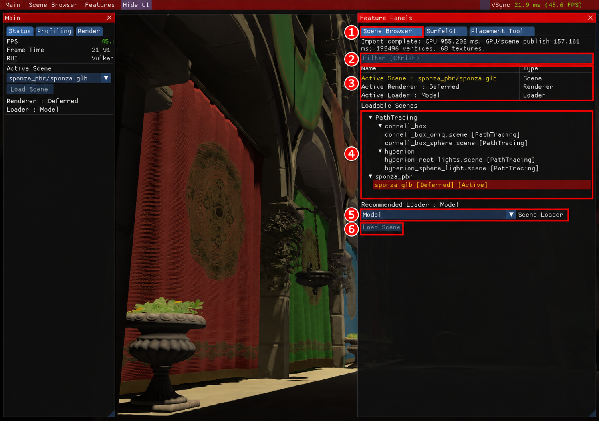

# 3. 프로젝트·씬·자산

[← 이전: 화면과 카메라](02-screen-camera.md) · [목차](README.md) · [다음: 배치와 Inspector →](04-placement-inspector.md)

**프로젝트**는 자산 경로·시작 장면·설정을 묶고, **장면 `.jscene`**은 물체의 계층·변형·속성을 저장합니다. 모델 파일을 장면에 여러 번 추가할 때는 새 `Assets`를 사용합니다. 기존 `Scene Browser`는 별도의 장면 교체 도구입니다.

## 프로젝트와 장면 저장·열기

**진입 경로:** 상단 `File`.

| 메뉴 | 동작 |
| --- | --- |
| `New project` / `Open project` | 프로젝트 폴더 만들기 / `project.jproject` 열기 |
| `Recent projects` | 최근 프로젝트 다시 열기 |
| `New scene` | 빈 저작 장면 시작 |
| `Open scene` | 작성한 `.jscene` 열기 |
| `Save` / `Save As` | 현재 장면 / 지정한 파일로 저장 |
| `Recover autosave` | 현재 프로젝트의 복구용 장면 열기 |

1. `File → Save As`에서 프로젝트 안의 `Scenes/Room.jscene` 같은 전체 경로를 넣고 `Apply`를 누릅니다.
2. 물체를 조금 이동해 상단 장면 이름 옆에 `*`가 나타나는지 봅니다.
3. `File → Open scene`으로 다른 장면을 열 때 `Unsaved scene`이 나오면 `Save`, `Discard`, `Cancel` 중 목적에 맞게 선택합니다.
4. 저장한 `Room.jscene`을 다시 열어 계층과 변형이 복구되는지 확인합니다.

**예상 결과:** 큐브·구·모델·조명·카메라·지형·효과의 저작 데이터가 파일에 남습니다. 모델의 실제 메시·텍스처 파일은 프로젝트 상대 경로로 다시 읽으므로 함께 보관해야 합니다. Undo 기록, 뷰포트의 자유 카메라 위치, 현재 살아 있는 파티클 상태까지 장면에 저장하는 것은 아닙니다.

기존 장면을 덮어쓸 때는 이전 파일을 `Room.jscene.bak`으로 보관합니다. 필요하면 원본을 별도로 보관한 뒤 `Open scene`의 경로 입력에서 이 백업 파일을 직접 열고, 새 `.jscene` 이름으로 저장하세요.

## 자동 복구용 저장

`Window → Layout settings → Autosave every 60 seconds`가 켜져 있으면 변경된 편집 장면을 프로젝트의 `.jeditor/recovery.jscene`에 기록합니다. Play 중이나 편집 드래그가 진행 중일 때는 쓰지 않습니다.

복구할 때는 `File → Recover autosave`를 선택하고 내용을 확인한 뒤 `Save As`로 원하는 장면에 저장하세요. 자동 저장은 마지막 정상 저장 파일을 덮어쓰지 않으며, 모든 입력 직후나 앱 종료 직전에 항상 기록되는 기능도 아닙니다.

## Assets에서 모델 추가하기

**진입 경로:** `Window → Assets / Console`을 켜고 `Project tools → Assets`.

[기본 화면 그림의 ⑤ Project tools](02-screen-camera.md)에서 찾습니다. 그림에는 실제 PNG 미리보기와 모델·재질·장면 타일이 표시되어 있습니다.

1. 프로젝트를 연 상태에서 폴더 트리를 고릅니다. `All assets`, `Search`, `Kind`로 범위를 좁힐 수 있습니다.
2. 모델 타일을 두 번 클릭하거나 우클릭의 `Add model instance`를 선택합니다. 타일을 `Scene`으로 끌어도 추가합니다.
3. `Project tools → Imports`에서 CPU 준비와 GPU 업로드 상태를 확인합니다.
4. 새 모델을 Hierarchy에서 선택하고 `F`로 초점을 맞춥니다.

**예상 결과:** 기존 장면을 유지하면서 모델 인스턴스가 추가됩니다. 같은 모델을 반복 추가하거나 복제할 때는 메시·재질 자원을 공유하고 각 물체의 변형은 따로 유지합니다. 모델 더블클릭은 현재 장면 교체가 아닙니다. `.jscene` 타일의 열기는 장면 교체이며 저장 확인을 거칩니다. Prefab은 `File → Instantiate prefab`으로 여세요.

PNG 텍스처는 화면에 필요한 항목부터 작은 미리보기를 준비합니다. 다른 형식과 아직 준비되지 않은 항목은 종류 표시가 나올 수 있습니다. 모든 모델의 3D 렌더 미리보기를 만드는 브라우저는 아닙니다.

## 파일·폴더 가져오기와 정리

`Assets`의 `New folder`, `Import file` 또는 폴더의 우클릭 메뉴를 사용합니다. `Import file`에는 **외부 원본의 전체 경로**와 `Project folder`를 넣고 `Apply`를 누릅니다. 원본 파일을 프로젝트에 복사하며 같은 이름의 대상 파일이 있으면 덮어쓰지 않습니다.

모델이 참조하는 `.bin`, 텍스처, `.mtl` 등도 올바른 상대 경로에 있어야 합니다. 선택한 파일 하나를 가져온다고 외부 폴더의 모든 의존 파일을 자동 복사하지 않습니다. 상태 메시지나 타일 툴팁의 `Missing`을 확인하세요.

| 자산·폴더 우클릭 | 동작과 확인할 점 |
| --- | --- |
| `Rename` / `Move` | 프로젝트 안에서 이름·위치 변경. 파일 확장자는 유지합니다. |
| `Move to trash` | 프로젝트 `.jeditor/trash/` 아래로 이동. 영구 삭제가 아닙니다. |
| `Reimport` | 변경된 원본과 관련 자산의 리비전을 갱신하고 실제 런타임을 갱신합니다. |
| 모델의 `Import settings` | 형상 배율, UV 뒤집기, 누락 노멀 생성 설정 |

참조를 깨뜨리는 이동·삭제는 거부될 수 있습니다. 자산의 `.jasset` 파일은 안정 ID·리비전·설정을 담으므로 원본과 함께 보관하세요. 휴지통의 자동 복원 버튼은 없으며 표시된 복구 경로를 확인해 원본과 메타데이터를 함께 관리합니다.

`Import settings`의 `Geometry scale`은 양수 배율, `Flip texture V`는 텍스처 V 좌표 뒤집기, `Generate missing normals`는 없는 노멀 생성입니다. `Defaults`는 배율 1·V 뒤집기 켬·노멀 생성 켬으로 맞추며 `Apply` 후 다시 준비합니다. 이미 저장한 모델별 메시 변형이 있으면 가져오기 설정을 바꾼 뒤 결과를 확인하세요.

## 변경 감지·업로드·취소

열린 프로젝트의 카탈로그는 주기적으로 다시 검사하며 `Refresh`로 직접 갱신할 수도 있습니다. `Reimport`는 수동으로 다시 읽는 경로입니다. 이미지가 바뀌면 텍스처 슬롯과 PNG 미리보기 캐시도 무효화합니다.

CPU 준비는 작업 스레드에서, 실제 GPU 업로드와 장면 반영은 소유 스레드에서 진행합니다. 모델 업로드는 프레임별 복사량·입장 시간 목표와 완료 펜스를 사용하지만 **화면 멈춤이 완전히 없어지는 보장은 아닙니다.** 드라이버 할당, 가속 구조, 셰이더 준비 등은 별도 비용입니다.

`Imports → Cancel pending imports`는 추가 준비·업로드 제출을 멈춥니다. 진행 중인 디코더 호출은 끝날 때 취소를 확인하고, 이미 제출한 GPU 작업은 안전하게 완료·회수합니다. 기존 정상 인스턴스는 유지합니다. 취소한 모델을 다시 시도하려면 해당 자산을 `Reimport`하세요. `Cancel scan`은 카탈로그 검사 취소로, 모델 가져오기 취소와 다릅니다.

## 프로젝트의 시작 장면·렌더링·키 설정

**진입 경로:** `Window → Project settings` → `Project Settings`.

1280×900 실제 GPU 실행 원본에 빨간 상자·번호를 더한 확대 주석본입니다. [원본 보기](images/raw/08-project-settings.png)

| 번호 | 확인할 영역 |
| --- | --- |
| ① `Startup scene` | 시작 장면 경로·Scene picker·목록 새로고침 |
| ② `Renderer defaults` | 렌더링 요청값과 실제 Inline 지원 상태 |
| ③ `Editor camera keys` | 여섯 카메라 이동 키 |
| ④ `Save and Apply` | 프로젝트에 저장한 뒤 적용 |

1. **① `Startup scene → Scene picker`**에서 프로젝트 안의 기존 `.jscene`을 선택합니다. `Relative .jscene path`에 직접 넣거나 `Refresh scene list`로 다시 찾을 수도 있습니다.
2. **② `Renderer defaults`**에서 `Deferred renderer`, `SurfelGI`, `SSGI`, `Bloom and eye adaptation`, `VSync (requested)`를 고릅니다.
3. `SurfelGI intensity`는 0~8, `Inline rays per surfel`은 1~16 범위입니다. `Inline ray gather (requested)`는 실제 장치 지원 상태를 함께 확인합니다.
4. **③ `Editor camera keys`**에서 여섯 이동 동작의 키를 고릅니다. 서로 충돌하는 키는 저장 시 거부되며 Ctrl·Alt·Shift 조합은 카메라 이동에 쓰지 않습니다.
5. **④ `Save and Apply`**를 누르고 `Project settings saved and applied.` 메시지를 확인합니다.

**예상 결과:** 설정이 `project.jproject`에 저장된 뒤 실제 기존 래스터 렌더러와 에디터 카메라에 적용됩니다. 지원하지 않는 Inline/VSync 요청은 프로젝트에 남길 수 있어도 실제 상태는 지원 범위로 제한합니다. 기존 PathTracing 장면 파이프라인은 일부 렌더러 기본값을 덮어쓸 수 있습니다.

`Revert edits`는 창의 미저장 수정만 버립니다. `Use engine defaults`는 알려진 설정을 기본값으로 맞추는 초안이며 역시 Save and Apply가 필요합니다. 프로젝트 이름은 바꿀 수 있지만 이 창에서 자산 루트나 프로젝트 ID를 바꾸지는 않습니다. 카메라 키는 에디터 조작용이며 일반 게임플레이 입력 맵은 아닙니다.

## 클래식 Scene Browser를 쓸 때

**진입 경로:** `F10 → Scene Browser` 또는 `Features → Scene Browser`.

**클래식 장면 교체 화면 참고 그림입니다.** 1280×900 실제 실행 원본에 빨간 번호 주석을 추가했습니다. [원본 보기](images/raw/02-scene-browser.png)

1. **① 탭**을 열고 **② `Filter`**로 이름을 찾습니다.
2. **④ `Loadable Scenes`**에서 장면을 고르고 **⑤ `Recommended (...)`** 로더를 확인합니다.
3. **⑥ `Load Scene`**을 누르고 **③ `Active Scene`·`Active Loader`**의 변경을 기다립니다.

그림은 이미 Sponza를 Model로 연 상태여서 같은 장면·로더의 `Load Scene`이 비활성화된 것입니다. 목록은 실행 리소스의 `.gltf`, `.glb`, 기존 `.scene`을 대상으로 합니다. 검색 힌트의 `Ctrl+F` 대신 검색칸을 직접 클릭하세요.

이 경로는 장면 전체를 교체합니다. 클래식 Model 로더는 CPU 준비 후 GPU 완료를 동기식 어댑터로 기다려 마지막 반영에서 멈춤이 남을 수 있습니다. 기존 PathTracing 로더는 **동기식**이며 실패 전에 기존 장면을 지울 수 있습니다. 저작 `.jscene` 저장·열기나 모델 다중 배치에는 `File`과 새 `Assets`를 사용하세요.

[← 이전: 화면과 카메라](02-screen-camera.md) · [목차](README.md) · [다음: 배치와 Inspector →](04-placement-inspector.md)
