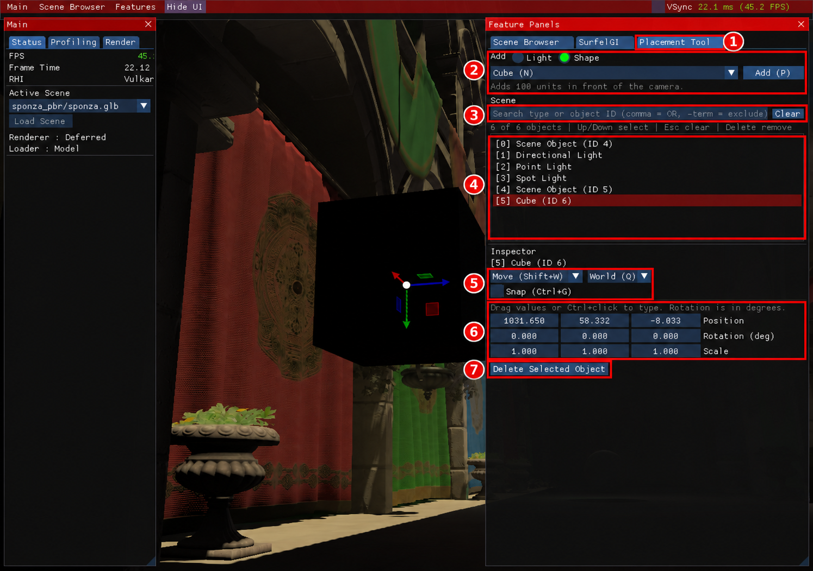

# 4. 배치와 Inspector

[← 이전: 장면 불러오기](03-scene-browser.md) · [목차](README.md) · [다음: SurfelGI →](05-surfelgi.md)

먼저 큐브 한 개로 조작을 익혀 보세요. 이 도구는 현재 장면에 기본 도형과 조명을 추가하고 선택한 물체를 바꿉니다. **편집 결과 저장과 Undo/Redo는 지원하지 않습니다.**

**진입 경로:** `Features → Placement Tool`을 켠 뒤 오른쪽 `Placement Tool` 탭을 선택합니다.

1280×900 실제 실행 원본에 빨간 번호 주석을 추가한 그림입니다. [원본 보기](images/raw/03-placement-inspector.png)

## 큐브 하나 추가하기

1. **① `Placement Tool` 탭**을 엽니다.
2. **② `Add` 영역**에서 `Shape`를 선택합니다.
3. 같은 영역의 종류 목록에서 `Cube (N)`를 고릅니다.
4. **② `Add (P)` 버튼**을 한 번 누릅니다.
5. **④ `Scene` 목록**에 새 항목이 생기고 **⑥ `Inspector`**에 변형 값이 나타나는지 확인합니다.

**예상 결과:** 카메라 앞 100 엔진 단위 지점에 큐브가 생기며 자동으로 선택됩니다. 기존 검색어는 비워져 새 물체를 찾을 수 있습니다. 그림처럼 큐브가 어둡게 보여도 선택 행과 축 손잡이로 위치를 확인할 수 있습니다. 표면 색과 밝기는 장면 조명의 영향을 받습니다. 같은 방식으로 `Sphere (M)`를 추가할 수 있습니다.

조명을 추가하려면 **② `Light`**로 바꾸고 `Point Light`, `Spot Light`, `Directional Light` 중 하나를 고른 뒤 `Add (P)`를 누릅니다. 종류 선택만으로 물체가 생기지는 않습니다.

## 목록에서 선택하고 찾기

1. **③ 검색칸**을 클릭해 `Cube`, `Light` 또는 보이는 ID 일부를 입력합니다.
2. **④ 결과 목록**의 행을 클릭합니다. `Inspector` 내용과 뷰포트 선택이 같은 물체로 바뀝니다.
3. 검색을 끝내려면 **③ `Clear`**를 누릅니다.

검색은 대소문자를 구분하지 않습니다. `Cube,Sphere`는 두 종류 중 하나를 찾고, `Light,-Spot`은 Spot을 제외한 Light를 찾습니다. 이 검색 문법은 Placement 목록용이며 Scene Browser의 단순 이름 검색과 다릅니다.

검색 후 선택한 물체가 목록에서 숨겨져도 선택 자체는 유지될 수 있습니다. `Selection is hidden by the search.`가 보이면 검색을 지우고 대상부터 다시 확인하세요. `Scene Object (ID ...)`는 가져온 일반 물체에 쓰는 표시이며 파일 이름이나 저장용 영구 ID가 아닙니다.

`Placement Tool`이 열려 있고 UI가 가리지 않는 물체를 뷰포트에서 짧게 클릭해 선택할 수도 있습니다. 카메라 회전 드래그와 구분해 클릭하세요.

## 숫자로 위치·회전·크기 바꾸기

1. 큐브가 선택된 상태에서 **⑥ `Position`**의 값 하나를 조금 드래그합니다. 값을 직접 쓰려면 `Ctrl`을 누른 채 해당 숫자를 클릭합니다.
2. **⑥ `Rotation (deg)`**에서 한 축의 값을 바꿉니다. 예를 들어 `90`은 90도입니다.
3. **⑥ `Scale`**에서 크기를 바꿉니다. `1`은 원래 크기, `2`는 두 배입니다.

**예상 결과:** 입력한 값이 선택한 큐브에 반영됩니다. 위치는 예전의 -500~500 슬라이더 범위에 제한되지 않습니다. 회전은 도 단위로 표시·입력합니다.

0이나 음수 크기, `NaN`·무한대 같은 잘못된 값은 적용하지 않습니다. 크기의 최소값은 `0.001`입니다. 숫자를 바꾸기 전에 원래 값을 기록하면 다시 입력해 복구할 수 있습니다.

각 벡터 입력칸의 우클릭 메뉴에는 `Copy`와 `Paste`가 있습니다. 값은 `x, y, z` 형태로 복사합니다. 조명은 종류에 따라 `Position`, `Direction`, `Color`가 표시되며 기본 도형과 모든 항목이 같지는 않습니다.

## 기즈모로 조작하기

선택한 물체 주위에 나타나는 축 손잡이를 기즈모라고 부릅니다.

1. **⑤ 도구 목록**에서 `Move`, `Rotate`, `Scale` 중 하나를 고릅니다.
2. **⑤ 좌표계**에서 `World` 또는 `Local`을 고릅니다. World는 장면 기준, Local은 물체 기준 축입니다.
3. 뷰포트의 축 손잡이를 드래그합니다.
4. 일정 간격으로 맞추려면 **⑤ `Snap (Ctrl+G)`**을 켜고 나타나는 간격을 조절합니다.

**예상 결과:** 선택한 도구와 축을 따라 물체가 이동·회전·확대됩니다. Snap 간격은 기즈모 조작에 사용되며 Inspector의 직접 숫자 입력에 일괄 적용되는 설정은 아닙니다.

가져온 장면에 여러 메시가 있으면 `Meshes` 목록이 나옵니다. **처음에는 메시 하나를 선택해 조작하세요.** 여러 메시 또는 전체 물체의 그룹 기즈모는 현재 상대 위치·회전·크기를 제대로 보존하지 못할 수 있습니다. `Shift+클릭`, `Select all meshes`, `Clear meshes`는 메시 선택을 바꾸지만 이 그룹 변형 제한을 해결하지는 않습니다.

## 삭제하기

1. **④ `Scene`에서 삭제할 물체**를 다시 확인합니다.
2. **⑦ `Delete Selected Object`**를 누릅니다. 텍스트를 편집하지 않을 때 `Delete` 키로도 삭제할 수 있습니다.

**예상 결과:** 선택한 물체가 현재 장면과 목록에서 제거되고 선택이 해제됩니다. 검색으로 숨긴 물체도 선택된 상태라면 삭제 대상이 될 수 있으므로 대상 표시를 먼저 확인하세요. Undo가 없으므로 이 동작을 되돌리는 단축키는 없습니다.

## 배치 단축키 모아 보기

`Placement Tool`이 현재 열린 탭이고 텍스트·숫자를 편집하지 않을 때 사용합니다. 키를 누르고 있는 동안 새 물체가 계속 생기는 방식은 아닙니다.

| 키 | 동작 |
| --- | --- |
| `L` / `K` / `J` | Point / Spot / Directional Light 종류 선택 |
| `N` / `M` | Cube / Sphere 종류 선택 |
| `P` | 선택한 종류 추가 |
| `Shift+W` / `Shift+E` / `Shift+R` | Move / Rotate / Scale 기즈모 선택 |
| `Q` | World / Local 전환 |
| `Ctrl+G` | Snap 켜기·끄기 |
| `↑` / `↓` | 검색 결과 안에서 이전 / 다음 물체 선택 |
| `Esc` | 물체·메시 선택 해제 |
| `Delete` | 선택한 물체 삭제 |

현재 카메라의 `W` 이동과 기즈모의 `Shift+W`가 함께 처리될 수 있습니다. 정밀하게 도구를 바꿀 때는 **⑤ 도구 목록을 클릭**하는 방법을 사용하세요. macOS에서도 표의 `Ctrl`은 Control 키이며 Command 키 대체 동작은 연결되어 있지 않습니다. Forward Delete 키가 없는 키보드에서는 **⑦ 삭제 버튼**을 사용하면 됩니다.

[← 이전: 장면 불러오기](03-scene-browser.md) · [목차](README.md) · [다음: SurfelGI →](05-surfelgi.md)
