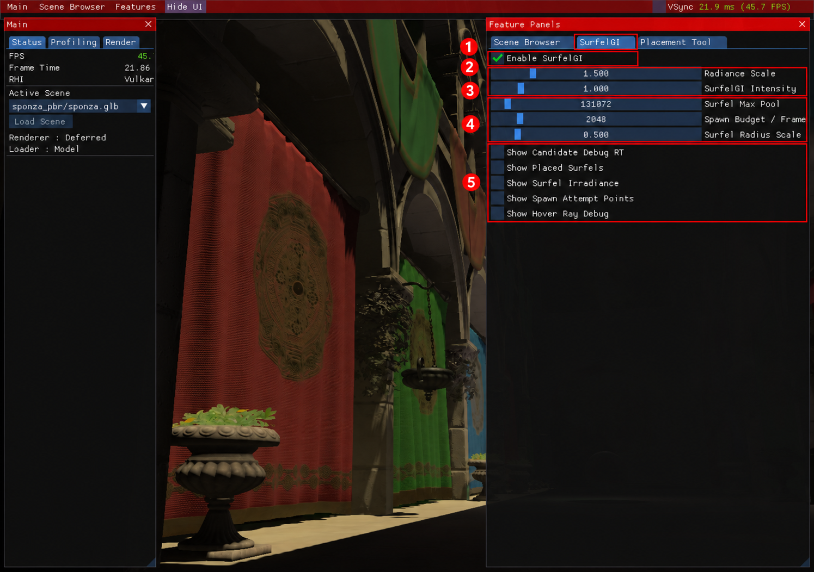

# 5. SurfelGI 살펴보기

[← 이전: 배치와 Inspector](04-placement-inspector.md) · [목차](README.md) · [다음: 콘솔과 로그 →](06-console-logs.md)

SurfelGI는 표면 위의 작은 샘플인 **surfel**에 조명 정보를 모아 간접광을 표현하는 실험 기능입니다. 먼저 기본 켜기·끄기와 표시 옵션을 비교한 뒤, 지원 환경에서 Inline Ray Gather를 시험하세요.

**진입 경로:** `Features → SurfelGI`를 켠 뒤 오른쪽 `SurfelGI` 탭을 선택합니다.



1280×900 실제 실행 원본에 빨간 번호 주석을 추가한 그림입니다. [원본 보기](images/raw/04-surfelgi.png)

## 화면에서 켜고 비교하기

1. **① `SurfelGI` 탭**을 선택합니다.
2. **② `Enable SurfelGI`**를 켭니다. 꺼져 있으면 아래 설정도 비활성화됩니다.
3. 현재 값을 기록하고 **③ `SurfelGI Intensity`**를 조금 바꿔 봅니다. `Radiance Scale`은 모은 조명 정보의 배율을 조절합니다.
4. **② 켜기·끄기**를 비교하되 카메라와 장면은 그대로 둡니다.

**예상 결과:** 지원되는 장면·렌더링 경로에서 SurfelGI의 기여가 달라집니다. 효과의 크기는 장면과 수집된 조명 이력, 런타임의 Inline 지원 여부에 따라 달라집니다. 체크를 켰다는 사실만으로 새 하드웨어 광선 샘플이 수집됐다고 판단하지 마세요.

## 샘플과 시각화 살펴보기

| 번호 / 라벨 | 바꾸는 내용 |
| --- | --- |
| ④ `Surfel Max Pool` | 유지할 surfel 풀의 최대 개수 |
| ④ `Spawn Budget / Frame` | 프레임마다 새로 배치할 샘플 예산 |
| ④ `Surfel Radius Scale` | surfel 반경 배율 |
| ⑤ `Show Candidate Debug RT` | 후보 디버그 화면 표시 |
| ⑤ `Show Placed Surfels` | 배치된 surfel 표시 |
| ⑤ `Show Surfel Irradiance` | surfel의 조명 정보 표시 |
| ⑤ `Show Spawn Attempt Points` | 배치를 시도한 지점 표시 |
| ⑤ `Show Hover Ray Debug` | 포인터가 가리키는 surfel의 광선 디버그 표시 |

한 번에 **⑤ 표시 옵션 하나씩** 켜 보세요. 확인이 끝나면 끄고 원래 장면과 비교합니다. 숫자를 크게 설정하면 자원 사용량이나 프레임 시간이 늘 수 있으므로 작은 변화부터 확인하세요. 광선 정보가 아직 없거나 Inline 경로가 동작하지 않는 경우 관련 디버그 정보가 보이지 않을 수 있습니다.

## Inline Ray Gather는 어디서 켜나요?

**현재 그림의 간단한 SurfelGI 패널에는 `Enable Inline Ray Gather` 체크박스가 없습니다.** 이 설정은 콘솔 명령 또는 실행 환경변수로 바꿉니다. 먼저 [콘솔 여는 법](06-console-logs.md)을 확인한 뒤 다음을 입력하세요.

```text
r.surfelgi.inline_ray.enable
r.surfelgi.inline_ray.enable true
```

첫 줄은 현재 설정값 조회, 둘째 줄은 활성화 요청입니다. 활성화를 요청해도 GPU·드라이버가 지원하지 않으면 Inline 수집은 실행되지 않습니다. 지원 환경에서는 다음과 같이 설정을 조회하거나 바꿀 수 있습니다.

```text
help r.surfelgi.inline_ray.count
r.surfelgi.inline_ray.count
r.surfelgi.inline_ray.guide_enable
```

광선 수를 늘리면 작업량도 늘어납니다. 실제 수집에서 한 surfel당 광선 수는 1~16 범위로 제한됩니다. 자세한 항목은 `find surfelgi.inline_ray`로 찾을 수 있습니다.

## Apple M4: 안정 실행과 실험 실행 구분

| 실행 환경 | 사용할 수 있는 범위 |
| --- | --- |
| Homebrew의 안정 MoltenVK | 기본 Vulkan 렌더링. 이 환경에 실험용 Inline ray-query 지원이 생기는 것은 아닙니다. |
| 별도로 빌드하고 검증한 실험 MoltenVK + 지원 GPU | Metal 기반 Inline ray query를 시험할 수 있습니다. RT 파이프라인 지원 전체를 뜻하지 않습니다. |

실험 런타임을 준비하려면 저장소 최상위 폴더에서 다음 순서로 실행합니다.

```sh
./scripts/setup-macos-rayquery.sh
./scripts/verify-macos-rayquery.sh
./scripts/run-macos.sh
```

기본 macOS 의존성이 먼저 필요합니다. 검증을 통과한 드라이버 기록이 있고 드라이버 해시가 맞을 때 일반 실행 스크립트가 해당 런타임을 선택합니다. `MVK_CONFIG_ENABLE_EXPERIMENTAL_RAY_TRACING=1`만 설정해서 안정 드라이버에 없는 기능을 만들 수는 없습니다. 자세한 준비·검증 범위는 [플랫폼 안내](../platform-and-ci.md#surfelgi-hardware-inline-ray-queries)를 참고하세요.

실행할 때 Inline 설정까지 명시하려면 다음과 같이 사용할 수 있습니다.

```sh
JENGINE_SURFEL_GI=1 JENGINE_INLINE_RAY=1 ./scripts/run-macos.sh
```

이 값들은 `0` 또는 `1`을 받습니다. 실제 수집에는 엔진의 레이 트레이싱 사용 설정, 장치의 Inline 지원과 정상적으로 불러온 장면의 가속 구조가 모두 필요합니다. TLAS는 광선이 장면 속 물체를 찾는 데 사용하는 공간 정보입니다. 장면을 불러오는 중이거나 필요한 구조가 없으면 설정이 켜져 있어도 수집하지 않습니다.

문제가 생기면 엔진을 종료하고 안정 드라이버로 다시 실행합니다.

```sh
JENGINE_RUNTIME=stable ./scripts/run-macos.sh
```

## 두 종류의 끄기는 다릅니다

- `r.surfelgi.inline_ray.enable false`는 **새 Inline 샘플 수집을 멈춥니다.** 기존 조명 이력이 남을 수 있어 화면이 즉시 완전히 달라지지 않을 수 있습니다.
- **② `Enable SurfelGI`를 끄거나** `r.surfelgi.enable false`를 입력하면 SurfelGI의 기여를 끕니다.

기록을 초기화하는 별도 버튼을 안내하고 있지는 않습니다. 전후 비교를 할 때는 이전 이력이 남는다는 점을 함께 확인하세요.

[← 이전: 배치와 Inspector](04-placement-inspector.md) · [목차](README.md) · [다음: 콘솔과 로그 →](06-console-logs.md)
