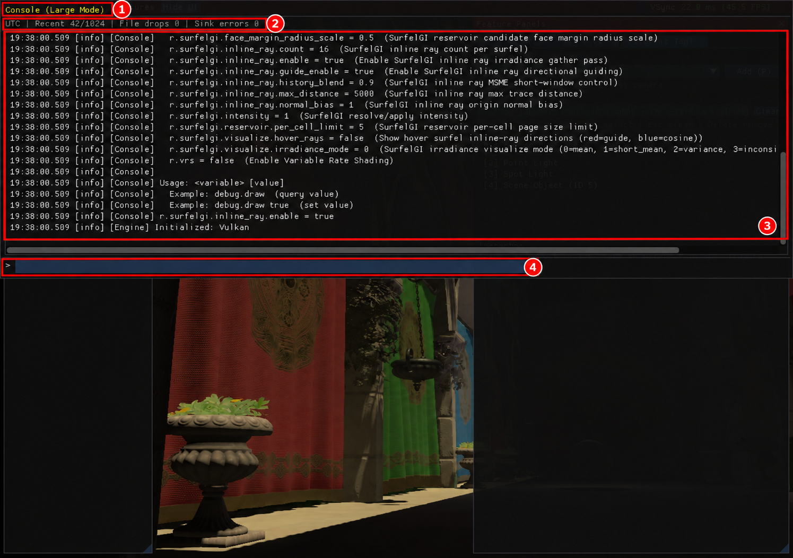

# 6. 콘솔과 로그

[← 이전: SurfelGI](05-surfelgi.md) · [목차](README.md) · [다음: 문제 해결과 지원 범위 →](07-troubleshooting.md)

콘솔에서는 설정값을 조회하거나 변경하고, 불러오기·셰이더·런타임 메시지를 읽을 수 있습니다.

## 기본 저작 화면의 Console

**진입 경로:** `Window → Assets / Console`을 켠 뒤 `Project tools → Console`.

[기본 화면 그림의 ⑤ Project tools](02-screen-camera.md)에서 `Console` 탭을 누릅니다. 그 그림은 Assets 선택 상태이므로 로그 내용은 Console로 바꾼 뒤 확인하세요.

1. `Minimum level`에서 표시할 최소 심각도를 고릅니다.
2. `Search`에 분류나 메시지 일부를 입력해 최근 로그를 좁힙니다.
3. 아래 `Command` 입력칸에 `find surfelgi`를 넣고 Enter를 누릅니다.
4. 메시지 위에 마우스를 올리면 UTC 시각·스레드·순서 정보를 봅니다.

**예상 결과:** 새 저작 화면 안에서 로그 필터와 명령 실행을 함께 사용할 수 있습니다. 이 간단한 Command 입력칸과 아래의 자동완성·기록 기능을 가진 클래식 콘솔은 입력 UI가 다릅니다.

## 클래식 콘솔 그림

**진입 경로:** 엔진 창에서 **백틱(Grave Accent) 키**를 누릅니다. 기본 저작 화면에서도 열 수 있습니다. 그림의 명령은 아래 `>` 입력칸에 씁니다.



**클래식 콘솔 참고 그림입니다.** 1280×900 실제 실행 원본에 빨간 번호 주석을 추가했습니다. [원본 보기](images/raw/05-console.png)

## 콘솔 열고 닫기

1. 백틱 키를 한 번 누릅니다. **① 모드 표시**가 `Console (Small Mode)`로 바뀝니다.
2. 다시 누르면 `Large Mode`가 됩니다.
3. 한 번 더 누르면 숨깁니다. 열려 있을 때 `Esc`로 바로 닫을 수도 있습니다.

**예상 결과:** 작은 모드는 화면 아래쪽, 큰 모드는 위쪽 절반에 나타납니다. 그림의 ①은 두 번 눌러 연 `Console (Large Mode)` 상태입니다. 콘솔이 열려 있는 동안 카메라 키 입력은 막힙니다.

## 첫 명령 실행하기

1. **④ `>` 입력칸**에 `help`를 쓰고 `Enter`를 누릅니다.
2. **③ 로그 출력**에서 사용 가능한 명령과 변수를 확인합니다.
3. 같은 입력칸에 `find surfelgi`를 입력해 SurfelGI 관련 변수를 찾습니다.
4. 변수 이름만 입력하면 현재 값을, 이름 뒤에 값을 쓰면 변경 결과를 확인할 수 있습니다.

```text
help
find surfelgi
r.surfelgi.enable
r.surfelgi.enable true
r.surfelgi.intensity
r.surfelgi.intensity 1.0
```

**예상 결과:** 조회는 `이름 = 현재값` 형태로 출력되고, 유효한 변경은 연결된 렌더링 설정에 적용됩니다. `help r.surfelgi.intensity`처럼 특정 변수의 설명도 볼 수 있습니다.

| 명령 | 용도 |
| --- | --- |
| `help` | 명령과 변수 도움말 |
| `help 변수이름` | 해당 변수의 형식·설명·현재값 |
| `list` | 등록된 변수 목록 |
| `find 검색어` | 이름에 검색어가 포함된 변수 찾기 |
| `변수이름` | 현재값 조회 |
| `변수이름 값` | 값 변경 |
| `clear` | 콘솔의 최근 출력 지우기 |

숫자는 한 값 전체가 올바르게 해석돼야 합니다. `12junk`, `NaN`, 무한대 같은 입력은 거부됩니다. 숫자·불리언 변수에 값 여러 개를 한꺼번에 넣을 수는 없습니다. **값이 문법상 유효한 것과 그 기능을 GPU가 지원하는 것은 별개**입니다.

## 자동완성과 기록

- 이름 일부를 쓰고 `Tab`을 누릅니다. 후보가 하나면 완성하고, 여러 개면 후보를 출력합니다.
- 추천 목록이 떠 있을 때 `↑`/`↓`는 추천 항목을 고릅니다. `Enter`가 추천 내용을 입력칸에 적용한 경우에는 내용을 확인한 뒤 한 번 더 눌러 실행합니다.
- 추천 목록이 없을 때 `↑`/`↓`로 이전에 실행한 명령을 살펴봅니다.

콘솔의 방향키는 물체 선택용 방향키와 문맥이 다릅니다. 배치 조작을 다시 하려면 먼저 콘솔을 닫으세요.

## 로그를 읽는 순서

1. **② `Recent`**에서 현재 보관한 최근 레코드 수를 봅니다. 기본 상한은 1,024개입니다.
2. **③ 메시지**에서 시간, 심각도, 분류와 내용을 읽습니다. 화면의 시간은 **UTC**입니다.
3. 긴 줄은 마우스를 올려 세부 메시지와 레코드·스레드 정보를 봅니다.
4. **② `File drops`**나 `Sink errors`가 늘었는지 확인합니다. 파일 오류가 있으면 상태 줄에 마우스를 올려 마지막 오류를 볼 수 있습니다.

경고는 노란색, 오류는 붉은색으로 표시합니다. 최근 로그 화면은 보관 한도가 있으므로 계속 늘어나는 전체 기록창이 아닙니다. `File drops`는 파일 기록 대기열이 가득 차 새 파일 제출이 빠진 수이며, 해당 메시지가 최근 화면에는 남을 수 있습니다.

## 파일 로그 찾기

정상 실행 기준 기본 파일은 다음 위치입니다.

```text
jEngine/logs/jEngine.log
```

정확히는 **프로그램 실행 작업 폴더의 `logs/jEngine.log`**입니다. 파일은 줄마다 JSON 레코드 하나를 저장합니다. `timestamp_ms`, `level`, `category`, `message`, `thread_id`, `sequence` 등으로 원인을 찾아볼 수 있습니다.

기본 설정은 파일 하나당 최대 4 MiB, 현재 파일을 포함해 3개 회전 보관입니다. 메시지 하나는 최대 4 KiB여서 긴 메시지가 잘릴 수 있습니다. 모든 실행의 전체 기록을 영구 보관하는 구조는 아닙니다.

별도 위치에 저장하려면 실행 전에 `JENGINE_LOG_FILE`을 지정합니다. macOS 예시는 다음과 같습니다.

```sh
JENGINE_LOG_FILE="$PWD/build/my-session.log" ./scripts/run-macos.sh
```

**`clear`는 최근 콘솔 출력만 지우며 이미 기록된 파일을 삭제하지 않습니다.** 콘솔에서 바꾼 배치나 렌더링 값을 파일 로그가 다시 적용해 주는 것도 아닙니다.

[← 이전: SurfelGI](05-surfelgi.md) · [목차](README.md) · [다음: 문제 해결과 지원 범위 →](07-troubleshooting.md)
