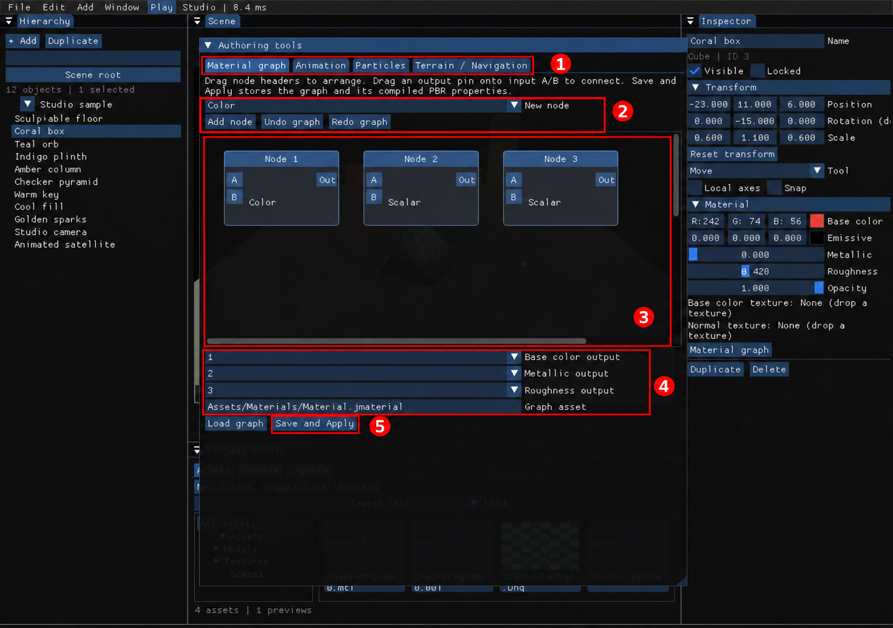

# 8. 재질·애니메이션·효과·지형

[← 이전: 문제 해결과 지원 범위](07-troubleshooting.md) · [목차](README.md) · [다음: 확장 플러그인·패키지 →](09-extensions-packaging.md)

**진입 경로:** `Window → Material / Animation / Effects / Terrain`. 열리는 창 이름은 `Authoring tools`입니다. 먼저 Hierarchy에서 편집할 물체를 선택하세요. 재질의 `Inspector → Material graph` 버튼으로도 이 창을 열 수 있습니다.

1280×900 실제 GPU 실행 원본에 빨간 상자·번호를 더한 확대 주석본입니다. [원본 보기](images/raw/07-authoring-tools.png)

| 번호 | 확인할 영역 |
| --- | --- |
| ① 탭 | `Material graph`, `Animation`, `Particles`, `Terrain / Navigation` |
| ② 노드 추가·되돌리기 | New node 종류, Add node, Undo graph, Redo graph |
| ③ 캔버스 | 노드 제목과 A/B/Out 핀 |
| ④ 출력·경로 | 세 PBR 출력과 Graph asset 입력칸 |
| ⑤ `Save and Apply` | 그래프 저장과 실제 재질 적용 |

그림은 기존 출력 선택 UI를 보여줍니다. 현재 버전에서는 캔버스의 `Material Output` 노드가 ④의 출력 선택을 대신합니다. `Node color`·`Node value`는 노드 제목을 클릭하면 나타납니다. 나머지 탭은 ①에서 바꿉니다.

## Material graph로 색 바꾸기

1. Cube를 선택하고 **① `Material graph`** 탭을 엽니다.
2. **③ 캔버스**의 기본 `Color` 노드 제목을 클릭하고 `Node color`를 바꿉니다. 노드 제목을 드래그하면 화면 안의 배치를 바꿉니다.
3. 캔버스의 `Material Output → Base Color` 핀에 해당 노드가 연결되어 있는지 확인합니다. `Show output`을 누르면 출력 노드로 이동합니다.
4. **④ `Graph asset`**에 `Assets/Materials/Cube.jmaterial` 같은 프로젝트 상대 경로를 넣습니다.
5. **⑤ `Save and Apply`**를 눌러 그래프 파일과 실제 물체의 재질에 적용합니다.

**예상 결과:** 장면의 큐브 색이 바뀌고 장면에 그래프 경로와 계산된 재질 속성이 기록됩니다. 그래프 파일도 프로젝트와 함께 보관합니다. `Load graph`는 편집할 그래프를 읽으며, 장면에 적용할 때는 `Save and Apply`를 누릅니다.

| 노드 | 현재 지원하는 계산 |
| --- | --- |
| `Color` | 상수 RGB |
| `Scalar` | 상수 수치 |
| `Texture` | 프로젝트 상대 경로의 색 텍스처 |
| `Multiply` | 상수끼리 곱하거나 색 텍스처 하나에 상수 색을 곱함 |
| `Add` | 상수끼리 더함 |

**② `New node → Add node`**로 노드를 추가하고 **③ `Out`**을 연산 노드의 `A`/`B`나 `Material Output`의 핀에 끌어 연결합니다. 출력 핀을 클릭해 연결할 노드를 선택하거나 연결을 끊을 수도 있습니다. `Base Color`는 색상과 텍스처를, `Normal`은 Texture 노드의 노멀맵을, `Metallic`과 `Roughness`는 수치 값을 받습니다. Texture를 쓰면 `Texture path`에 프로젝트 파일 경로를 넣으세요. 순환 연결, 없는 노드 참조, 텍스처 둘의 혼합, 텍스처 더하기, 텍스처 Metallic/Roughness 출력은 거부됩니다.

프로젝트에 등록된 PNG, JPEG, BMP, TGA, HDR 이미지는 `Texture` 노드와 Inspector의 Base Color·Normal 텍스처 슬롯에 썸네일이 표시됩니다. 썸네일에 커서를 올리면 큰 미리보기와 파일 경로를 확인할 수 있습니다.

`Scalar`에는 수치가, `Color`에는 RGB 값과 색상 견본이 표시됩니다. `Multiply`와 `Add`는 연결된 입력으로 계산한 결과를 표시합니다. 텍스처를 곱할 때는 적용될 색을 표시하며, 결과에 커서를 올리면 입력 A/B 값도 볼 수 있습니다.

### 여러 오브젝트에서 그래프 공유하기

`Assets`의 `.jmaterial`을 Inspector의 `Shared material`에 끌어 놓거나, 그래프에서 경로를 지정하고 `Use as shared material`을 누릅니다. 여러 오브젝트에 같은 파일을 연결할 수 있습니다.

특정 오브젝트의 Base Color, Metallic, Roughness를 수정하거나 Inspector의 Base Color·Normal 슬롯에 다른 텍스처를 놓으면 해당 항목만 인스턴스 값이 됩니다. `Use shared value`를 누르면 공유 그래프의 값으로 돌아갑니다. 그래프의 `Save and Apply`는 공유 기본값을 갱신합니다.

`Undo graph`·`Redo graph`는 그래프 편집 상태를 되돌립니다. `Edit → Undo`는 장면 문서 편집을 되돌립니다. 외부 그래프 파일의 덮어쓰기까지 장면 Undo가 복원하는 것은 아닙니다.

## 변형 애니메이션과 Play/Stop

**진입 경로:** 물체 선택 → `Authoring tools → Animation`.

1. 편집 상태에서 `Enabled`를 켜고 `Duration`을 정합니다. 반복하려면 `Loop`를 켭니다.
2. `Time`을 0으로 맞추고 Inspector에서 시작 변형을 정한 뒤 `Key current transform`을 누릅니다.
3. `Time`을 다른 시각으로 옮기고 Inspector에서 끝 변형을 정한 뒤 다시 `Key current transform`을 누릅니다.
4. 장면을 저장한 뒤 상단 `Play`를 누릅니다. 또는 `Preview in Play`를 켜 미리보기를 시작합니다.
5. Play 중 `Time`을 움직여 로컬 위치·회전·배율의 보간 결과를 확인합니다.
6. `Stop`을 눌러 편집 상태의 문서·선택·카메라로 돌아옵니다.

**예상 결과:** 실제 물체가 키 사이에서 움직입니다. Play 중의 Time 이동은 저장된 문서의 변경 표시나 Undo 기록을 만들지 않습니다. Play 중 임시로 추가·변경한 데이터는 Stop에서 버립니다. Camera 엔티티를 쓰는 경우 보이는 `Primary` 카메라 하나만 지정하는 편이 명확합니다.

키 목록의 `Go`는 그 키의 변형을 **문서의 현재 로컬 변형으로 적용**합니다. 편집 상태에서 단순 시간 조회로 생각하지 마세요. `Delete key`는 키를 지웁니다. 이 애니메이션은 물체의 로컬 TRS이며 스켈레탈 애니메이션·이벤트 트랙은 포함하지 않습니다.

## CPU 빌보드 파티클

1. `Add → ParticleEmitter`를 만들고 선택합니다.
2. `Authoring tools → Particles`를 엽니다.
3. `Emission`, `Maximum particles`, `Spawn / second`, `Lifetime`, `Speed`, `Size`, `Gravity`, `Seed`, `Particle color`를 작은 값부터 조절합니다.
4. `Play`에서 생성·이동·수명 종료를 확인하고 `Stop`으로 돌아옵니다.

**예상 결과:** CPU에서 입자를 계산하고 카메라를 향한 빌보드 삼각형으로 래스터 화면에 그립니다. 같은 설정과 Seed는 재현 가능한 시뮬레이션의 기준입니다. 입자 수 UI 상한은 4,096개입니다.

GPU 파티클·충돌·RT/PathTracing 입자·입자 그림자를 제공하는 시스템은 아닙니다. 장면은 효과 설정을 저장하며, 현재 살아 있는 입자 전체를 저장하지 않습니다. Animation의 Time 슬라이더는 변형 애니메이션을 샘플링하는 도구이며 임의 시각의 파티클 상태를 정확히 복원하는 타임머신은 아닙니다.

## Terrain 브러시

1. `Add → Terrain`을 만들고 선택합니다.
2. `Authoring tools → Terrain / Navigation`을 엽니다.
3. `Grid resolution`, `Width`, `Depth`를 정합니다. 해상도를 바꾸면 기존 높이 샘플이 초기화되므로 먼저 저장하거나 Undo를 준비하세요.
4. `Brush`에서 `Raise`, `Lower`, `Flatten`, `Smooth`를 고릅니다.
5. `Radius`와 `Strength`를 정합니다. `Flatten`에서는 `Target height`를 지정하고, `Smooth`는 반경에 따른 감쇠를 사용합니다.
6. `Paint in Scene`을 켜고 Scene에서 선택한 지형에 커서를 올립니다. 지형 표면에 적용 범위의 윤곽과 반경·강도 또는 목표 높이가 표시됩니다.
7. 왼쪽 클릭으로 한 번 적용하거나 드래그로 이어서 편집합니다. `Ctrl+Z`는 드래그 한 번을 되돌립니다. 카메라를 움직이려면 오른쪽 드래그 또는 `Alt`+왼쪽 드래그를 사용하세요.
8. `File → Save`로 높이 데이터를 저장합니다.

숫자로 위치를 지정하려면 패널의 로컬 좌표 `Brush X`, `Brush Z`를 입력하고 `Apply brush`를 누릅니다. 지형을 수정하면 메시를 다시 만들므로 큰 격자에서는 반영 시간이 길어질 수 있습니다.

## 선택한 Terrain에서 Navigation 계산하기

같은 `Terrain / Navigation` 탭에서 진행합니다.

1. `Navigation enabled`를 켭니다.
2. `Cell size`, `Agent radius`, `Agent height`, `Maximum slope`를 지형 크기에 맞게 정합니다.
3. `Path start (local)`, `Path end (local)`를 지형 위의 두 지점으로 지정합니다.
4. `Bake and find path`를 누릅니다.
5. `Walkable polygons`, `Path points`, `Path preview`의 좌표 결과와 오류 메시지를 확인합니다.

**예상 결과:** Recast/Detour가 선택한 Terrain의 로컬 메시에서 걸을 수 있는 다각형과 경로를 계산합니다. 결과는 프로젝트 `Navigation/<엔티티 ID>.jnav`에도 기록됩니다. 현재 경로 미리보기는 패널의 좌표 목록입니다. 전체 레벨의 충돌체를 자동 수집하거나 군중·에이전트를 실제로 이동시키는 기능은 아닙니다.

[← 이전: 문제 해결과 지원 범위](07-troubleshooting.md) · [목차](README.md) · [다음: 확장 플러그인·패키지 →](09-extensions-packaging.md)
