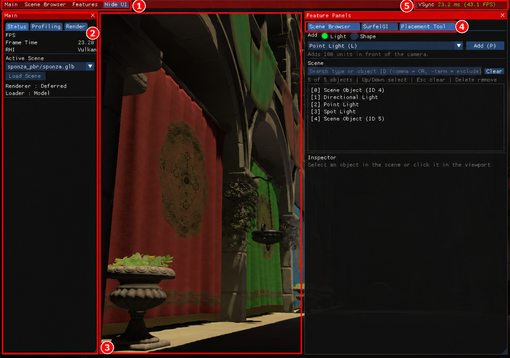

# jEngine 사용설명서

처음 실행해서 장면을 보고, 도형과 조명을 배치하고, 렌더링 효과를 비교하는 순서로 안내합니다. 화면의 **빨간 상자와 번호**를 먼저 찾은 뒤 같은 영문 라벨을 따라 조작하세요. 그림마다 번호는 새로 시작합니다. 주석본은 가독성을 위해 원본보다 확대되어 보일 수 있습니다.

jEngine은 그래픽 기능을 실험하는 개인용 엔진입니다. 현재 편집 기능은 기본 도형·조명 배치와 변형을 중심으로 제공합니다. **배치한 물체와 변형을 장면 파일로 저장하거나, Undo/Redo로 되돌리는 기능은 아직 없습니다.**

1280×900 실제 실행 원본에 빨간 번호 주석을 추가한 그림입니다. [원본 보기](images/raw/01-overview.png)

## 처음이라면 이 순서로 읽으세요

| 순서 | 안내 | 여기서 할 일 |
| --- | --- | --- |
| 1 | [시작하기](01-getting-started.md) | 빌드·실행하고 첫 화면 확인하기 |
| 2 | [화면과 카메라](02-screen-camera.md) | 패널을 열고 장면 안에서 이동하기 |
| 3 | [장면 불러오기](03-scene-browser.md) | 장면을 선택하고 로딩·취소 상태 이해하기 |
| 4 | [배치와 Inspector](04-placement-inspector.md) | 큐브 하나를 추가하고 위치·회전·크기 바꾸기 |
| 5 | [SurfelGI 살펴보기](05-surfelgi.md) | 효과와 시각화를 비교하고 Inline GI 조건 확인하기 |
| 6 | [콘솔과 로그](06-console-logs.md) | 명령을 입력하고 오류·로그 파일 찾기 |
| 7 | [문제 해결과 지원 범위](07-troubleshooting.md) | 막힌 조작을 확인하고 현재 한계 알아두기 |

## 가장 짧은 체험 순서

1. [시작하기](01-getting-started.md)의 자기 운영체제 명령으로 실행합니다.
2. `Scene Browser`에서 장면 하나를 선택하고 `Load Scene`을 누릅니다. 완료되면 중앙 화면과 `Active Scene`이 바뀝니다. 이미 원하는 장면이 활성화되어 있으면 그대로 다음 단계로 넘어갑니다.
3. `Features → Placement Tool`을 열고 `Shape → Cube → Add (P)`를 선택합니다. 새 큐브가 선택된 상태에서 `Inspector`의 `Position`을 바꿔 봅니다.

종료하면 이 실습에서 바꾼 배치·변형은 복구되지 않습니다. 오래 유지할 값을 시험한다면 숫자를 따로 기록해 두세요.

## 그림을 읽는 방법

- **번호**는 클릭하거나 확인할 화면 영역입니다. 단계의 `② Add`처럼 영문 라벨도 함께 적었습니다.
- **예상 결과**에는 조작이 반영됐는지 확인할 위치를 적었습니다.
- **알아둘 점**에는 저장 범위, 로더 차이처럼 결과에 직접 영향을 주는 제한을 적었습니다.
- 그림의 장면 이름·ID·FPS와 사용자의 값은 다를 수 있습니다. FPS 숫자 하나를 성능 보장으로 해석하지 마세요.

화면 예시는 Apple M4의 검증된 실험 MoltenVK 환경에서 캡처했습니다. 가독성을 위해 표시 글자 배율만 1.15로 설정했으며, 그림의 번호와 빨간 상자는 사용법 안내용 주석입니다. 드라이버별 기능 차이는 [SurfelGI 안내](05-surfelgi.md)에서 구분합니다.

기술적인 설정은 [플랫폼·빌드 안내](../platform-and-ci.md), 앞으로의 작업은 [엔진 로드맵](../engine-roadmap.md), 측정 방법과 결과는 [성능 보고서](../reports/editor-foundation-performance.md)를 참고하세요.

[첫 장으로: 시작하기 →](01-getting-started.md)
