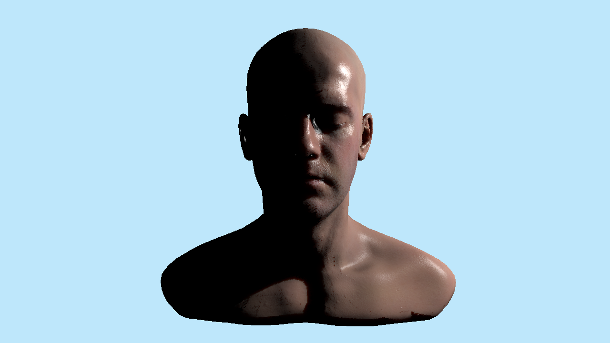
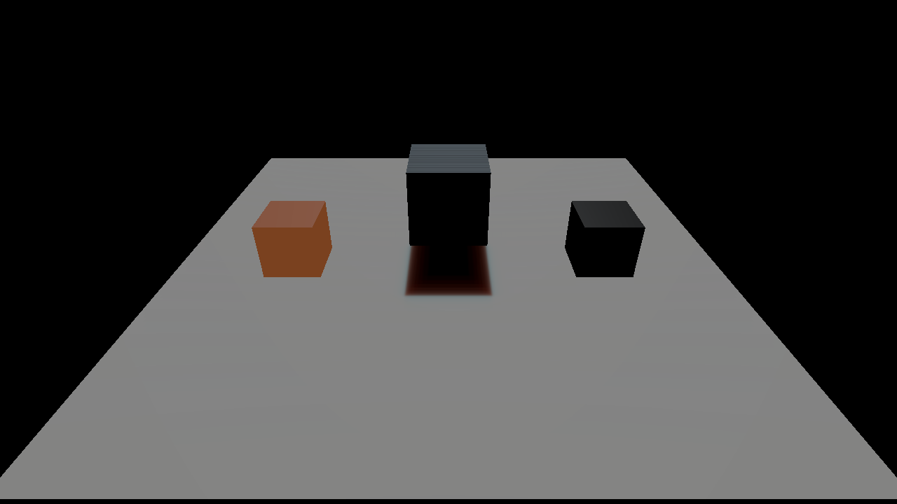
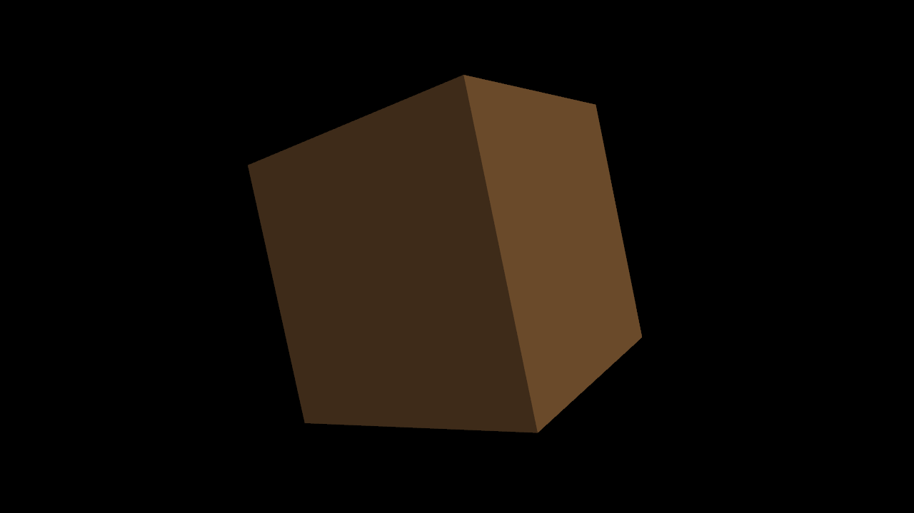
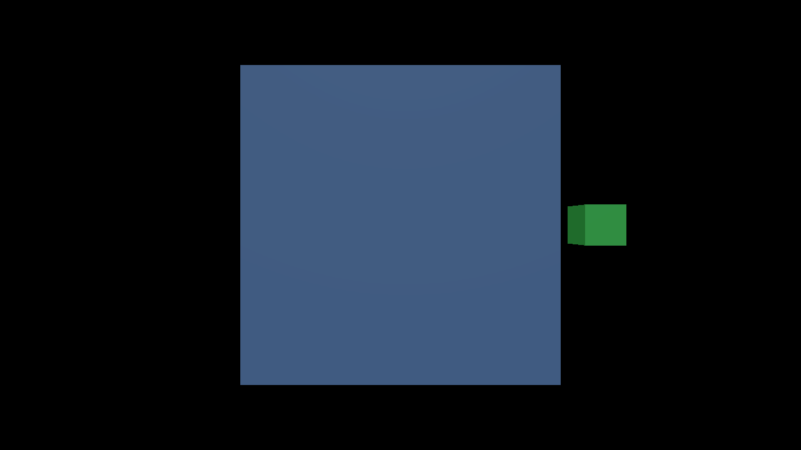

# Material diffusion, Deferred MSAA and Hi-Z

[Manual index](README.md) · [Material mapping](material-mapping.md) · [Scene features](scene-features.md)

Material-authored **screen-space** surface diffusion, Deferred multisampling and bounded same-frame Hi-Z visibility are implemented. Native Vulkan verification on macOS passed **127 rendered frames / 183 GPU checks**, with no Vulkan/Metal validation problems and preserved preferences. That receipt covers the generic control fixtures, not the original Shadows Skin reference path described below. See the [validation report and captures](../reports/material-diffusion-msaa-hiz.md) for the exact cases and binary. Windows-targeted DXIL compilation passed; no Windows native execution is claimed. The defaults keep surface diffusion and Hi-Z disabled, with one requested sample.

Open the [saved SSS sample project](../../examples/subsurface-demo/project.jproject) and its [scene guide](../../examples/subsurface-demo/GUIDE.md) to try the OFF, Skin, Wax, zero-value, texture-graph and 4x controls.

## Original Skin reference path — verified human sample

The [human-head sample](../../examples/subsurface-human-demo/README.md) now includes the actual source maps, saved projects/scenes/materials and six unmodified captures. Its corrected native run passed **76 rendered frames / 142 checks**, with no Vulkan/Metal validation problems and preserved preferences. This is separate from the earlier generic 127/183 receipt. See the [Skin reference audit](../reports/skin-reference-audit.md) and [portable native evidence](../reports/data/skin-reference-gpu.json). Original screenshot pixel parity is not claimed; the source asset credits and unchanged-map provenance remain with the sample.

[Human ON](../reports/images/skin-reference/human-on.png) · [Transport OFF, same BRDF/maps/key](../reports/images/skin-reference/human-off.png) · [Open the ON project](../../examples/subsurface-human-demo/project.jproject)

The reference path combines detailed object-baked normals, a Kelemen/Beckmann BRDF, UV-space diffusion and a bounded front-light capture/transmission approximation. **Diffusion profile 0 named Skin does not select the Skin Kelemen BRDF.** Select the model separately in **Inspector → Material → Skin shading** or **Material graph → Surface settings**.

| Material control | Default | Meaning |
| --- | --- | --- |
| Shading model | Standard PBR (0) | Standard PBR retains GGX; Skin Kelemen (1) uses the source-style Kelemen lobe and energy correction |
| Subsurface space | Screen (0) | Texture (UV) (1) requests the reference transport path |
| Specular weight | 1 | Finite 0–8, Kelemen lobe weight; not dielectric F0 |
| Diffuse occlusion | 1 | Finite 0–1, diffuse component weighting separated from specular |
| Pre-scatter weight | 1 | Finite 0–1, the albedo split before/after UV transport |

In Skin Kelemen, the existing **Roughness** output means **Beckmann m** and the BRDF clamps it to 0.02–1. Standard PBR keeps its previous interpretation. In UV transport, irradiance is multiplied by `albedo^p` before diffusion and the result by destination `albedo^(1-p)` afterward. The source uses **p = 0.5** for a square-root split; 1 puts all color before transport and 0 puts it after. Screen fallback currently applies full albedo before filtering and ignores this split.

For the supplied `Infinite-Level_02_World_NoSmoothUV.jpg`, connect **Texture Object → Sample Normal → Normal**, with **Normal space = Object**, **Negate source Z = on** (`+1,+1,-1`) and **Flip normal Y = off**. Despite the filename, this is a source-rest/object-space bake. Object mode follows the real mesh/parent transform with its normal matrix; World mode would stay fixed in engine-world axes. Keep the native Inspector **Normal texture** slot for Tangent maps. UV V flip and normal-axis corrections are independent.

Read `SpecularAOMap.png` as **Linear (height / data)**, then connect Texture Sample/Channel/Multiply: **R/0 × 1.99 → Specular Weight**, **G/1 × 0.5 → Roughness**, **B/2 → Diffuse Occlusion**. These are the saved reference multipliers; the roughness scale remains provisional because the partly occluded source UI is not reliable calibration. The original normal is linear too; the diffuse JPEG remains **Color (sRGB)**. These channels must not receive color gamma correction. The three scalar outputs accept Scalar, Channel and numeric composition; model/space are material metadata. Optional asset `surface.skin` and scene `material.skin` blocks preserve defaults and instance overrides/Undo. Sample Normal remains node kind 8; existing nodes retain Tangent behavior.

Use **Project settings → Renderer defaults → Surface diffusion (SSS) → Texture-space transport**, then **Save and Apply**:

| Control / project-key suffix after `render.textureSubsurface.` | Default | Accepted range |
| --- | --- | --- |
| UV tile resolution / `tileResolution` | 1024 | Power of two, 128–1024 |
| Light capture resolution / `captureResolution` | 1024 | Power of two, 128–2048 |
| Gaussian step scale / `gaussianStepScale` | 1 | Finite 0–10 |
| World units per millimeter / `worldUnitsPerMillimeter` | 1 | Finite 0.00001–1000; the human preset explicitly stores 0.3 |
| Enable thin-surface transmission / `enableTransmission` | true | Boolean |
| Transmission extinction / mm / `transmissionExtinctionPerMillimeter` | 0.2 | Finite 0.001–100 |
| Transmission thickness scale / `transmissionThicknessScale` | 1 | Finite 0–10 |
| Capture bias (world) / `captureBiasWorld` | 0.05 | Finite 0–100 |

These are project settings, not per-scene unit guesses. Missing keys use generic defaults. The UV path requires **Skin profile 0, one contributing directional or point key with Cast shadows enabled, and no active diffuse SH/environment, SSGI or SurfelGI**. Spot lights, multiple/no or non-shadowing keys, other profiles and diffuse-GI compositions expose a reason and retain Screen fallback. Opaque eligibility requires an explicit graph **Surface settings → Alpha mode = Opaque**, published as canonical material coverage after cloning; SSS/Skin metadata alone does not establish opaque coverage. Mask/Blend, unsupported geometry and over-budget preparation retain fallback.

The real source has **208 overlapping texels at 1024×1024** inside its eye charts. Ambiguous eye footprints, silhouette/coverage footprints and missing front-light capture use local Screen diffuse, while unambiguous face UV transport stays active. The corrected capture reconstructs the receiver surface-plane intersection; it does not treat the raster pixel centre as the UV fragment's receiver. The [audit](../reports/skin-reference-audit.md) records this correction and measured diffuse/specular controls.

**Skin Kelemen blocks switching to Forward or Path Tracing**, even in transport-weight-zero controls, because the implemented reference path requires Deferred. Standard PBR retains its existing behavior; mapped graphs have their separate ray-tracing publication gate. No ray-hit, collision, anatomical eye or full volumetric BSSRDF parity is implied.

When comparing OFF and ON, preserve the BRDF, normals, specular/AO maps, camera and key light and change only transport weight. Open the sample's **six control .jproject files** to restore each control's global Gaussian/transmission/strength settings too; opening only a .jscene does not restore those settings. Default `project.jproject` starts on human-on. The saved reference uses pre-scatter 0.5, source scale 300 and 0.3 world units/mm.

## Author a subsurface material

1. Select a mesh in **Hierarchy**, then open **Inspector → Material → Subsurface material**.
2. Set **Subsurface weight** above zero. Set **Subsurface color**, **Thickness (world)** and **Diffusion profile** for the material.
3. Open **Window → Project settings → Renderer defaults → Surface diffusion (SSS)**. Enable **Enable Deferred SSS**, then click **Save and Apply**.
4. Use the viewport's **Renderer → Deferred** and inspect the lit surface. Start with the default global strength and radius controls.
5. Save the scene to retain its material values. Use scene Undo/Redo for instance edits. **Inherit subsurface** restores inherited material data; shared graph parameters also offer **Use shared value**.

The weight is the existing canonical surface `Subsurface` value. Older instances without the new authored block retain their imported material value; an explicitly authored zero is stored separately from that absence. Editing one instance copies its material before publishing, preserving the shared source. Entity controls apply across that object's material slots. For a particular imported source slot, use the existing **Scene material library** workflow.

| Property | Default | Accepted values / meaning |
| --- | --- | --- |
| Subsurface weight | 0 | Finite 0–1; zero disables its diffusion contribution |
| Subsurface color | `(1,1,1)` | Finite linear RGB 0–1; channel-wise diffusion blend mask |
| Thickness (world) | 1 | Finite 0–10,000 scene world units; zero disables diffusion |
| Diffusion profile | 0 | Integer 0–7, from the stable preset table below |

For Screen diffusion, thickness bounds the effective diffusion radius. It is an authored surface parameter, not a ray-traced measurement through the mesh. Distances use world units without automatic millimetre/centimetre conversion; the new Texture path has its separate explicit conversion above. These Screen presets are approximate diffusion supports, not calibrated measurements of real materials.

| ID | Profile | Support radius in world units | RGB falloff |
| --- | --- | --- | --- |
| 0 | Skin | 1.2 | `(1, 0.37, 0.30)` |
| 1 | Wax | 4 | `(1, 0.80, 0.60)` |
| 2 | Marble | 8 | `(1, 0.85, 0.70)` |
| 3 | Milk | 2.5 | `(0.85, 0.95, 1)` |
| 4 | Jade | 5 | `(0.35, 1, 0.45)` |
| 5 | Leaf | 1 | `(0.35, 1, 0.20)` |
| 6 | Clay | 2 | `(1, 0.50, 0.30)` |
| 7 | Neutral | 2 | `(1, 1, 1)` |

The separable kernel is normalized per color channel, so a constant diffuse field is preserved. Its world support is scaled by the global radius setting and limited by authored thickness and the maximum pixel radius.

Uncropped native Scene output: [SSS off](../reports/images/material-diffusion-msaa-hiz/off.png), [Skin](../reports/images/material-diffusion-msaa-hiz/skin.png), [Wax](../reports/images/material-diffusion-msaa-hiz/wax.png). These are rendered scenes, not mockups of the Inspector. The shown comparisons use direct illumination. The report pairs image differences with geometry-derived witness and metadata checks.

## Compose SSS with graph nodes

Open **Material graph** from Inspector or **Window → Material / Animation / Effects / Terrain**. The existing **Out → input** drag and click-to-connect menus work for the new outputs too.

1. Keep **Base Color** connected. Add a **Scalar** for strength, a **Color** for the mask, another **Scalar** for thickness, and **Diffusion Profile**.
2. Connect them to **Material Output → SSS Weight**, **SSS Color**, **SSS Thickness** and **SSS Profile** respectively.
3. Select **Diffusion Profile** and choose its preset. Profile values have their own type; a generic Scalar or texture cannot be connected as a profile ID.
4. For a thickness or strength texture, use **Texture Object → Texture Sample → Channel**, then multiply by a Scalar to convert normalized data to the intended weight or world thickness. Use **Linear (height / data)** for these data maps.
5. Set **Graph asset** to a project-relative `.jmaterial` path and click **Save and Apply**. Save the scene's graph assignment too.

**Add surface settings → Surface settings** exposes constant subsurface defaults in the asset, including the same canonical weight. Unconnected SSS outputs use those material constants. Per-instance SSS overrides replace their final graph output rather than multiply it again. Profile and numeric changes remain uniform values, allowing the same generated shader code to be reused.

The graph keeps its bounded 256-node / eight-texture / 64-float4-value contract. `Diffusion Profile` appends node kind 15; graphs using SSS outputs save as version 2. Old v1 assets remain loadable, and their existing `surface.subsurface` scalar retains its meaning. New color/thickness/profile metadata is optional. Scene instances use an optional `material.subsurface` block; omission inherits, while a stored zero is explicit. Invalid ranges, partial blocks and fractional profile IDs reject without replacing the previous material or document.

The existing PT subsurface scalar remains its existing shading approximation. The new screen-space diffusion pass is Deferred only. Forward skips that pass with a visible reason; Path Tracing and HWRT hit shaders do not acquire this screen-space effect. Typed mapped graphs retain the existing raster publication restrictions described in [Material mapping](material-mapping.md).

## Global diffusion quality

Project settings expose actual diffusion controls rather than an abstract quality preset:

| Control | Default | Range |
| --- | --- | --- |
| Enable Deferred SSS | Off | Boolean |
| Global SSS strength | 1 | Finite 0–1 |
| Diffusion radius scale | 1 | Finite 0–100 |
| Depth rejection (world) | 1 | Finite 0.00001–10,000 world units |
| Normal threshold | 0.6 | Finite −1–1 |
| Maximum radius (pixels) | 32 | Finite 0–64 pixels |

Each separable axis uses a bounded 17-sample kernel. Depth and normal rejection limit blending across different surfaces; they do not recover hidden geometry. The pass filters **direct and SH diffuse lighting**, then recombines that change with the scene. Existing **SSGI and SurfelGI contributions remain unchanged**; the effect does not claim to diffuse every GI path. Native checks also cover actual metallic/specular and emissive HDR witnesses. It is an approximate surface effect, with no behind-surface transmission, volumetric scattering, cosmetic layers or collision change. Forward and Path Tracing skip the screen-space diffusion pass.

Zero strength, radius scale or maximum radius disables the global effect. The diffusion module bounds its three RGBA16F scratch images to 256 MiB; upstream material/diffuse buffers and multisample attachments cost additional memory. Resource bounds do not impose a hard GPU frame-time limit.

## Request Deferred MSAA

1. Open **Project settings → Renderer defaults**.
2. Set **Deferred MSAA samples** to **1x**, **2x** or **4x**.
3. Click **Save and Apply**. Read **Requested / applied** and its support reason after the next owner-frame update.

The saved count is a request. Required color/depth formats and current renderer capabilities determine the applied count. Unsupported requests remain saved while the renderer falls back; Forward applies 1x with a reason. The renderer can require stored, non-subpass effective attachments while preserving the user's requested subpass/memoryless options. This option does not configure Path Tracing sample accumulation.

Higher sample counts add GBuffer, lighting and resolve work and consume more memory. They are quality/cost options; this guide makes no FPS or speedup claim.

[View the complete 4x frame](../reports/images/material-diffusion-msaa-hiz/msaa-4.png). Per-sample coverage, distinct surface lighting, uncovered-sample rejection and HDR averaging are checked by GPU readbacks in the report; this screenshot alone is not the coverage test. A combined 4x MSAA + SSS case also passed.

## Enable bounded Hi-Z visibility

Start with **1x applied MSAA** and an opaque scene containing an occluder and a second mesh behind it. Open **Project settings → Renderer defaults → Hi-Z occlusion**, enable **Enable Hi-Z**, then **Save and Apply**.

| Control | Default | Range |
| --- | --- | --- |
| Enable Hi-Z | Off | Boolean |
| Conservative depth bias | 0.00001 | Finite 0–0.01 in normalized depth |
| Maximum candidates | 4,096 | Integer 1–16,384 |

The module records same-frame real-mesh depth, a maximum-depth pyramid and indexed indirect arguments. It does not reuse previous-frame visibility. It admits a conservative subset of indexed opaque, undeformed raster draws. Water, active mapped programs, alpha tests/blending, uncertain legacy texture alpha, instancing and unsupported draw/depth state keep their normal direct path. Near-plane or uncertain/off-screen bounds stay visible rather than risk an incorrect rejection. An object with shadow casting disabled can still be an occluder.

Current Hi-Z admission requires single-sample coverage; applied MSAA above 1x disables it with a reason. Failed or unsupported views retain all direct draws. Pyramid/depth resources are bounded to 128 MiB, the maximum dimension is 8,192 with at most 14 levels, and CPU bounds scanning is capped at 4M vertices.

**Admitted candidates** and **indirect draws** describe admission and submitted commands. They are not a GPU-culled-object count. Read the support reason when no candidates are admitted. No timing improvement is implied by enabling the checkbox.

[View the complete Hi-Z frame](../reports/images/material-diffusion-msaa-hiz/hiz-deferred.png). Correct visible output is paired with native indirect-argument/visibility checks, including hidden/visible objects and conservative fallback. Applied MSAA above 1x explicitly retains direct draws instead of using the single-sample Hi-Z test.

## Verified generic screen-space / MSAA / Hi-Z scope

| Native group | Rendered frames | Passed GPU checks |
| --- | --- | --- |
| SSS, nine cases including 4x combination | 39 | 140 |
| Hi-Z visibility and fallback | 51 | 23 |
| Deferred MSAA and capability/Forward fallback | 37 | 20 |
| Total | 127 | 183 |

All groups used the same verified engine binary. Validation collection reported no Vulkan/Metal problems, and checkout INI / `.jeditor` preferences were preserved. Linked CPU material, Water, Hi-Z and SSS checks passed, together with affected SPIR-V/DXIL and layout checks. See the report for receipts and limitations. This native correctness evidence does not establish original Skin/UV transport parity, a human-mesh result, a performance gain or a Windows native result.

## Project and console keys

| Project key | Console variable |
| --- | --- |
| `render.msaa.samples` | `r.msaa.samples` |
| `render.sss.enabled` | `r.sss.enable` |
| `render.sss.strength` | `r.sss.strength` |
| `render.sss.radiusScale` | `r.sss.radius_scale` |
| `render.sss.depthRejectWorld` | `r.sss.depth_reject_world` |
| `render.sss.normalThreshold` | `r.sss.normal_threshold` |
| `render.sss.maxRadiusPixels` | `r.sss.max_radius_pixels` |
| `render.hiz.enabled` | `r.hiz.enable` |
| `render.hiz.depthBias` | `r.hiz.depth_bias` |
| `render.hiz.maxCandidates` | `r.hiz.max_candidates` |

Project boolean values use `true` or `false`; sample/candidate counts are exact integers. Console edits are validated owner-thread session requests; use Project settings to persist them. For example, `r.sss.enable true`, `r.msaa.samples 2`, or `r.hiz.enable true`. Invalid edits retain the last valid request. Runtime diagnostic strings and applied counts are observations and are not saved into the project.

[← Material mapping](material-mapping.md) · [Manual index](README.md)
