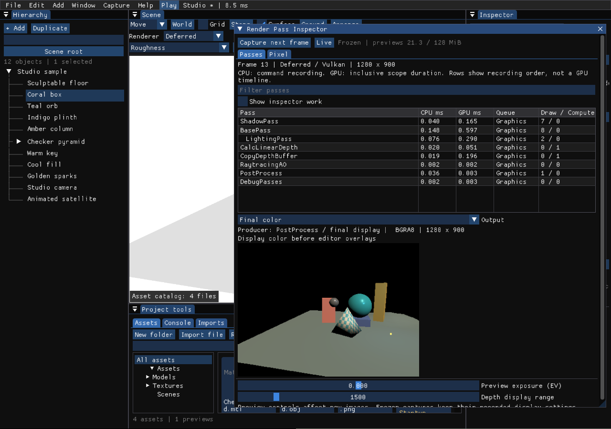
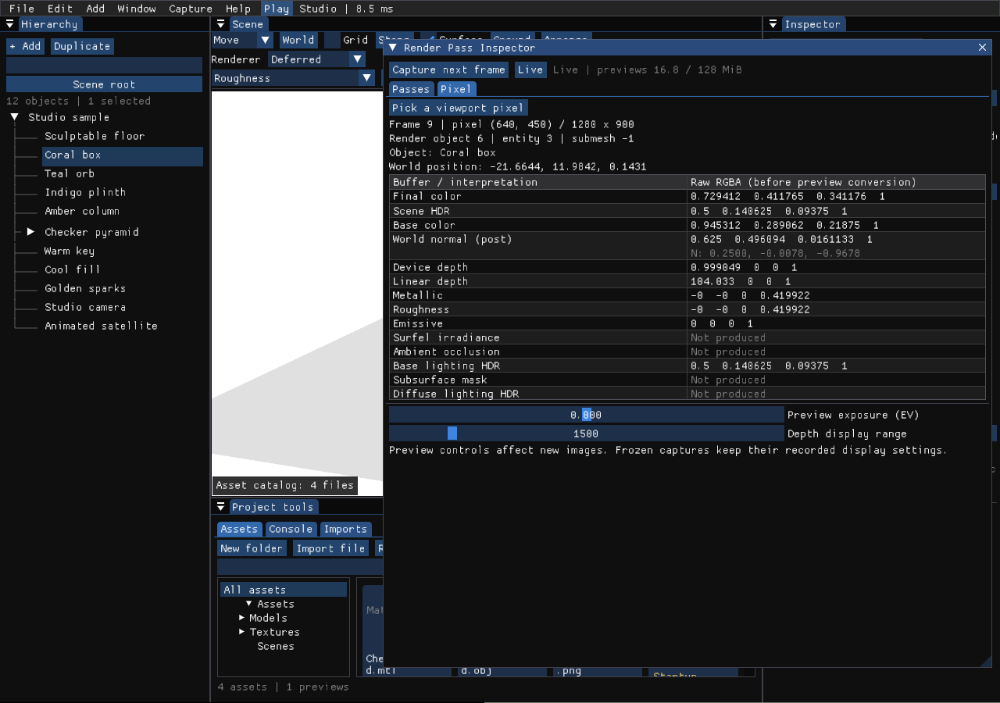
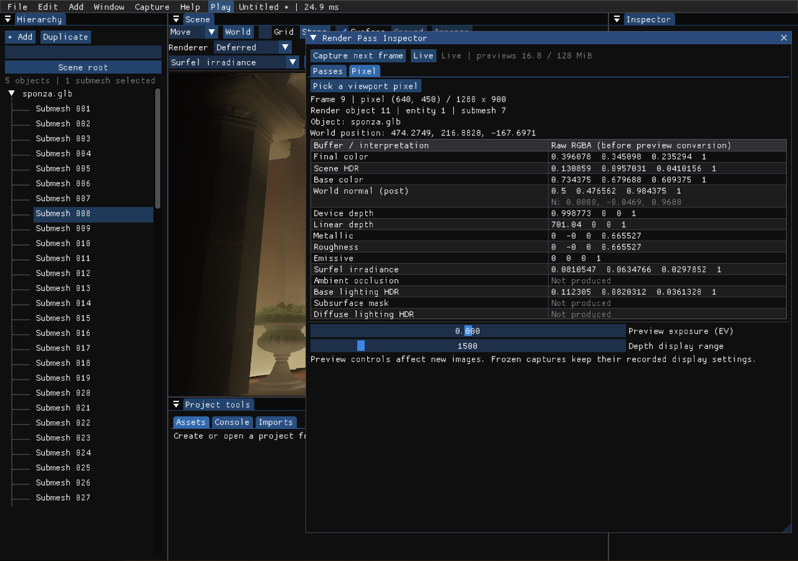

# 14. 렌더링 패스와 픽셀 진단

[사용 설명서 목차](README.md) · [구현·검증 기록](../reports/rendering-inspector.md)

`Render Pass Inspector`는 실제로 기록된 GPU 프로파일 구간과 중간 출력을 보여줍니다. 현재 버전은 패스 목록·프레임 캡처·Debug View·Pixel Inspector를 제공합니다.

## 열기와 Debug View

1. 기본 저작 화면의 **Scene 뷰포트**를 엽니다. 클래식 화면이라면 `F10`으로 전환합니다.
2. 렌더러 선택 아래의 **Debug View 드롭다운**에서 `Final color`, `Base color`, `World normal (post)`, `Roughness` 등을 선택합니다.
3. 옆의 **Render passes** 버튼을 누릅니다. `Window → Render Pass Inspector`로도 열 수 있습니다.
4. 창의 모서리를 끌어 크기를 바꾸거나 제목 표시줄을 끌어 도킹합니다. 뷰포트 클릭을 가리지 않도록 배치하면 픽셀 조회가 편리합니다.

| 보기 | 읽는 값 |
| --- | --- |
| Final color | 디버그 보기·에디터 윤곽선 적용 전의 최종 shaded color |
| Scene HDR / Base lighting HDR | 후처리 직전 / BasePass 조명 단계의 선형 색 |
| Base color / World normal (post) | GBuffer 색 / 후처리에서 사용하는 월드 노멀 |
| Device depth / Linear depth | 장치 깊이 / 뷰 공간 Z |
| Metallic / Roughness | GBuffer2의 B / A 채널 |
| Emissive / Surfel irradiance / Ambient occlusion | 해당 단계가 실제로 생성한 출력 |
| Subsurface mask / Diffuse lighting HDR | SSS가 활성일 때 생성되는 보조 출력 |

활성 렌더러나 설정에서 만들지 않는 출력은 **Unavailable / Not produced**로 표시합니다. 예를 들어 Forward는 이 도구가 사용하는 Deferred GBuffer를 생성하지 않습니다. 이 경우 이전 Deferred 프레임의 값을 대신 보여주지 않습니다.

## 패스와 한 프레임 살펴보기

1. **Passes** 탭에서 이름으로 검색하거나 패스를 선택합니다. 관측된 출력이 연결된 패스를 선택하면 해당 출력으로 이동합니다.
2. **Output**에서 확인할 버퍼를 고릅니다. 현재 프레임과 GPU 측정값이 함께 준비될 때까지 몇 프레임 지연될 수 있습니다.
3. **Capture next frame**을 누르면 다음 프레임의 메타데이터와 지원되는 출력 미리보기를 보존합니다. 화면의 `Frame` 번호와 `Frozen` 표시를 확인합니다.
4. 엔진은 계속 실행됩니다. 캡처 이후 장면을 변경해도 고정한 미리보기는 유지됩니다. **Live**로 돌아가면 최신 완료 프레임을 다시 표시합니다.

- **CPU ms:** 해당 구간에서 CPU가 명령을 기록한 시간입니다. 엔진 전체 CPU 작업 시간은 아닙니다.
- **GPU ms:** 자식 구간을 포함하는 시간입니다. 부모와 자식의 값을 모두 더하면 중복됩니다.
- **Queue:** 실제 명령 버퍼 종류입니다. Compute dispatch도 Graphics 큐에 기록될 수 있습니다.
- **Draw / Compute:** 해당 구간에 직접 속한 RHI 호출 수입니다. 자식 구간·RT dispatch는 제외되며, indirect 호출 하나를 실제 GPU draw 수나 삼각형 수로 해석하면 안 됩니다.
- 행 순서는 **명령 기록 순서**입니다. 여러 큐의 실제 병렬 실행 타임라인이나 완전한 리소스 의존성 그래프는 아닙니다.

`Show inspector work`를 켜면 미리보기 생성에 사용된 `InspectorPreview` 구간도 볼 수 있습니다. 캡처 자체의 GPU 작업이 측정에 포함됩니다.

미리보기는 최대 512×288 텍스처로 보존되며, 카메라 화면 비율을 유지해 표시합니다. 뷰포트 Debug View는 원래 출력 크기를 사용합니다. `Preview exposure (EV)`와 `Depth display range`는 진단용 표시를 조절하며, 고정한 이미지는 캡처 당시 표시 설정을 유지합니다.

## Pixel Inspector

1. 편집 상태의 Scene 뷰포트에서 **Pick pixel**을 누릅니다. Inspector의 **Pixel → Pick a viewport pixel**도 같은 기능입니다.
2. 조사할 픽셀을 클릭합니다. 다음 렌더링 프레임에서 값을 읽고, GPU 완료 후 결과를 표시합니다.
3. **프레임 번호·픽셀 좌표·Render object·Entity·Submesh**를 확인합니다. 문서에 연결된 오브젝트는 이름과 공유 머터리얼 경로도 표시됩니다.
4. Final color, Scene HDR, GBuffer, 깊이 등의 원시 RGBA를 비교합니다. 버퍼 이름에 마우스를 올리면 포맷과 채널 의미가 나옵니다.

`Submesh`는 0부터 시작하는 메시 인덱스입니다. 예를 들어 7은 모델의 여덟 번째 메시이며, -1은 별도 서브메시 선택이 없는 객체를 뜻합니다.

`Cancel pick` 또는 `Esc`로 선택 대기를 취소할 수 있습니다. 선택 대기 중에는 기즈모·지형 브러시·자산 배치 클릭을 가로채지 않도록 처리합니다. Play 중에는 UI의 픽셀 선택 버튼을 비활성화합니다.

값은 미리보기의 노출·감마 변환 전입니다. 뷰포트가 Roughness 보기여도 `Final color` 행에는 원래 shaded color가 표시됩니다. 배경을 선택하면 오브젝트가 없음을 표시하되, 버퍼 원시 값은 확인할 수 있습니다.

GPU 저장 포맷의 정밀도 때문에 입력값과 읽은 값에 작은 차이가 있을 수 있습니다. 검증 장면에서는 거칠기 **0.42 → 0.419922**가 확인됐습니다. 존재하지 않는 버퍼는 0이라는 재질 값으로 해석하지 않고 `Not produced`로 표시합니다.

위 화면은 Surfel GI와 Inline Ray Gather를 켠 Sponza의 실제 실행입니다. Surfel irradiance 행은 Resolve 결과를 읽습니다. 이 화면으로 기존 Windows 깜빡임의 원인을 확정하거나 문제가 해결됐다고 판단한 것은 아닙니다.

## 현재 범위

- 공통 구현은 Vulkan과 DX12에 연결되어 있습니다. 실제 GPU 검증은 Apple M4/MoltenVK에서 수행했고, 두 API용 새 셰이더 컴파일과 Vulkan 상수 버퍼 배치를 검사했습니다.
- 픽셀 값은 256바이트 읽기 버퍼로 비동기 회수합니다. 오브젝트 식별은 기존 1픽셀 선택 경로를 사용하며, 이 경로에는 클릭 시 동기 대기가 있습니다.
- 최근 32프레임의 패스 메타데이터를 유지합니다. Live 출력 이미지는 짧은 순환 버퍼를 사용하고, 고정 캡처는 별도로 보존합니다. 출력 미리보기·뷰포트 표시 자원의 합계 한도는 128 MiB입니다.
- 현재 출력 관측 지점은 BasePass, 깊이, AO, Surfel Resolve, 후처리 전 HDR, 최종 색 등입니다. 임의의 셰이더 descriptor 전체나 모든 중간 버퍼를 자동으로 추적하는 기능은 후속 단계입니다.

[사용 설명서 목차로 돌아가기](README.md)
