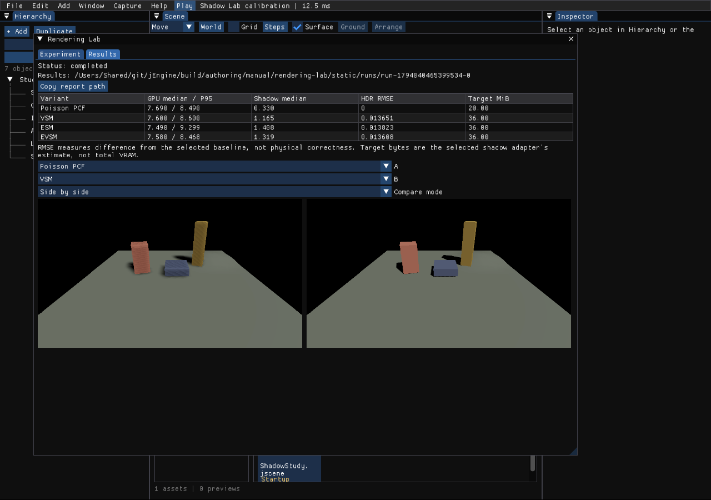

# Rendering Lab — 렌더링 알고리즘 비교 실험

**Window → Rendering Lab**에서 엽니다. 첫 번째 실험군은 **Shadow Lab**입니다. 현재 엔진이 사용하는 PCF·VSM·ESM·EVSM을 같은 장면과 카메라에서 순차 실행하여 시간과 실제 출력 차이를 비교합니다.

## 목차

1. [첫 실행](#첫-실행)
2. [실험 조건과 변형](#실험-조건과-변형)
3. [결과 읽기](#결과-읽기)
4. [저장 파일과 명령줄](#저장-파일과-명령줄)
5. [측정 범위와 제한](#측정-범위와-제한)
6. [엔진 모듈 구성](#엔진-모듈-구성)

## 첫 실행

1. `Window → Rendering Lab → Experiment`를 엽니다.
2. **Open Shadow Lab sample**로 기본 비교 장면을 엽니다. 기존 장면이 수정되었다면 일반 장면 전환의 저장 확인을 따릅니다.
3. **Experiment file**에 저장소의 `examples/rendering-lab/shadow-comparison.jlab` 절대 경로를 입력하고 **Load experiment**를 누릅니다.
4. 결과 폴더를 확인하고 **Run experiment**를 누릅니다.
5. 실행이 끝나면 **Results** 탭에서 A/B 화면과 GPU 시간을 확인합니다. **Copy report path**를 누르면 브라우저로 열 수 있는 `report.html`의 경로가 복사됩니다.



결과 표 아래에서 **A**, **B**를 선택하고 **Side by side**, **Swipe**, **Difference**로 비교합니다. Swipe의 Split 슬라이더로 경계를 옮깁니다. 위 화면은 실제 엔진 GPU 출력이며 UI와 장면을 합성한 그림이 아닙니다.

## 실험 조건과 변형

| 항목 | 의미 |
| --- | --- |
| Store current camera in experiment | 현재 카메라를 `.jlab`에 포함합니다. Use camera at run start는 실행 시작 시 카메라를 사용합니다. |
| Warmup frames | 셰이더·자원 준비 이후 측정에서 제외할 프레임 수입니다. |
| Measured frames / Repetitions | 변형별 측정 프레임과 반복 횟수입니다. 짝수 번째 반복은 역순으로 실행합니다. |
| Static / Camera arc / Light sweep | 고정 장면, 카메라 왕복, 방향광 왕복입니다. 모든 변형에 같은 고정 시간 간격과 경로를 적용합니다. |
| Common shadow resolution | 캐스케이드 타일 크기입니다. 512이면 실제 2×2 아틀라스는 1024×1024입니다. |
| Algorithm variants | 활성화 체크박스, 이름, 개별 해상도를 설정합니다. Duplicate for parameter sweep으로 해상도 비교군을 만들 수 있습니다. |
| Comparison baseline | 차이 계산의 기준입니다. 활성화된 변형이어야 합니다. |
| Difference ROI | 정규화된 `[x, y, width, height]` 구역의 HDR 오차를 계산합니다. 히트맵은 전체 화면을 표시합니다. |
| Display exposure | PNG와 비교 화면의 고정 노출입니다. 선형 HDR 오차 계산에는 영향을 주지 않습니다. |

실행 중에는 장면 편집과 자동 객체·광원 업데이트를 일시 중단합니다. **Cancel experiment** 또는 **Esc**로 취소할 수 있습니다. 완료·실패·취소 시 변경한 옵션, 카메라와 광원 설정을 복원합니다. 장면 문서는 수정하지 않습니다.

## 결과 읽기

| 결과 | 해석 |
| --- | --- |
| GPU median / P95 | UI를 제외한 그래픽스 장면 구간의 중앙값과 95백분위 시간(ms)입니다. 중첩 패스 시간을 더한 값이 아닙니다. |
| Shadow median | AdvancedShadows 구간의 GPU 중앙값입니다. |
| HDR RMSE | 기준 출력과의 선형 RGB 차이입니다. 알파는 제외합니다. |
| Target MiB | 선택한 그림자 구현이 추적하는 추가 렌더 타깃의 추정치입니다. 전체 GPU 메모리 사용량이 아닙니다. |
| Unavailable | 실제 적용 경로·해상도 확인 또는 GPU 시간 수집이 실패했습니다. 0ms 성능으로 취급하지 않습니다. |

**기준 영상은 정답 영상이 아닙니다.** PCF의 줄무늬나 낮은 해상도 오류에 더 가까운 결과도 RMSE가 작을 수 있습니다. 화질 평가는 A/B 화면과 함께 판단하세요. 캡처에 NaN/Inf가 있으면 해당 실행을 무효로 표시합니다.

PNG에는 고정 노출 후 Reinhard와 gamma 2.2를 적용합니다. 실제 비교 수치는 톤 매핑 전의 HDR RGB로 계산합니다. 히트맵은 채널별 최대 절대 차이를 4배 확대하며 검정 → 빨강 → 노랑 순서입니다.

## 저장 파일과 명령줄

**Save experiment / Load experiment**는 JSON 형식의 `.jlab` 파일을 사용합니다. 공통 조건과 개별 변형의 `overrides`를 저장하므로 커밋하여 비교 조건을 공유할 수 있습니다. UI는 개별 해상도 변경을 제공하고, JSON에서는 공통 설정에 있는 다른 매개변수도 개별 지정할 수 있습니다.

실행마다 고유 폴더를 만듭니다.

```text
run-…/
├── experiment.jlab          실험 설정과 카메라
├── scene-snapshot.jscene    실행 전 저작 장면
├── results.json             환경 정보, 실행 상태, 프레임별 시간, 통계
├── summary.csv              비교 표
├── report.html              브라우저 보고서
├── pcf.pfm / pcf.png        선형 float RGB / 화면용 이미지
├── vsm.pfm / vsm.png
├── esm.pfm / esm.png
├── evsm.pfm / evsm.png
└── *-difference.png         기준과의 차이 히트맵
```

명령줄 예시는 [샘플 README](../../examples/rendering-lab/README.md)에 있습니다. `--render-lab <experiment.jlab> <output-root>`는 에디터 프로젝트를 로드한 뒤 실험을 실행하고 종료합니다. 전부 성공하면 종료 코드 0, 실패·취소·사용 불가능한 변형이 있으면 1입니다.

## 측정 범위와 제한

- 첫 버전은 **래스터 렌더러, 첫 번째 방향광, 정적 메시**를 대상으로 합니다. Path Tracing, Play 실행 중, 가져오기 진행 중, 보이는 애니메이션 Water는 실행을 거부합니다.
- 환경 효과, GI, AO, SSS, Hi-Z, MSAA 등을 실험 동안 끕니다. 다른 광원은 조명에 참여하지만 그림자는 만들지 않습니다.
- 네 구현 모두 1개 캐스케이드와 같은 타일 해상도를 사용합니다. **VSM/ESM/EVSM의 기존 receiver/caster fitting은 유지**되므로 정확히 같은 투영 행렬로 필터만 비교하는 실험은 아닙니다.
- GPU 측정과 HDR readback·PNG 저장은 별도 단계입니다. 이미지 인코딩 완료 후 다음 변형을 측정합니다. 실행 도중 크기·장면 구성이 바뀌면 중단합니다.
- 최대 8개 변형, 5회 반복, 렌더 영역 4메가픽셀, 실행 10분 제한입니다. 고해상도 Retina 창은 줄여서 실행하세요.
- 장면과 자산의 리비전 참조를 기록하지만 외부 자산, 드라이버, 실행 바이너리와 셰이더 전체를 묶지는 않습니다. 비트 단위 재현성을 보장하지 않습니다.
- 움직임 시나리오도 품질 이미지는 첫 반복의 종료 위치에서 한 장만 저장합니다. 프레임 간 깜빡임·고스팅 수치, 경로 추적 정답 영상, SSIM/FLIP, 그래프 편집, 원격 배치 실행은 이후 확장 항목입니다.
- 프레임 시계는 되돌리지 않습니다. 기존 GI/시간 누적 효과의 내부 히스토리까지 저장·복원하는 기능은 아닙니다.
- 성능 비교에는 Release 빌드, 충분한 warmup/반복, 동일 드라이버·전원·해상도를 사용하세요. 아래 검증 수치는 Debug 환경의 기능 확인용입니다.

실측과 플랫폼별 확인 범위는 [검증 보고서](../reports/rendering-lab.md)에 정리합니다.

## 엔진 모듈 구성

```text
Renderer/Experiments/
  jRenderingExperiment       설정 검증, 실행 순서, 통계, 선형 이미지 비교
  jExperimentImage           HDR PFM, 표시 변환, 차이 히트맵
  jExperimentPng             엔진 PNG 인코더 연결
Code/Engine/Editor/jRenderingLab
  장면/옵션 보호, 그림자 어댑터, 단계 실행기, 에디터 UI, 보고서
Profiler/jRenderTrace
  Inspector와 별도로 유지되는 실험 캡처 세션, 원래 프레임의 GPU 시간
```

새 알고리즘은 별도의 실험용 렌더러를 복제하는 대신 실제 엔진 경로를 호출하는 어댑터로 추가합니다. AO·GI 등으로 확장할 때 공통 데이터·통계·HDR 비교를 재사용하고, 해당 실험군의 입력·초기화·적용 확인을 추가해야 합니다. 현재 등록된 실험군은 Shadow만입니다.

기존 선택지도 검토했습니다. [Falcor/Mogwai](https://github.com/NVIDIAGameWorks/Falcor/blob/master/docs/getting-started.md)는 독립 렌더링 연구 환경입니다. 이번에는 jEngine의 실제 패스와 Windows/macOS 경로를 평가해야 하므로 다른 렌더러 의존성 없이 기존 엔진 자원·프로파일러를 재사용했습니다.

[사용설명서 목차](README.md)
