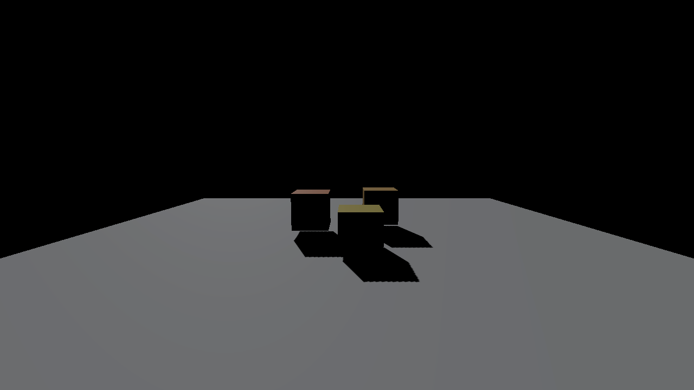
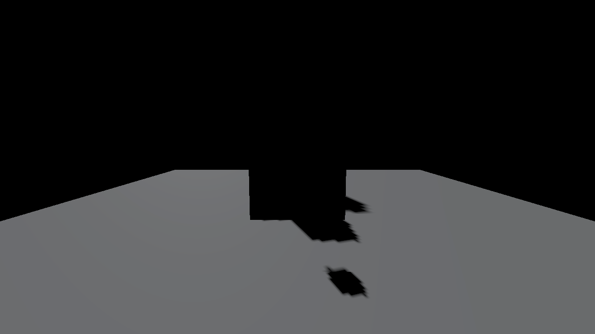
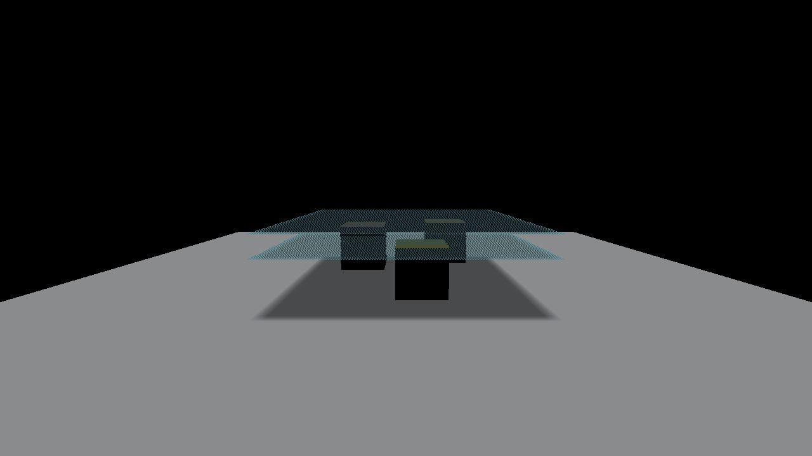
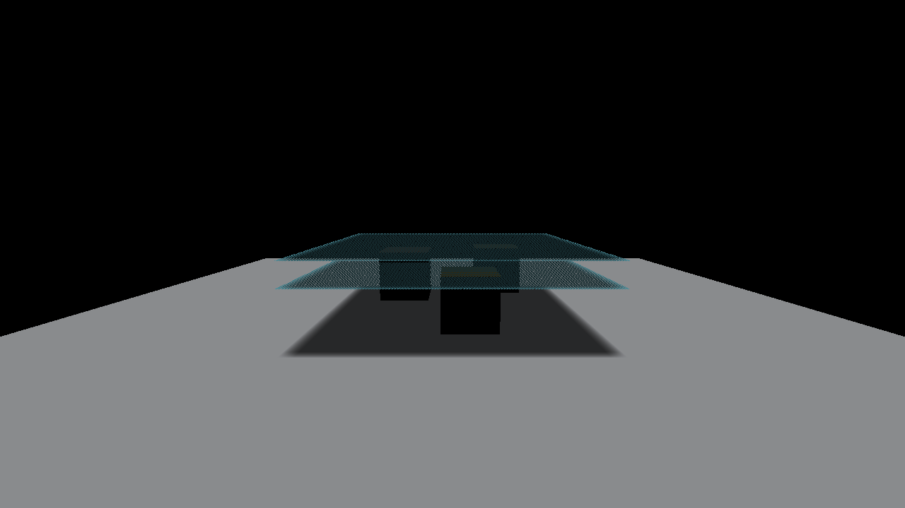
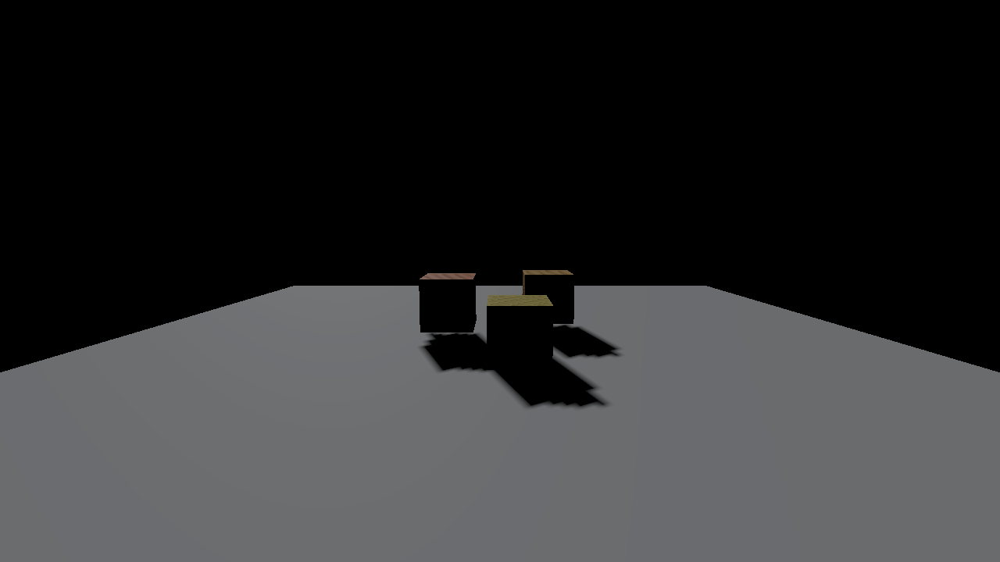
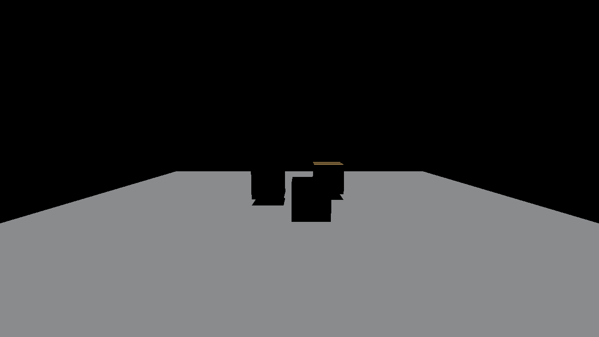
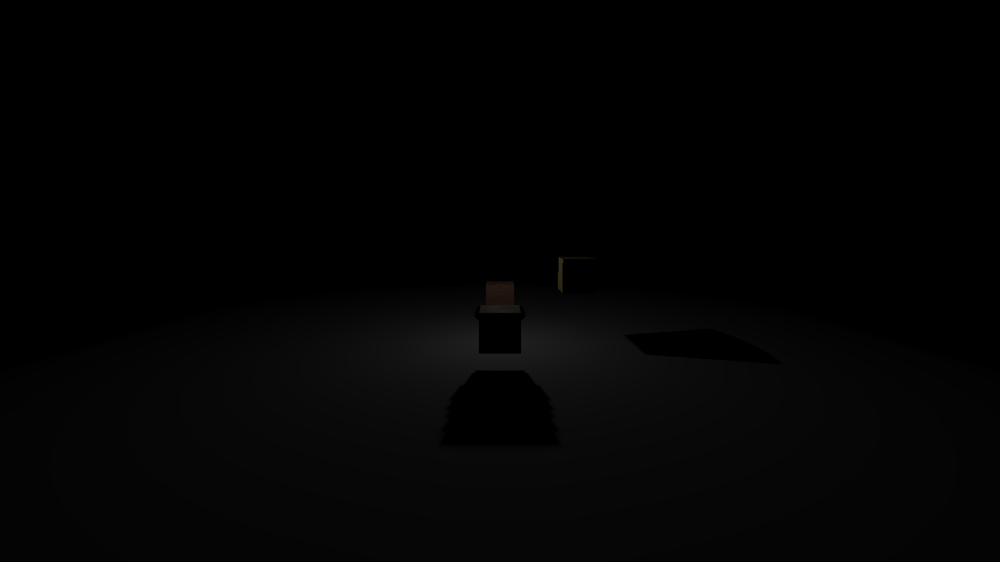
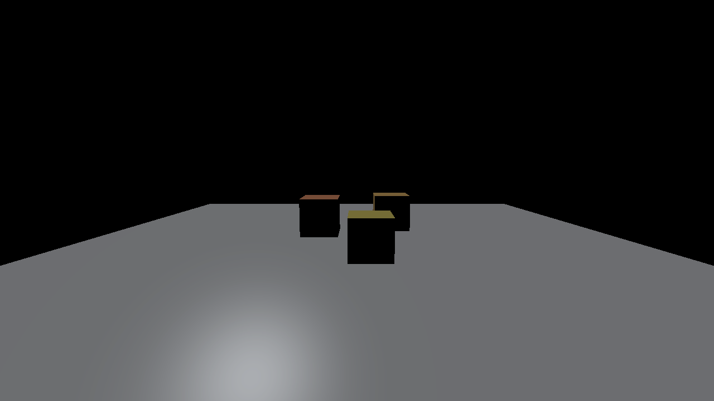

# Advanced shadows: implementation and validation

2026-11-05. Implemented original intake **1, 17, 18, 19, 20 and 21** on local `codex/viewport-renderer-switch`, starting from `2f6b0ba0`. Reference algorithms came from the prepared Shadows checkout; its historical renderer and platform code were not merged wholesale. No new dependency was required.

[Controls and limitations](../manual/advanced-shadows.md) · [Openable sample project](../../examples/advanced-shadow-demo/README.md) · [Measurement data](data/advanced-shadows.json) · [Remaining twelve choices](../rendering-feature-intake.md#remaining-decisions)

## Delivered behavior

| No. | Feature | Engine behavior |
| --- | --- | --- |
| 1 | CSM restoration | One to four practical-split cascades, texel stabilization, bounded distance/caster padding and an atlas in the current renderer. |
| 17 | VSM / ESM / EVSM | FP32 shadow moments, tile-clamped separable blur, positive/negative exponent controls, variance floor and light-bleeding reduction. |
| 18 | Shadow volumes | Welded closed-mesh topology, capped finite extrusion, z-fail stencil and a light-specific screen visibility mask. Invalid geometry retains existing shadow maps with a diagnostic. |
| 19 | Deep shadows | Eight projected-depth optical bins in two additive RGBA16F targets; transmittance derives from actual authored scalar opacity. |
| 20 | Dual-paraboloid point shadows | Two hemispheres, conforming angular subdivision, overlap sampling and bounded geometry caching. Invalid or over-budget input falls back to cube shadows. |
| 21 | Perspective shadow maps | Post-camera-projection directional warp, source-style virtual slide-back and a reported fitted-orthographic fallback for unsafe configurations. |

Projection and representation are separate. Forward and Deferred share the same math, settings, GPU helpers and per-light renderer result. Default **Single / Cube / Depth** preserves the existing path. The frame owner prepares and publishes immutable bindings before renderer setup workers consume them.

Open **Window → Project settings → Renderer defaults → Shadows** for defaults, or select a light and use **Inspector → Light → Override shadow settings**. The override replaces the whole advanced settings set for that light. **Inspector → Shadow casting** controls whether an object casts; a receiver-only floor remains visible and receives shadows. Project, scene/prefab save/load and Undo/Redo use the existing editor document. Old documents without the optional fields inherit their original behavior.

The [sample](../../examples/advanced-shadow-demo/README.md) contains 24 actual saved diagnostic scenes. Its startup is the CSM scene. Each scene stores caster flags and explicit active-light settings; use the saved primary camera through Play. Select Forward beside the viewport for `forward-*` scenes. No external asset download is required.

## Verified scope

The final native run used **Apple M4, 16 GiB RAM, macOS 26.6.2**, Debug, Vulkan through stable MoltenVK, Khronos validation and Metal API validation. It rendered **115 actual frames across 24 cases**, passed **213 checks**, and reported **zero Vulkan/Metal validation problems**. Checkout preferences/INI were preserved. The executable SHA-256 and portable numerical receipt are in the measurement JSON.

The native checks exercised:

- Real CSM atlas occupancy/splits and a camera move; actual post-perspective PSM with a nonconstant atlas.
- Nonconstant VSM/ESM/EVSM floating-point targets and actual blur changes, with finite values.
- Dual front/back hemispheres and seam coverage, including actual generated geometry.
- Two Deep layers with opacity 0.5: measured transmittance **0.250138**, expected **0.25**. At opacity 0.75: measured **0.062569**, expected **0.0625**. These are actual GPU optical-bin readbacks.
- A closed volume mask containing both shadow and light, a camera inside the volume, deliberate open-mesh rejection and an independent healthy light override.
- Forward CSM, EVSM, Deep, Dual and Volume rendering; returning to legacy shadows reproduced the baseline pixel hash exactly.
- Reloading all 24 saved scenes, caster/mode persistence, normal authoring-runtime publication without test-only caster setters, and the saved CSM project startup.

Related checks passed: the linked rendering-feature CPU group including eight real mesh-slice adapter checks; both standalone CTest shadow targets; **95** pure math and **218** settings checks under ASan/UBSan; **130** actual document checks under ASan/UBSan; **15** isolated production object-flag checks under ASan/UBSan. The sanitizer scopes are narrower than an instrumented full-engine GPU run. Five malformed advanced-shadow CLI forms failed before initialization.

The shader checker compiled **37 production DXIL/SPIR-V variants**, checked four CPU/SPIR-V layouts, rejected a negative ABI control, and checked that the volume pixel shader cannot discard or write fragment depth. The advanced block is 544 bytes; view/material/object layouts remain 560/1184/192 bytes. Native Visual Studio project entries and XML were checked.

**Windows C++ compilation and physical DX12/Vulkan execution were not run in this local macOS batch.** DXIL compilation does not establish Windows runtime correctness. Separate synchronization validation was not enabled. Hosted CI, push and main integration remain deferred under the current batching policy.

## Performance and memory

These observations compare **feature off/on in the same new executable**. They are not an isolated old-code/new-code benchmark. Each profile excludes four warmup frames and uses six measured frames; fixture preparation, screenshots and readbacks are outside the samples.

| Path | Legacy median | Advanced median | Observed difference |
| --- | ---: | ---: | ---: |
| Deferred, four-cascade Depth | 8.432 ms | 8.478 ms | +0.046 ms |
| Forward, EVSM | 8.423 ms | 8.163 ms | −0.259 ms |

The timer covers owner-thread input/update/visibility/render/present/event-poll latency. Debug validation and presentation pacing are included; these are **not GPU-only costs**. The short samples cluster around an 8 ms presentation interval. The negative Forward difference is ordinary variation and does not establish a speedup. Large-scene preparation latency and Windows performance were not measured. Raw samples remain in the JSON.

The native fixture used **256-pixel tiles**. Its additional targets were 5 MiB for CSM4, 1.25 MiB for a single unblurred depth/moment map, 2.25 MiB with moment blur scratch, 1 MiB for Deep's two bin targets, 2.5 MiB for Dual depth, and 14.06 MiB for a 1280×720 volume depth/stencil-plus-mask set.

At the UI default **512-pixel tile**, the corresponding map targets cost four times as much: CSM4 Depth 20 MiB, single unblurred 5 MiB, single moments with blur 9 MiB, single Deep 4 MiB, Dual depth 10 MiB. Volume targets follow viewport size. These counts describe one target set and exclude driver overhead, frame retirement, geometry and the retained legacy shadow allocation. No GBuffer attachment was added in this batch.

Admission is bounded to **16 advanced lights/view**, **192 MiB of additional targets/light**, **384 MiB/view**, and a geometry cache of **32 entries / 64 MiB**. Uncached CPU preparation admits **131,072 input and 524,288 output triangles/view**; the per-light source limit defaults to 20,000. These bounds do not impose a hard preparation-time deadline. New immutable generated meshes use existing host-visible buffer support instead of adding a staging-upload queue wait; driver allocation and CPU topology/subdivision still run on the frame owner.

## Integration fixes exercised

- Restored actual dirty caster-list publication and removed dangling pending pointers on object destruction. Editor changes flush before renderer and ray-tracing scene snapshots; receiver-only objects stay in the visible scene.
- Stabilized exactly vertical directional-light cameras by choosing a valid up vector and updating the pose before camera matrices.
- Preserved real imported submesh ranges/base vertices, index widths, position stride, compacted vertices and mirrored winding during geometry preparation.
- Used compatible depth/stencil layouts and explicit render-pass depth/stencil dependencies. A standalone receiver-depth pass supports Deferred subpasses as well as Forward volume rendering.
- Corrected DX12 depth-clamp polarity and stencil masks; supported VertexID-only draws and valid empty descriptor/root layouts in both backends.
- Used a no-output/no-discard volume pixel shader so depth clamp retains capped geometry. FP32 atlas filtering uses explicit bounded loads rather than assuming hardware linear-filter support.
- Restored PSM virtual slide-back so empty near-view space does not collapse distant casters into a subpixel strip. Unsafe caster-domain fits report the orthographic fallback.

## Limits

These are raster features. Path Tracing and HWRT direct-lighting rays retain their existing shadow evaluation. Forward keeps its existing first-light-per-type direct-light model.

Deep is a fixed eight-bin approximation with interpolation, scalar authored opacity and a finite optical-depth cutoff. It does not evaluate alpha textures, transparent surface compositing, refraction, a volumetric medium or full hair shading. Thin depth-separated layers can blur together.

Volumes require closed, consistently oriented, opaque static rendered meshes. A material submesh that is open on its own can fail even if the full source model is closed. Instanced/indirect geometry, analytic Water and unsupported topology use the documented fallback. Extrusion is finite. Dual subdivision also requires static base geometry and can fall back near a light or on excessive work. PSM retains its explicit degeneracy fallback; selecting it is not proof that every frame used the projective fit.

## Actual GPU captures

These are unmodified 1280×720 scene readbacks from the final run, not an art or quality benchmark. The isolated direct-light fixture has no ambient fill, so unlit object faces and the background are black. Deep's wireframe layers expose the diagnostic geometry rather than demonstrating surface transparency.

| Existing shadows | CSM4 |
| --- | --- |
|  |  |

| VSM with blur | EVSM with blur |
| --- | --- |
|  |  |

| Deep opacity 0.5 + 0.5 | Deep opacity 0.75 + 0.75 |
| --- | --- |
|  |  |

| Perspective shadow map | Closed shadow volume |
| --- | --- |
|  |  |

| Dual-paraboloid point shadow | Forward EVSM |
| --- | --- |
|  |  |

Local detailed receipts are ignored build output under `build/advanced-shadows/`: `native-final/verification.json`, `root/feature-cpu-delivery.log`, `root/ctest-delivery.log`, `root/cli-delivery.json` and `shader-checks/report.json`. The committed measurement JSON preserves the final native numerical receipt with machine-local paths made portable.
