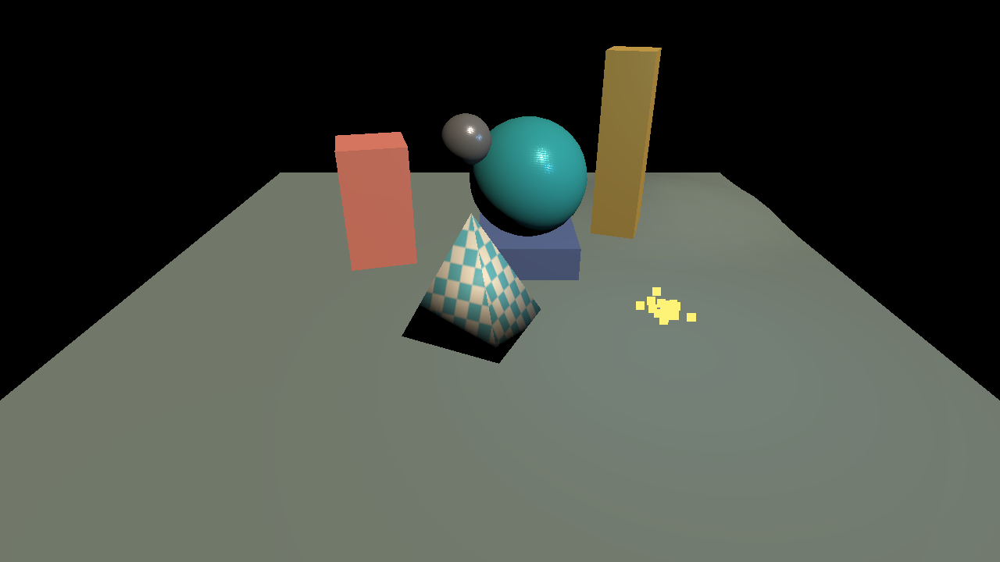

# Editor authoring: implementation and verification

Measured on **2026-11-04**, Apple M4, 10 logical CPUs, 16 GiB RAM,
macOS 26.6.2. The baseline is `main` at `95768204`; both rendering executables
were built as **Release, `-O3 -DNDEBUG`**. Exact executable hashes, inputs and
individual samples are linked below.

The editor now supports a complete small-scene workflow: create a project,
import and place assets, edit and undo, save and reopen, preview with Play,
and export a runnable folder. The default authoring UI and additional rendering
work cost **0.261 ms per measured mean frame** in this comparison: **1.21% slower**.
This work demonstrates responsive staged upload admission and broader authoring
capabilities; it does not demonstrate an engine-wide FPS improvement.

Start with the [numbered Korean manual](../manual/README.md),
[technical support matrix](../editor-authoring.md) or
[working Studio sample](../../examples/authoring-demo/README.md).

## Implemented workflows

| Area | Behavior |
| --- | --- |
| Scenes and history | Stable IDs, hierarchy, local/world transforms, guarded reparenting, atomic `.jscene` saves/backups, recovery, dirty-close guard, bounded Undo/Redo and edit transactions. |
| Selection and reuse | Multiple selection, shared-pivot gizmos, duplicate/delete, multi-root Copy/Paste with ancestor deduplication, fresh IDs and Prefabs. |
| Workspace | Docked Hierarchy/Scene/Inspector/Project tools, saved layouts, optional native windows, image-coordinate picking, camera focus/fly/orbit and input capture. |
| Projects and assets | Registry IDs/sidecars, folders/search, PNG previews, drag-to-scene, import settings, dependency-aware moves/trash, asynchronous preparation, cancellation and reimport. |
| Resource ownership | Shared model geometry, per-instance material overrides, texture leases, byte/chunk admission and completion-based cancellation retirement. |
| Authoring | PBR Inspector, bounded material graph, transform timeline, raster CPU particles, heightfield terrain/brushes and selected-terrain Recast/Detour navigation. |
| Runtime and extensions | Play/Stop restoration, authored cameras, startup/render/camera-key settings, staged runtime packaging and versioned native C ABI plugin reload/state migration. |
| Diagnostics | Filtered bounded console, rotating JSON logs, import/cache counters, editor diagnostics and reproducible verification drivers. |

The [support matrix](../editor-authoring.md) defines the scope of each feature.
For example, the material graph supports constant arithmetic and one base-color
texture; animation covers transforms; navigation gathers the selected terrain;
particles use CPU simulation and raster billboards. Native plugins are compiled
externally before the loader watches/reloads their libraries.

## Before and after frame time

| Workload | Before | After | Observed difference |
| --- | ---: | ---: | ---: |
| Static Sponza, median of three mean render-loop times | 21.560450 ms | 21.821939 ms | +0.261489 ms, +1.21% time |
| Reciprocal of those mean times | 46.38 FPS | 45.83 FPS | Approximately 0.56 FPS lower |

The before executable uses the classic UI; the after executable uses the default
authoring UI, including its scene-preview copy and additional emissive G-buffer.
These are whole application loops including CPU/GPU/presentation waits, not GPU
timestamps or per-frame p95. Three trials are not a statistical significance
claim. The observed small slowdown must not be presented as a rendering speedup.

Both programs use the same 1280×720 model, camera, lights, environment maps,
driver, fixed simulation step and options. Each uses shaders and legacy UI
runtime inputs from its matching source revision. Sponza's rotating-light callback
is removed from **isolated preset copies for both programs**, avoiding different
animation behavior between legacy rendering and authored edit mode. Source files
remain unchanged. Models are copied into the isolated resource tree to retain
their canonical scene IDs; source assets are verified by SHA256.

The importer finishes before frame one. Each process warms for 120 frames, then
240 frames are measured from flushed progress markers. Runs alternate before/after
and after/before. No other test, compiler or GPU benchmark ran during these six
processes; ordinary OS background activity was not disabled. Startup-marker times
are retained as diagnostics and are not compared because UI initialization work
occurs at different points in the two implementations.

All six processes completed 360 frames with the requested scene published before
frame one. [Raw samples, input hashes and matching shader-tree hashes](editor-authoring/frame-times.json).

## Large-model upload admission

Three fresh Release processes prepared the real Sponza model on a worker, then
used the production owner-thread upload session. Every run contained **192,496
vertices, 786,801 indices, 103 submeshes and 68 textures**, with **299,876,002
uploaded bytes**. Image caches started empty and decoded 68 distinct textures.

| Trial | CPU preparation | Step p95 | Maximum Step | Upload wall time |
| --- | ---: | ---: | ---: | ---: |
| 1 | 327.691 ms | 2.308 ms | 3.381 ms | 1180.780 ms |
| 2 | 290.852 ms | 2.584 ms | 3.663 ms | 1186.495 ms |
| 3 | 397.480 ms | 1.946 ms | 3.294 ms | 1138.406 ms |

The normal admission configuration is 8 MiB, a 2 ms admission target and two
pending chunks. Measured steps admitted at most **4 MiB and two tickets**. The
2 ms target was exceeded in **54 / 55 / 33** calls: a timer can stop starting
another operation, but cannot preempt an allocation or driver call already in
progress. This is not a hard 2 ms frame-time guarantee.

The wall times include a harness's 1 ms polling pauses across 755 / 756 / 756
calls. Those calls are **not rendered frames** and these wall times are not
interactive import latency or FPS. Preparation, BeginFinalize, TakeModel and world
registration are recorded separately; this driver does not build acceleration
structures, replace a running scene or render frames.

The earlier foundation report's **135.553 ms** owner pause included upload,
scene replacement and AS waits. It is not the same measurement as one new Step
or the polling-harness wall time, so no improvement percentage is calculated.
[Historical scope](editor-foundation-performance.md#import-phase-evidence-and-remaining-work).

[Summary and build provenance](editor-authoring/upload-summary.json) ·
[trial 1](editor-authoring/upload-run-1.json) ·
[trial 2](editor-authoring/upload-run-2.json) ·
[trial 3](editor-authoring/upload-run-3.json).

## Runtime and correctness evidence

- Local macOS Debug and Release pass all four CTest suites: CPU, CLI validation,
  shader contracts and Vulkan synchronization contracts. A full ASan/UBSan build
  passes the same suites; the CPU suite also passes ThreadSanitizer. macOS does
  not support this toolchain's LeakSanitizer, so `detect_leaks=0` is explicit.
- Shader checks compile 70 Vulkan/DX12 profiles and verify six CPU/GPU layout
  contracts, including the 176-byte material-aware render-object block.
- Real upload/particle verification passes **18 checks**: geometry/texture/mip
  readback, actual byte/ticket budgets, sharing, reimport, cancellation and
  independent particle materials. [GPU evidence](editor-authoring/upload-gpu-verification.json).
- Real editor verification passes **44 checks over 148 frames** with 100 mixed
  entities, 95 object bindings, three lights, shared geometry, material copy on
  write, save/reopen, duplicate/delete/Undo/Redo, Prefab, Play/Stop/camera,
  animation seek and actual terrain vertex/image readback. Two OS viewports were
  created; the secondary rendered 144 frames and was drained/destroyed.
  Vulkan/Metal validation reports zero errors.
  [Editor and terrain evidence](editor-authoring/editor-gpu-verification.json).
- Existing SurfelGI history/candidate/finite-resolve tests, 256-word GPU readback,
  moving TLAS updates and 120-frame odd/tiny bloom/exposure/SSAO/SSGI/atmosphere
  cases pass. Local evidence remains under `build/authoring/system-gpu/`.
- The shipped Studio project is checked through an isolated verbatim copy,
  including its actual OBJ/MTL/PNG files, four registry assets, startup scene and
  transitive dependencies. The original files remain unchanged.

Hosted Windows Debug/Release checks both CMake and the preserved native project;
macOS Debug/Release also passes. Verified code/test revision `5d60ce66`:
[Windows](https://github.com/scahp/jEngine/actions/runs/41765886682) ·
[macOS](https://github.com/scahp/jEngine/actions/runs/41765886631).
Windows GPU rendering was not exercised on this Mac.

## Portable runtime result

The production packager exported **109 files, four assets and 78,877,078 bytes**,
collected runtime dependencies, adjusted staged library paths and applied ad-hoc
signatures to staged Mach-O copies. The folder was moved to a path containing **Korean text,
spaces, a literal `$` and brackets**, then launched from an unrelated temporary
working directory without external developer SDK/loader/DXC path overrides. It
rendered 120 frames, captured frame 60, shut down cleanly and preserved the source
project. The verifier scans an isolated project copy and also passed with fresh
checkout timestamps, which can otherwise refresh asset sidecars.

The screenshot below is the actual packaged runtime with editor panels hidden.
Packaging targets the input binary's host OS/architecture; it is not an installer,
cross compiler or notarization workflow.



[Packaging verification and executable hash](editor-authoring/package-verification.json).

## Repairs found by integration

- Cold startup now permits pending asynchronous model imports instead of exiting
  before the first frame with an empty startup error.
- Scene-preview output is opaque. The old tonemap alpha of zero caused a rendered
  scene to disappear when composed as an editor image.
- Terrain render indices now follow the engine's left-handed front-face
  convention. CPU terrain/Recast data keeps its mathematical winding. A real
  unoccluded terrain pixel patch catches the previously invisible floor.
- Particle pages and deferred-light resources are prepared before render passes;
  DX12 upload heaps retain their required read-only state.
- Detached Vulkan windows own pipelines compatible with their actual render
  passes. Swapchain reinitialization restores platform metadata while retaining
  valid UI texture leases. Sleeping displays trigger real monitor requery and
  safe fallback to the main window.
- Registry mutations copy borrowed IDs before replacing catalogs; project startup
  scenes are validated before replacement; Inspector transactions finish on
  selection/save/modal transitions.
- Native UTF-8 paths reach Windows filesystem/image/import calls through native
  paths. MSVC secure file creation, PCH selection and an invalid ImGuizmo enum
  sentinel were corrected. Gizmos/status text respect panel clipping/occlusion.

## Remaining limits and next performance work

Copy admission is bounded; arbitrary driver allocations, shader compilation,
AS builds and scene publication still require separate traces and can stall.
Terrain rebuilds and thumbnail convenience uploads use existing completion waits.
Legacy PathTracing import remains synchronous. Queue/ticket counts and thumbnail
LRU size are bounded, but there is no hard total RAM/VRAM ceiling across legacy
caches and all resident scene assets. Geometry sharing does not prove a thousand
resident instances or automatic draw-call batching.

The scene history uses bounded snapshots; very large edits still copy document
data. This validation covers the measured sample and 100-entity workflow, not a
prolonged soak, arbitrary corrupt inputs, device loss or complete game logic.
Physics/audio/gameplay services and broader animation/streaming remain in the
[engine roadmap](../engine-roadmap.md).

## Reproduce

```sh
cmake --build --preset macos-debug
ctest --preset macos-debug
python3 scripts/verify-editor-authoring.py --wake-display \
  --icd /path/to/verified/MoltenVK_icd.json --output build/authoring/new-gpu-check
python3 scripts/benchmark-upload-admission.py --run --runs 3 \
  --icd /path/to/verified/MoltenVK_icd.json
python3 scripts/verify-runtime-package.py \
  --icd /path/to/verified/MoltenVK_icd.json --output build/authoring/new-package-check
python3 scripts/benchmark-frame-times.py --static-sponza \
  --before-engine /path/to/main-95768204-release/jEngine \
  --before-source /path/to/matching-baseline-checkout \
  --after-engine build/macos-release/jEngine \
  --icd /path/to/verified/MoltenVK_icd.json --output build/authoring/new-frame-check
```

Use Release builds for timings, fresh owned output directories, identical assets,
and no concurrent compiler/GPU measurements. The baseline runtime inputs were
also preserved locally in `build/authoring/baseline-inputs/` before integration.

The [manual image record](../manual/images/README.md) contains actual raw captures,
built-in imagegen annotation details and the complete prompt set. Annotated images
are enlarged visual guides; raw files and hashes preserve the exact captured pixels.
