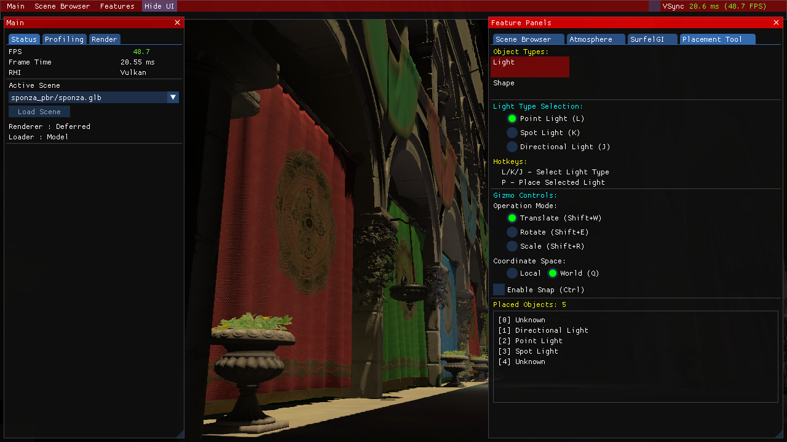
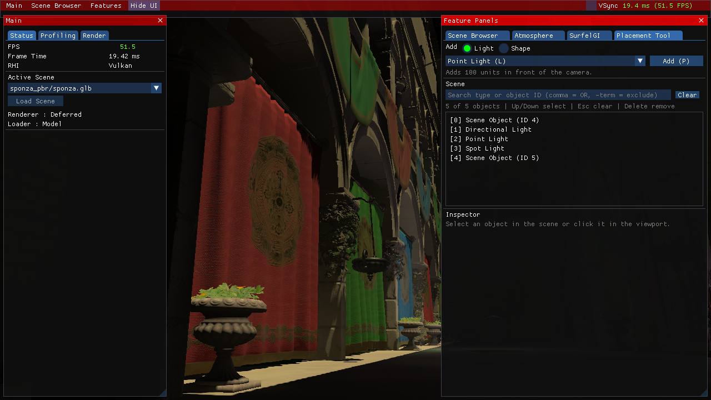

# Editor foundation: changes and measurements

Measured on 2026-11-04, Apple M4 / 10 logical CPUs / 16 GiB / macOS 26.6.2.
CPU/UI/log measurements compare `ecb49a12` with feature commit `edc270d1`; the
controlled render comparison uses `98adf5fc` on `codex/editor-foundation`. The
latter Windows compatibility fix does not change the macOS algorithms.
Release builds use `-O3 -DNDEBUG`.

CPU decoding, hierarchy drawing and console contention improved. The largest
remaining import pause is owner-thread GPU/scene publication: **135.553 ms**
median for the measured model. Upload batches and completion-based resource
lifetime are the next priority; this change does not promise uninterrupted frames
while finalizing a large import.

## Before and after

| Workload | Before | After | Interpretation |
| --- | ---: | ---: | --- |
| 24 PNGs, eight callers, CPU decode/cache API | 67.444 ms | 14.114 ms | 79.1% less elapsed time, 4.78 times the measured throughput. |
| 10,000 scene-list entries, steady UI frame | 1.416583 ms | 0.006000 ms | Cached search plus visible-row clipping; this does not render 10,000 3D assets. |
| Console draw after 50,000 input records | 13.459709 ms | 0.044083 ms | Old unlimited retention versus a 1,024-record recent view plus clipping. |
| Concurrent console producer, p99 call latency at that workload | 13.013333 ms | 0.005166 ms | Removes the log producer's wait through UI drawing; file sink disabled in this paired test. |
| Real rendered loop, median of three mean frame times | 20.863885 ms | 21.100447 ms | Observed 1.1% slower loop, approximately 47.9 to 47.4 FPS; no full-render gain demonstrated. |

These are workload-specific observations. The controlled render measurement
shows a small slowdown, despite large editor/decoding gains; there is no
demonstrated engine-wide FPS improvement in this sample.
The full-render measurement includes CPU work, the existing profiler, GPU work,
presentation and waits; it is neither isolated GPU time nor per-frame p95.

Single-caller image decoding was 68.484 to 59.840 ms. More importantly, adding
eight callers previously provided almost no parallel speedup (68.484 to 67.444 ms);
the new implementation reduces that same workload from 59.840 to 14.114 ms.
The production model decoder pool is capped at four workers and reserves two
logical CPUs; the separate eight-caller benchmark deliberately tests the cache's
concurrency boundary.

## What changed

- Logging uses pinned spdlog headers, a private asynchronous file worker and JSONL
  records containing sequence, time, producer thread, severity, category and
  message. Defaults are 8,192 queued records, 1,024 recent records, 4 KiB messages
  and three rotating files of up to 4 MiB each. Queue overflow drops new file
  submissions and exposes a counter; explicit flush/shutdown drains accepted work.
- The console snapshots immutable recent records and clips visible rows. It no
  longer holds the producer's log mutex throughout ImGui drawing. The new file
  capability is measured separately: four producers submitted 10,000 records in
  33.351 ms and drained in 34.567 ms, with 10,000 written, zero drops/errors. That
  burst test uses queue capacity 16,384 and has no old file-sink counterpart.
- macOS decoding no longer holds one cache lock during file reading/decoding.
  Requests for the same key coalesce, unrelated keys progress independently,
  failures wake waiters and repaired files can be retried.
- Model preparation owns plain CPU data and request-local completions. A bounded
  service prepares on a worker; owner-thread finalization creates objects/GPU
  resources. Latest-request generations suppress superseded publication. Known
  Model preparation failures retain the old scene; cancellation and shutdown join
  before graphics teardown.
- Placement now has compact Add/Scene/Inspector sections, an explicit Add button,
  automatic selection, cached search and clipped lists, consistent selection and
  shortcut capture, validated transform fields and degree/radian conversion.
- The shader watcher stop flag is atomic. Vulkan avoids one unused staging
  allocation and full-image copy per uncached texture. Existing GPU waits remain.

## Import phase evidence and remaining work

The three real imports contain **192,496 vertices and 68 decoded textures** each.
CPU preparation wall times were 314.185 / 312.646 / 311.737 ms, on the preparation
worker. Owner-thread GPU/scene publication was 138.851 / 130.929 / 135.553 ms.
The latter includes upload, scene replacement and acceleration-structure waits;
it is an observed main-thread pause, not an isolated GPU duration.

Current limitations:

- GPU finalization is synchronous; one completion per frame is a count limit,
  not a millisecond or byte budget. Vulkan texture upload/mip generation and
  scene/AS publication retain completion waits. Vulkan mesh copies are submitted
  asynchronously; they are not a queue-idle wait per mesh.
- Queue/ready payload counts are bounded, but decoded/GPU caches retain strong
  ownership behind existing raw material references. A hard total-memory budget
  requires asset handles and safe eviction; those are not implemented here.
- Legacy PathTracing import is synchronous and can clear the previous scene
  before a failure. The transactional retention guarantee applies to Model import.
- Backend device-loss/arbitrary GPU-allocation failure recovery is incomplete.
- Arbitrary cloning, undo/redo, parent/group pivots preserving offsets, authored
  scene saving and a general asset browser remain in the
  [engine roadmap](../engine-roadmap.md).

## Method and reproducibility

The CPU/UI baselines were captured before their production implementations were
changed. Rebuilding the old CPU/UI baseline requires the pinned old source plus
only the measurement translation units and early CLI dispatch; the original
archived engine supports the rendering test but does not contain those new CLI modes. Final measurements ran sequentially after builds/sanitizer jobs ended.
Other ordinary OS activity was not disabled.

- Decode: 24 distinct paths to identical 1024x1024 RGBA PNGs; cold engine cache
  per trial, warm repeated filesystem access; five trials per worker count.
  This measures the image API, not the complete importer, GPU publication or frame
  stalls. Use [prepare-fixtures.py](editor-foundation/prepare-fixtures.py).
- Placement: actual public `RenderUI`, fresh headless ImGui context, fixed
  600x1040 display / 560x1000 window, 30 warmup and 120 measured frames per row
  count, no selection/search/scroll/input and no GPU. Layout changes affect visible
  rows/vertices. This is steady cached drawing; scene/filter invalidation still
  performs work over the list.
- Console: the same driver compiles pinned old and current production console
  code. Three sessions per input count, 30 measured draws and 500 producer calls
  per session at 1 ms spacing, with a 16 ms UI cadence. Both use the default font
  and 1280x720 display. Conventional median and nearest-rank percentiles are used.
  The explicit retained counts describe the changed retention policy.
- Rendering: original preserved baseline and final Release executable, same
  1280x720 scene/INI/driver and fixed simulation timestep. Three alternating
  before/after processes, 120-frame warmup and 240-frame wall-clock measurement.
  For this controlled comparison the new importer still uses its CPU worker and
  owner publication, but a test-only wait finishes it before the first rendered
  frame. The baseline restores during its first update before the first draw.
  This equalizes temporal scene history; both then warm up for 120 scene frames.
  Time-to-initialized has different preload semantics and is not compared.
  Earlier background-import traces are retained separately as async publication
  evidence, not as a full-render performance claim. Use `--background-import` to
  reproduce that distinct trace.

```sh
python3 docs/reports/editor-foundation/prepare-fixtures.py
mkdir -p build/foundation/after
build/macos-release/jEngine --benchmark-assets build/foundation/fixtures build/foundation/after/assets.json
build/macos-release/jEngine --benchmark-editor build/foundation/after/editor.json
python3 jEngine/Tests/benchmark-console.py --build-dir build/macos-release --output build/foundation/logging-final
python3 scripts/benchmark-frame-times.py \
  --before-engine /path/to/preserved/baseline/jEngine \
  --after-engine build/macos-release/jEngine \
  --icd /path/to/verified/MoltenVK_icd.json --output build/foundation/frame-comparison
```

Versioned evidence: [protocol](editor-foundation/protocol.json),
[decode before](editor-foundation/decode-before.json) /
[after](editor-foundation/decode-after.json),
[placement before](editor-foundation/editor-before.json) /
[after](editor-foundation/editor-after.json),
[console summary and source hashes](editor-foundation/logging-summary.json),
[raw console before](editor-foundation/logging-before.jsonl) /
[after](editor-foundation/logging-after.jsonl),
[controlled frame samples and executable hashes](editor-foundation/frame-times.json),
[background-import traces](editor-foundation/background-import-frame-times.json),
[import phases](editor-foundation/import-phases.json).

## Verification

Local macOS Debug/Release CTest suites pass. A clean full-engine ASan/UBSan build
passes all four suites, and the full CPU suite passes ThreadSanitizer. New tests
exercise real preparation without a device or global object registration,
duplicate/error/retry/waiter publication, bounded backpressure, cancellation,
shutdown, actual editor input/selection/transform paths and logging saturation,
rotation, errors and draining.

The M4 GPU test waits for the **new async Model path** to publish the scene, then
checks 256-word readback with zero mismatches, moving TLAS updates and 120-frame
SurfelGI/effects runs, including odd/tiny targets. Vulkan/Metal validation reports
zero errors. Normal async operation is also exercised by the six separate background-trace
processes, each requiring successful publication before its trace window. The
controlled steady-render comparison uses its own six processes.

Hosted Windows and macOS Debug/Release pass for engine commit `98adf5fc`. Windows checks both CMake and the preserved native project. The later measurement-protocol/report update changes no engine C++ code. Results are tracked in [Windows CI](https://github.com/scahp/jEngine/actions/runs/41696951732)
and [macOS CI](https://github.com/scahp/jEngine/actions/runs/41696952175).
Windows GPU rendering, prolonged soak/fuzzing and thousands of real concurrently
resident 3D assets were not validated by these measurements.

## Placement UI captures

Before:



After:


