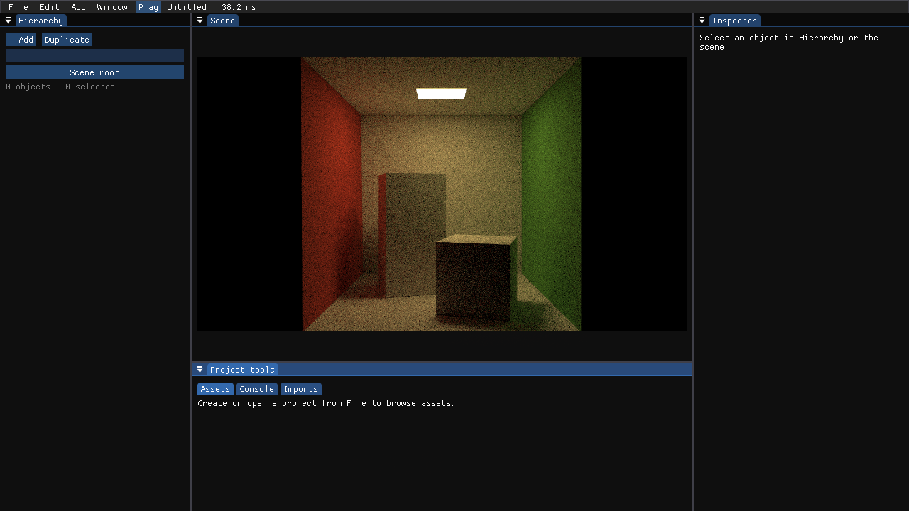
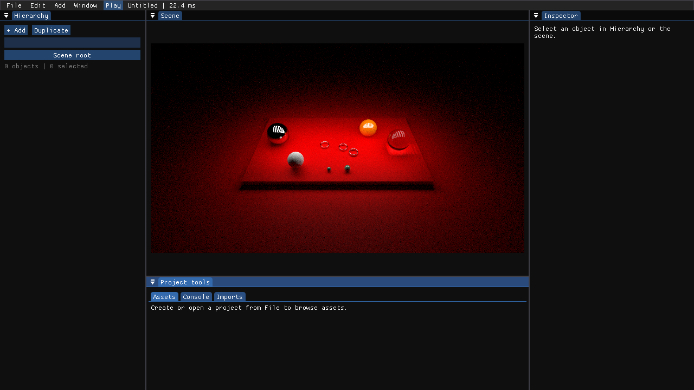
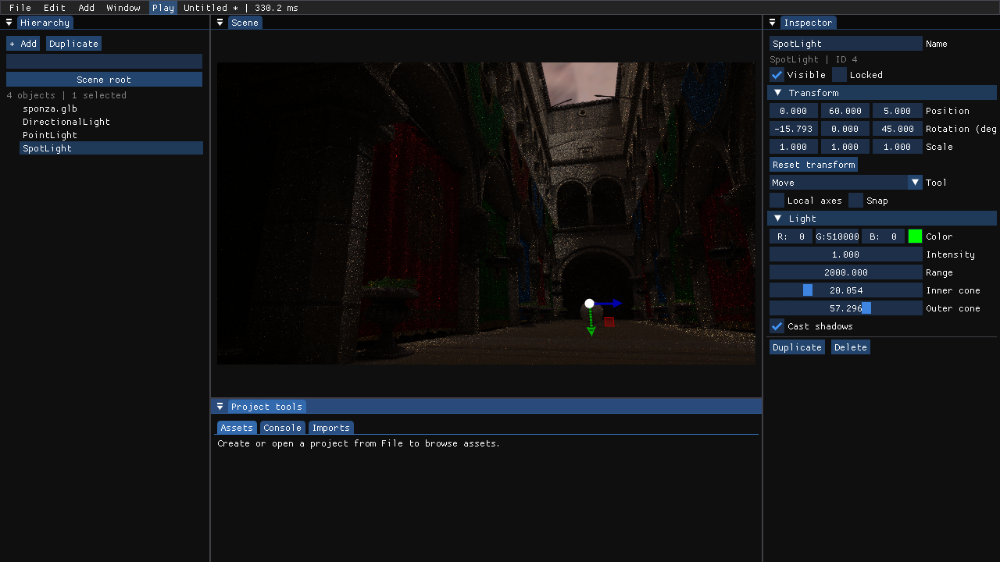

# Existing path tracer on Apple M4

Verified on 2026-11-04 with the experimental MoltenVK runtime documented in the
[platform guide](../platform-and-ci.md#surfelgi-hardware-inline-ray-queries).
All images below are unmodified engine swapchain captures from the same Debug
executable, at 1280×720, five rays per pixel and six maximum iterative bounces.

## Scene comparison

| Scene | Index width | Result |
| --- | --- | --- |
| Cornell Box, original | 32-bit | Area light, shadows and indirect wall color are visible. |
| Hyperion, rectangle lights | 32-bit | Lighting and reflections on the glass/metal spheres are visible. |
| Converted Sponza GLB | 16-bit | Textures and shading render after correcting index decoding. |

Each scene completed 64 frames with the existing RT pipeline renderer, without
Deferred fallback. At dispatch 60 the accumulation index was 59, giving 300
samples per pixel. All three runs exited normally with zero Vulkan validation
messages and zero Metal validation errors. Original source assets and editor
preferences were preserved.

### Cornell Box



### Hyperion



### Sponza



The Sponza path tracer currently uses the bound environment probe for lighting.
Its ordinary raster directional, point and spot lights are not converted into
the legacy path tracer's analytic emitters. The image is therefore darker than
the Deferred scene. This change does not add a new light-sampling system or a
denoiser. Keeping the camera and settings fixed accumulates more samples and
reduces noise; four times as many independent samples typically halves noise.

## What changed

Previously macOS explicitly disabled the existing RT pipeline even when the
experimental driver exposed it. The macOS device feature chain now retains
`rayTracingPipeline` together with the acceleration-structure and ray-query
features. Capability checks, extension lists and entry-point checks respect the
device's actual support. Pipeline creation caps its requested nested recursion
depth to the device limit, which is four on this verified driver.

Activating that renderer exposed a separate index-format bug. Model import keeps
mesh-local indices and selects 16-bit storage for Sponza, whose largest local
index is 23037. Vulkan RT shaders previously treated this storage as uint32:
the triangle `(0, 1, 2)` became `(65536, 131074, 196609)`. Acceleration-structure
traversal still used the correct width, so silhouettes appeared while normal and
UV fetches were invalid. Cornell Box and Hyperion use 32-bit indices and did not
show that failure.

The existing shared render-object uniform now carries the index element width
in previously unused padding, preserving its 192-byte layout. Vulkan path-tracing
and hardware-ray hit shaders unpack 8/16-bit indices from uint words. DX12 retains
its typed index views. Vulkan index buffers reserve a complete final word,
including when an odd uint16 count ends in half a word. Import payloads and
streaming copy-byte budgets are unchanged.

## Reproduce

Build the engine and prepare/verify the experimental runtime using the platform
guide. From the repository root, create the Sponza copy once:

```sh
python3 scripts/convert-scene-materials.py \
  jEngine/Resource/sponza_pbr/sponza.glb \
  jEngine/Resource/Sponza_PathTracing --pipeline PathTracing
```

Launch any of the scenes with the normal run script:

```sh
./scripts/run-macos.sh --scene-browser PathTracing/cornell_box/cornell_box_orig.scene PathTracing
./scripts/run-macos.sh --scene-browser PathTracing/hyperion/hyperion_rect_lights.scene PathTracing
./scripts/run-macos.sh --scene-browser Sponza_PathTracing/sponza.glb Model
```

The loader controls asset parsing; the scene's renderer metadata selects the
path tracer. `Model` is the correct loader for the converted Sponza GLB.
The optional `JENGINE_TEST_PATH_TRACING=1` diagnostic prints actual dispatch and
accumulation counts, resolution, samples, bounces, instance count and index width.
The SurfelGI inline-ray checkbox does not select this renderer.

## Validation and practical limits

- All four macOS Debug CTest suites passed, including engine-generated SPIR-V
  and DXIL compilation and CPU/GPU uniform-layout contracts.
- The real GPU upload suite passed 19 checks. Its 387 uint16 indices use 774
  source bytes and at least 776 bytes of Vulkan allocation; original-byte readback
  includes the final halfword.
- Deferred Sponza completed 120 frames with inline GI on, off and paused/resumed.
  Gather counts were respectively 90, zero, and 30→30→60. Pausing preserved the
  existing anchor's history; resuming increased it. All runs had zero validation
  problems. The stable driver retained its clean Deferred fallback.
- These are local M4 GPU results. Hosted CI compiles both platforms and runs its
  CPU/shader checks; it does not establish hardware RT support on every GPU.
- The corrected Sponza Debug run took 34.58 seconds for startup plus 64 frames.
  The earlier invalid-index image took 16.54 seconds and skipped valid material
  work, so these timings do not represent a useful performance comparison.
  This change establishes correctness and does not claim an FPS improvement.

Raw logs, binary fingerprints and per-run reports are in the verification
checkout's ignored `build/pathtracing-existing/` directory. The experimental
driver remains opt-in per process; the Homebrew installation is preserved.
