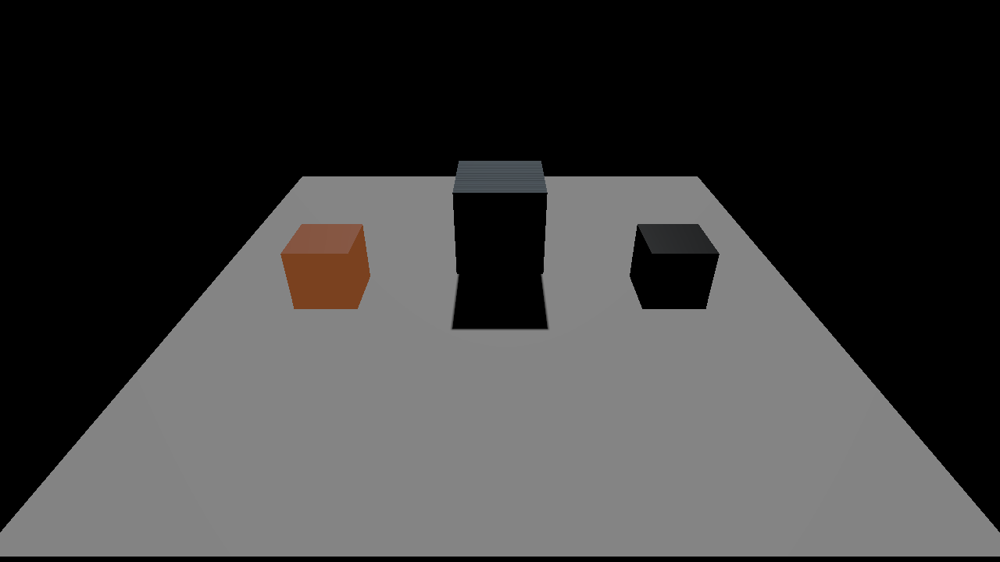
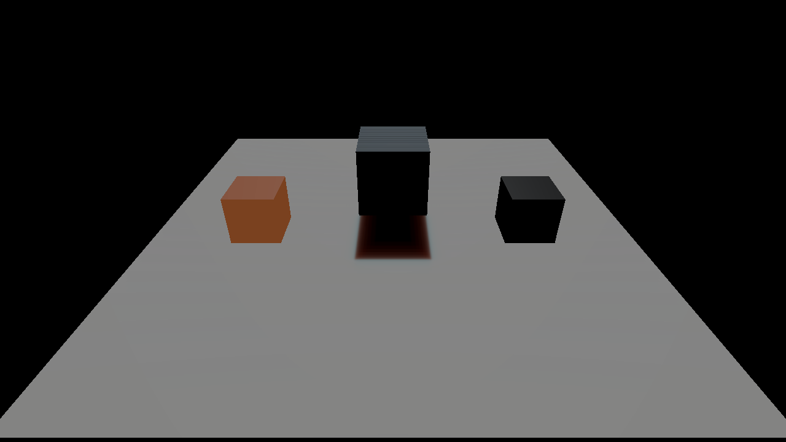
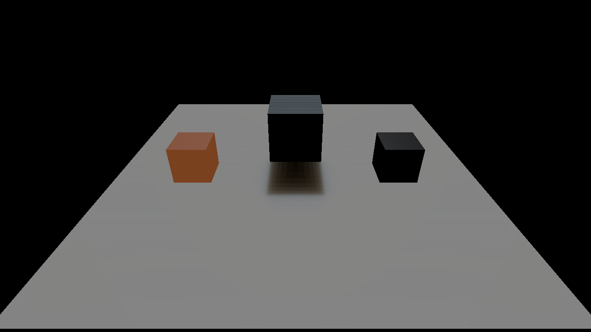
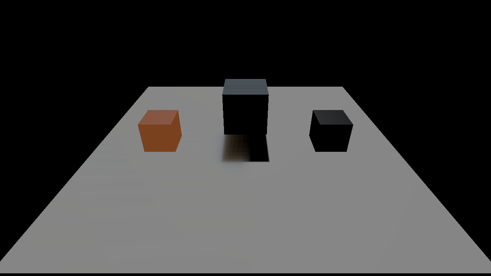
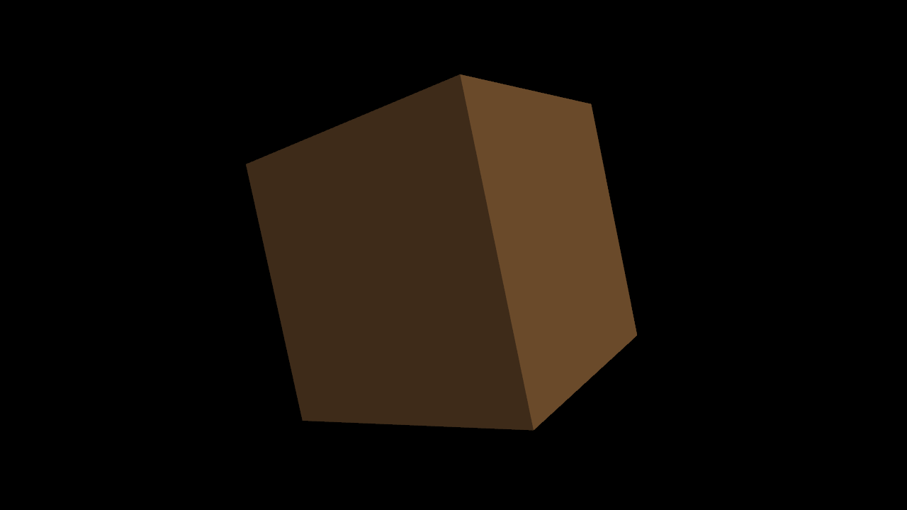

# Material diffusion, Deferred MSAA and Hi-Z verification

[User guide](../manual/material-diffusion-msaa-hiz.md) · [Evidence JSON](data/material-diffusion-msaa-hiz.json) · [Openable SSS demo](../../examples/subsurface-demo/project.jproject)

Implemented stable intake IDs **12, 22 and 24** as shared engine modules. This generic Screen SSS/MSAA/Hi-Z run rendered **127 engine frames**, passed **183 GPU assertions**, reported **zero Vulkan/Metal validation problems**, and preserved the checkout's INI/editor preferences. The separately corrected [human Skin reference audit](skin-reference-audit.md) publishes **76 frames / 142 checks** for original normal/Spec-AO maps, Skin Kelemen and UV diffusion/transmission; the two receipts have different scopes and do not imply source pixel parity. Windows DXIL compilation passed; native Windows DX12 execution was unavailable.

## What the material controls

Material constants and typed graph outputs provide SSS weight, linear RGB mask, world thickness and one of eight persistent diffusion profiles. Scalar/color/texture/channel/multiply nodes compose masks and thickness; the typed Diffusion Profile node selects a preset. Scene, asset, instance and Undo paths preserve explicit zero separately from inherited values. The canonical existing surface subsurface scalar remains shared with its existing PT approximation.

The Deferred path stores material metadata and isolated diffuse lighting. It filters diffuse in two separable axes and recomposes a separate HDR output, preserving specular and emission. Inactive pixels discard the final copy, avoiding an unnecessary native-format roundtrip. The direct and SH diffuse paths feed the isolated layer; existing SSGI/SurfelGI contributions retain their prior unfiltered behavior. The native comparisons below exercise direct illumination. This is approximate surface diffusion, without hidden-surface transmission or a volumetric BSSRDF.

## Actual GPU images

### 1. The same surface with diffusion off



### 2. Skin profile on the receiver



The red spread is a profile-dependent redistribution of diffuse light across the geometric shadow edge. Three geometry-derived receiver rows measure shadow-side gain and lit-side loss. Geometry, camera and illumination remain fixed. The metallic and emissive objects have separate actual HDR checks, so a floor pixel cannot masquerade as a material witness.

### 3. Wax and an authored texture mask





Global strength zero, material weight zero and thickness zero reproduce the baseline within the stated byte tolerance. The texture-masked inactive floor remains sharp. A separate case verifies SSS with actual 4x multisample geometry/lighting followed by coherent single-sample diffusion inputs.

### 4. Deferred 4x MSAA



The test reads real per-sample lit colors, normals and depth. Covered samples with different normals receive distinct lighting, uncovered samples remain unlit, and resolved HDR matches the mean of those actual samples. Depth and normal resolve from the same foreground sample. The simple flat cube has 3/6/12 observed colors at 1x/2x/4x, including background and coverage blends.

### 5. Same-frame Hi-Z


The hidden mesh's GPU-generated indexed argument has instanceCount zero; visible witnesses retain their complete commands. OFF/ON HDR differences are zero, with no nonfinite values. Camera movement and deletion of the occluder restore visibility from current-frame depth. The test compares every GPU pyramid texel against a CPU maximum-depth reference. No CPU visibility readback is part of normal rendering; readbacks occur only in this test harness.

## Verification scope

| Area | Actual frames | Assertions | Result |
| --- | ---: | ---: | --- |
| Material SSS, nine cases including graph/zero controls/4x | 39 | 140 | Pass |
| Conservative Hi-Z, Deferred/Forward/disocclusion/fallback | 51 | 23 | Pass |
| Deferred 1x/2x/4x samples, HDR/metadata and mode fallback | 37 | 20 | Pass |
| Total | 127 | 183 | Pass |

Two compute-only inspection frames are excluded from that rendered-frame total. The report retains all three native subreports; the driver's raster case contains both Hi-Z and MSAA assertions in its log.

Linked CPU rendering checks passed, including material compiler 46, project settings 115, water 50, SSS diffusion 94 and Hi-Z 32. Focused ASan/UBSan runs, production DXIL/SPIR-V compilation and CPU/shader ABI checks also passed. The shader groups include 62 deferred/material-MRT/resolve shaders, 40 scene/material-graph shaders, 37 legacy shadow/light shaders, six diffusion shaders and ten Hi-Z shaders; overlapping shared layouts are not independent feature counts.

## Measured feature cost

All measurements use the final executable. They compare a feature toggle or sample count in the same controlled scene, rather than different commits. Values are **CPU total-frame latency including presentation**, not isolated GPU time or a guaranteed frame-rate change. Warmup, scene edits, captures and readbacks are excluded. Small sample counts and presentation pacing make the small differences unsuitable as a general performance claim.

| Feature | Baseline ms | Enabled ms | Delta ms | Delta | Statistic |
| --- | ---: | ---: | ---: | ---: | --- |
| SSS | 8.245 | 8.349 | +0.104 | +1.26% | median, n=4 |
| Hi-Z | 8.328 | 8.444 | +0.117 | +1.40% | mean, n=6 |
| MSAA 2x | 8.352 | 8.354 | +0.002 | +0.02% | median, n=8 |
| MSAA 4x | 8.352 | 8.406 | +0.053 | +0.64% | median, n=8 |

The three-cube Hi-Z fixture suppresses one of three base candidates but adds three simple depth draws, a 12-level pyramid and culling. Its GPU payload is **14,871,416 bytes (14.18 MiB) per recorded view**, excluding uniform/descriptor/heap alignment and other in-flight slots. This small scene demonstrates correctness and overhead, not a speedup. Larger, expensive occluded scenes require a separate representative benchmark.

## Defects found and corrected

- Missing or disabled water left an indeterminate control vector, allowing ordinary geometry to deform. Material blocks and unused constants now initialize deterministically; water clears its fields before every early return. Poison-storage tests preserve unrelated mapping/SSS fields.
- Prepared draws retained temporary setup state. Cached graphics pipelines now freeze immutable fixed state on cache miss, and draws reference that owned state. Scope/copy/move regressions cover the lifetime.
- Native multisample counts and Vulkan image allocation previously disagreed. Counts, real multisample images, sampler-free inputs, per-sample interpolation and post-lighting resolves now match. Multisampled images have no storage usage.
- Vulkan read-only structured uploads lacked storage-buffer usage. Both SRV and UAV structured descriptors now receive compatible usage.
- A disabled Forward spot light could evaluate pow(0,0), producing nonfinite HDR after camera movement. Shared analytic-light math handles zero power and zero-radiance/range cases before invalid arithmetic.
- DX12 graphics indirect calls were stubs. Draw and indexed-draw signatures now execute per-view arguments; Vulkan indirect offsets include allocation offsets. DX12 multisample SRV unions use the correct fields.

The original failing runs and provisional false-witness captures remain under the ignored build diagnosis directories. They are not counted as final passing evidence.

## Defaults, fallbacks and budgets

SSS and Hi-Z default off; MSAA requests one sample. SSS requires Deferred. MSAA requests 1/2/4 and checks the actual attachment formats, with a 512 MiB attachment budget. Stored separate passes are selected when required while preserving requested subpass/memoryless settings. Hi-Z currently requires applied 1x coverage; unknown, masked, blended, deformed, instanced and near-plane bounds retain direct draws. Its per-view depth/pyramid/candidate budget is 128 MiB, up to 16,384 candidates and 4M scanned vertices. Diffusion uses three RGBA16F scratch targets capped at 256 MiB, plus the upstream material/diffuse targets. Resource budgets are not hard GPU-time budgets.

## Reproduce

```sh
cmake --build build/macos-debug --target jEngine --parallel 4
(cd jEngine && ../build/macos-debug/jEngine --ci-rendering-features)
python3 scripts/ci/check-deferred-msaa-shaders.py
python3 scripts/ci/check-subsurface-shaders.py
python3 scripts/ci/check-hiz-shaders.py
python3 scripts/verify-editor-authoring.py --engine build/macos-debug/jEngine --api vulkan --case subsurface --case raster-visibility --icd /path/to/MoltenVK_icd.json --wake-display --output build/feature-verification
```

Use the Windows binary and `--api dx12` for native Windows validation; that runtime validation was not performed here. The openable demo uses relative scene/material/mask paths and preserves all nine controls. Local changes remain on `codex/viewport-renderer-switch`; no push, hosted CI or main merge was requested for this batch.

## References

The selected source branches are [Skin at 51249d3](https://github.com/scahp/Shadows/tree/51249d3d4d9ea1c3320741077aaa5335b28c3418), [MSAA at dde92ae](https://github.com/scahp/Shadows/tree/dde92aeaa0f5b33f06e62348e7b9a1a84636dd53) and [Hi-Z at 02a8520](https://github.com/scahp/Shadows/tree/02a852037ce40b3396faf1ad4f05f60085a2fdb5). The engine modules use the existing RHI and typed shader infrastructure. Surface diffusion follows the diffuse/specular separation described in the [Separable Subsurface Scattering paper](https://www.iryoku.com/separable-sss/downloads/Separable-Subsurface-Scattering.pdf), with original approximate profile kernels and explicit world-unit controls.
