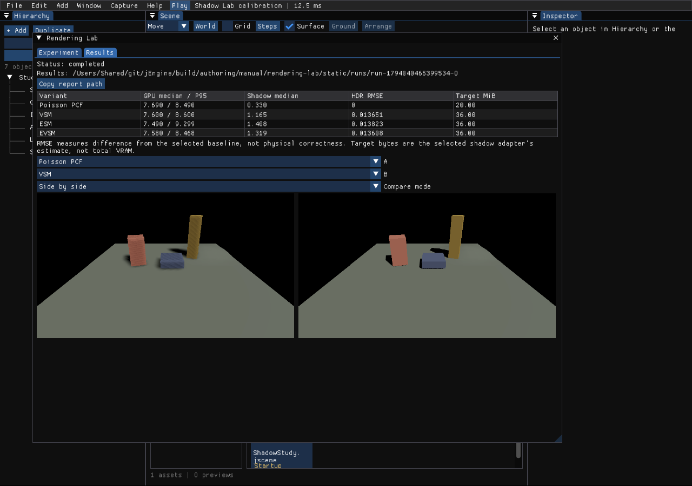
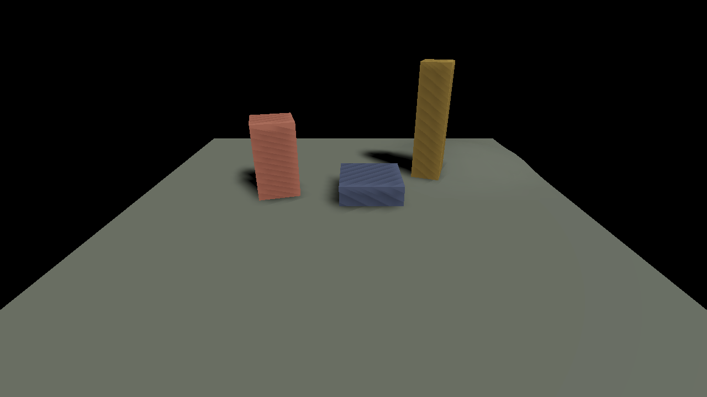
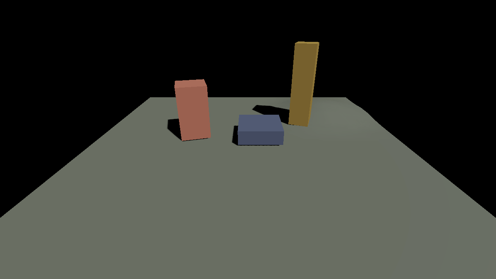
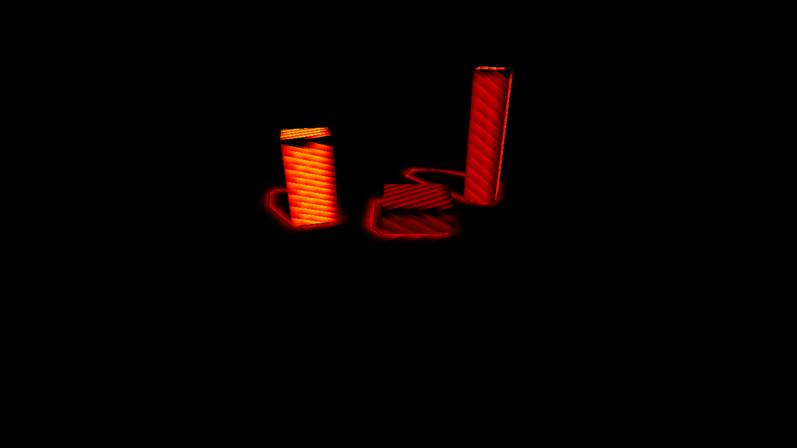

# Rendering Lab validation

Validated on **2026-11-07**, Apple M4, macOS Vulkan through the experimental MoltenVK runtime, Debug build. This is functional evidence, not a performance ranking for Windows or production Release builds.

[User manual](../manual/rendering-lab.md) · [Machine-readable measurements](rendering-lab.json) · [Calibration project](../../examples/rendering-lab/README.md)

## Delivered behavior

- `Window → Rendering Lab` saves/loads `.jlab` definitions, runs bounded sequential variants, and restores the original camera, light overrides and modified options.
- The first adapter family executes the production Poisson PCF, VSM, ESM and EVSM implementations. All use one active CSM cascade, with a 2×2 atlas. The existing moment-method receiver/caster fitting remains active.
- The Results tab displays GPU timing, baseline differences, side-by-side images, a swipe control and a difference view. Runs export float RGB PFM, PNG, JSON, CSV and HTML.
- The common experiment/data/image/statistics modules do not depend on the editor or an RHI. The editor owns scene protection, actual shadow-path application and GPU capture.

## Focused checks

| Check | Result |
| --- | --- |
| macOS Debug engine build | Passed |
| `render-trace` and `rendering-experiment` CPU tests | Passed; capture leases, invalid definitions, transactional saves, camera round trip, statistics, ROI, nonfinite pixels, float PFM round trip |
| New HDR capture shader | Vulkan SPIR-V and DX12 DXIL compilation passed; CPU/SPIR-V uniform layout matched |
| Production `--render-lab` CLI | Four completed variants, 24 valid GPU samples each, finite 1280×720 captures, 1024×1024 actual shadow atlases |
| Static editor run | Four variants completed; document/revision/dirty flag unchanged, original camera/options/light overrides restored |
| Camera arc | Four variants × two repetitions completed, with reversed order on repetition 2; state restored |
| Light sweep | Four variants × two repetitions completed; state restored |
| Cancellation | Cancelled during the first variant, cancellation report written, state restored |
| CLI input rejection | Seven malformed/conflicting requests rejected before GPU/window initialization |
| Vulkan/Metal validation | No validation errors in the successful run logs |
| Windows GPU runtime | Not executed on this Mac; shader compilation is not a Windows GPU runtime test |

The editor workflow used a disposable capture driver linked to the current engine objects. It invoked the real lab APIs and normal update/draw loop, verified restoration, and captured the real ImGui backbuffer after completion. Production frame numbering and the renderer were not changed for the screenshot. A separate unmodified engine executable verified the public CLI path.

The first local driver limit was too short for Debug PNG/report encoding; it was increased without changing measurement limits. Encoding frames are excluded from GPU sample arrays. The resulting editor screenshot uses an 8-sample smoke experiment; the table below is the separate 24-sample CLI run.

## Recorded measurements

Conditions: 1280×720, 12 warmup frames, 24 measured frames per variant, one repetition, tile resolution 512, static camera, fixed step 1/60, baseline PCF. Readback/PNG/report generation ran outside measurement. GPU times are milliseconds.

| Method | Scene median | Scene P95 | Shadow median | Linear RGB RMSE vs PCF |
| --- | ---: | ---: | ---: | ---: |
| Poisson PCF | 7.654 | 8.868 | 0.458 | 0 |
| VSM | 7.727 | 9.074 | 1.543 | 0.013651 |
| ESM | 7.833 | 8.343 | 1.417 | 0.013829 |
| EVSM | 7.879 | 8.256 | 1.557 | 0.013617 |

Scene times include the graphics scene interval, not the sum of nested scopes. The short Debug sample is too small to establish a stable overall ranking. Repeated Release runs with controlled power/thermal state are needed for optimization decisions.

## What the images reveal

The PCF baseline shows self-shadowing stripes on box faces in this calibration scene. The moment methods have different edge sharpness and fitting. These are visible properties of the existing production algorithms, not corrected or hidden by the lab. **Lower RMSE against PCF does not establish higher physical accuracy.**

| PCF baseline | EVSM |
| --- | --- |
|  |  |

All 921,600 pixels were finite in each CLI capture. The report retains raw per-frame timing values and PNG SHA-256 hashes in [rendering-lab.json](rendering-lab.json). Large PFM captures and full generated run folders remain under ignored `build/`, not in Git.

## Current boundaries

This version does not quantify temporal flicker/ghosting, produce a path-traced ground truth, bundle external assets, identify every shader/binary by content hash, or claim Windows GPU validation. Motion scenarios measure performance along a repeatable path; quality capture occurs at its endpoint. AO/GI experiment families require their own adapter and reset/application checks before registration.
