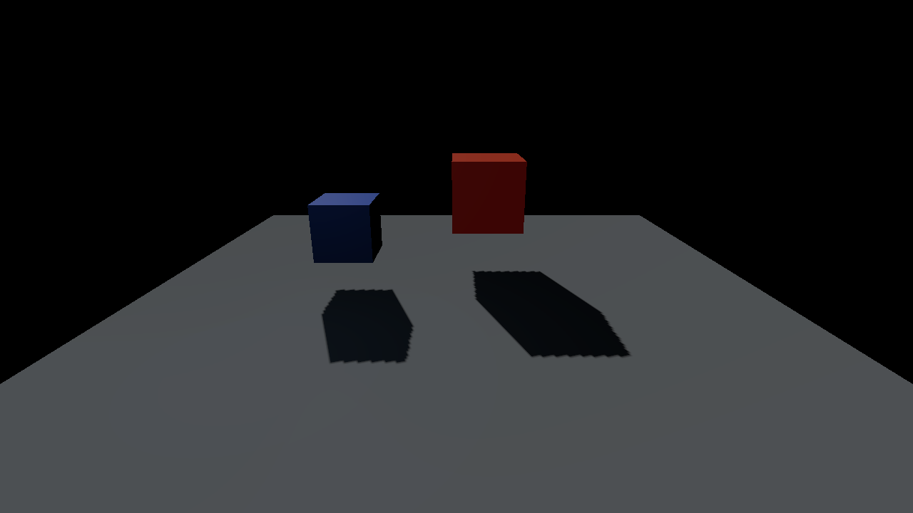
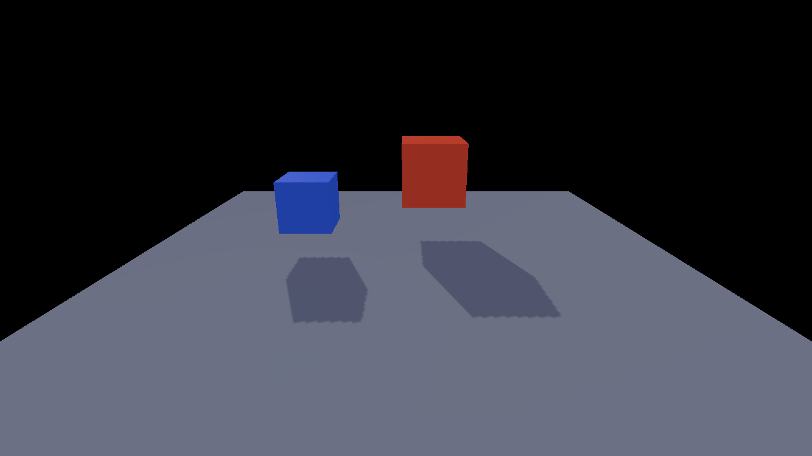
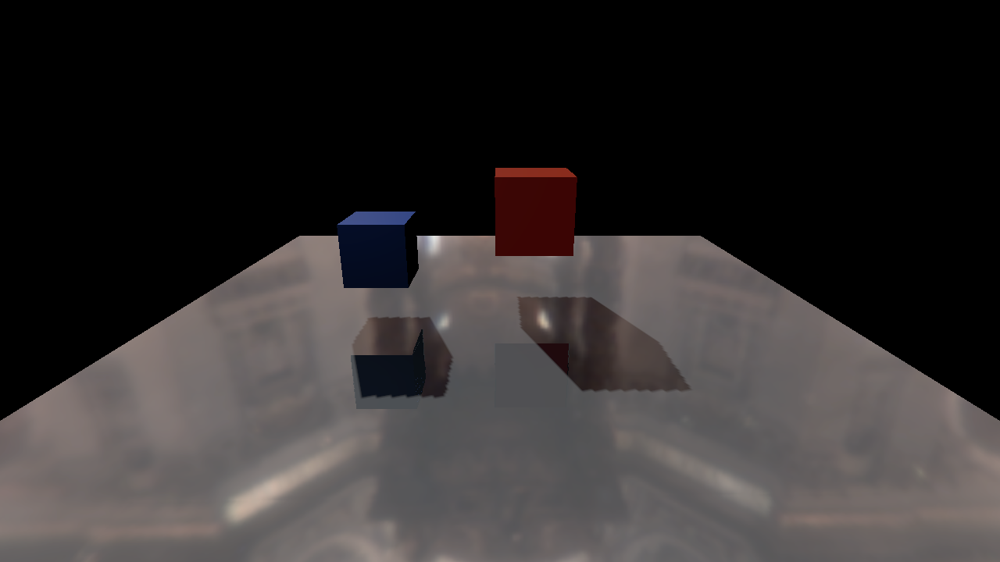
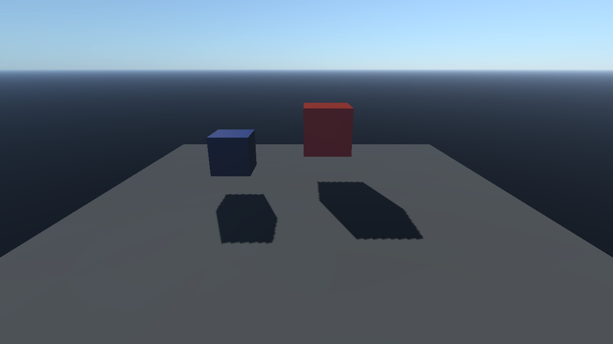
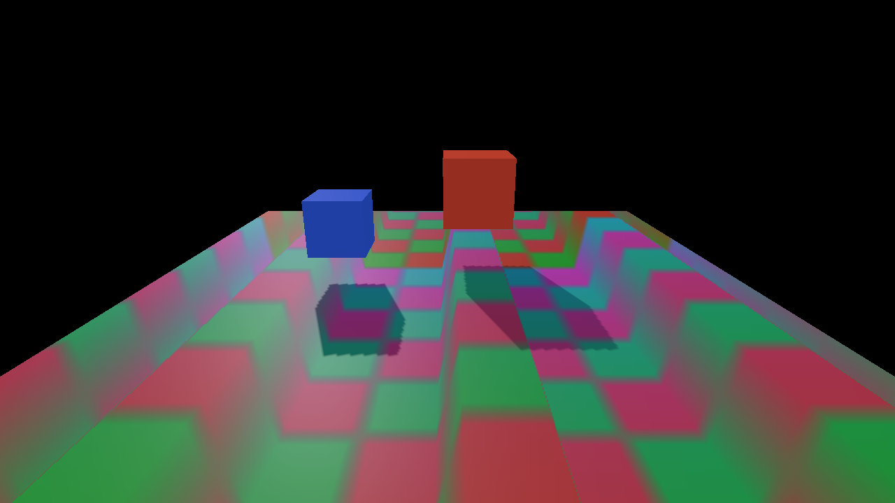
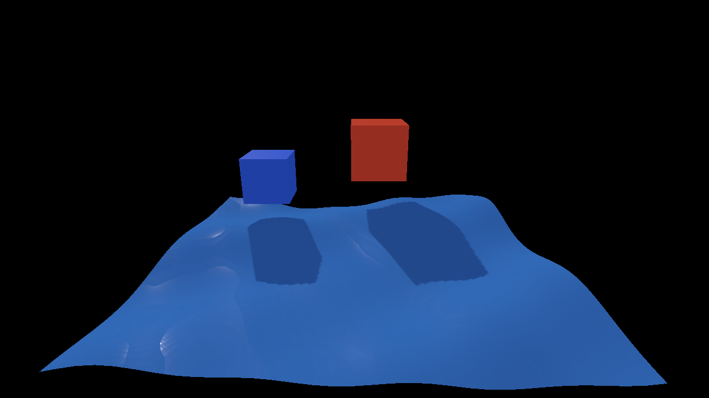

# Selected scene features: implementation and validation

2026-11-05. Implemented on the local `codex/viewport-renderer-switch` branch, starting from `26eb307d`. This report covers the user-selected **8, 9, 10, 11, 14 and 15**. Item **7 Parallax/POM** is included as the authorized material-node foundation. The [remaining choices](../rendering-feature-intake.md#remaining-decisions) keep their original numbers.

[Openable sample project](../../examples/scene-feature-demo/README.md) · [Scene features and baking](../manual/scene-features.md) · [Mapping node guide](../manual/material-mapping.md) · [Measurement data](data/selected-scene-features.json)

## Delivered behavior

| No. | Feature | Reusable implementation |
| --- | --- | --- |
| 8 | SH environment | CPU equirectangular projection, strict atomic `.jsh` asset, nine linear-radiance coefficients, shared diffuse evaluation and project settings. Valid positive diffuse GI replaces SH by default; explicit combination remains available. |
| 9 | PPR | Transient integer projection image, atomic scatter, resolve, bounded hole fill and cube/constant fallback. It uses actual visible scene geometry rather than an environment-only approximation. |
| 10 | Atmosphere | Bounded ground-level Rayleigh/Mie single scattering and scene transmittance, with explicit scene-to-meter conversion. |
| 11 | Waves | Shared analytic Gerstner settings and CPU surface query; four-wave GPU deformation, independent Water entities, conservative bounds, Inspector, persistence and Play/seek. Base, shadow and picking vertices use the same deformation. |
| 14 | Horizon | Cancellable eight-direction height bake, separate AO, lossless linear layers and a material visibility output. It affects the primary sun and SH ambient visibility without baking shadows into albedo. |
| 15 | Relief / interior | Composable bounded Relief and Interior nodes, including optional RG dual-depth inputs. UV, texture-object/sample, normal, channel and Parallax/POM nodes supply the common foundation. |

Material v1 remains loadable; new graphs save as v2. Typed graphs compile to HLSL through the existing shader cache. Numeric values and texture paths do not change code identity. Local output overrides, graph reimport and invalid-input retention use the existing document/material workflow.

SH/Horizon baking runs on one cancellable CPU worker. Linear/normal PNG, BMP and TGA decoding uses at most two workers and preserves all RGBA channels, including Horizon alpha, without Windows WIC's lossy BC3 path. A retained decoded-image cache is bounded to 64 entries/128 MiB; worker temporaries are additional. Owner-thread publication retains the last valid material while preparation is pending or fails. GPU upload and first pipeline creation still run on the owner thread; this is not a hard upload-time budget.

## Verified scope

The final native run used **Apple M4, 16 GiB RAM, macOS 26.6.2**, a Debug engine, stable MoltenVK, Khronos validation and Metal API validation. It rendered **247 actual frames**, passed **88 checks**, and reported **zero Vulkan/Metal validation problems**. Checkout INI/preferences and runtime options were preserved. The native engine SHA-256 is recorded in the measurement JSON.

The checks include SH in both raster renderers, zero-intensity GI retaining SH, PPR projection versus the same fallback with an inverted plane, atmospheric scattering, six mapping recipes in Deferred, generated POM in Forward, shader-variant reuse, and water at frozen times 0/1.5 in both raster renderers. CPU surface prediction matched GPU picking, including a later-drawn opaque object hidden behind the water. Saved scenes and the project form the sample linked above.

Related validation also passed:

- Incremental macOS engine build and the linked `--ci-rendering-features` group, including 71 math/bake checks, 34 material-compiler checks, 41 Water-document checks, 35 project/baker checks, 70 project-settings checks, and existing tools/runtime regressions.
- **112 actual engine-generated shader compilations:** 56 DXIL and 56 SPIR-V, with **12 CPU/SPIR-V layout contracts** and a rejected negative ABI control. The shared view is 560 bytes, the material block 1184 bytes, and the existing render-object prefix remains 192 bytes.
- Five malformed selected-feature CLI cases rejected before window/GPU initialization. Native Visual Studio project entries were checked for the new translation units; pure CPU modules avoid the engine PCH.
- Separate worker ASan/UBSan checks for the pure CPU algorithms, document/settings/bake boundaries and material compiler. These are narrower than an instrumented full-engine GPU run.

**Windows C++ builds and physical DX12/Vulkan execution were not run in this local macOS batch.** DXIL compilation is not Windows runtime validation. Hosted CI and main integration remain deferred under the user's batching policy.

## Performance observations

These are **feature-off versus feature-on in the same new executable**, not an isolated before-code/after-code benchmark. The earlier executable was not run against incompatible new shaders. Each entry below uses six measured frames after four warmup frames; captures/readbacks and asset preparation are outside these samples. The native automatic frame-60 screenshot was disabled after it was found to contaminate an earlier timing run. That run is not used here.

| Path | Off median | On median | Observed difference |
| --- | ---: | ---: | ---: |
| Deferred SH | 8.346 ms | 8.675 ms | +0.329 ms |
| Deferred PPR | 8.346 ms | 8.539 ms | +0.193 ms |
| Deferred atmosphere | 8.346 ms | 8.563 ms | +0.217 ms |
| Forward SH | 8.306 ms | 8.350 ms | +0.044 ms |

The timer covers owner-thread input/update/visibility, rendering, present and event polling. It includes present pacing and validation overhead; it is **not GPU-only timing**. Values cluster near an 8 ms presentation interval. Short-sample variation, including negative differences in some mapping pairs, does not establish a speedup or a reliable per-feature GPU cost. Raw samples and mapping/water profiles are in the JSON. Water time 0 versus 1.5 compares two active snapshots, not deformation-off versus on. Large-asset publication latency was not measured by this small fixture.

Memory changes can be stated directly. The fifth RG16F GBuffer attachment costs **4 bytes/pixel**, about **3.52 MiB per 1280×720 scene-target set**, including when its visibility values are neutral. Active scene-feature passes use two RGBA16F scratch images (about 14.06 MiB at that size); PPR adds an R32_UINT image (about 3.52 MiB). Pool reuse/frame retirement controls their lifetime. Disabled scene features skip their extra compute/copy passes.

## Integration fixes exercised

- Shadow and picking draws bind the shared deformation material block. Picking uses a fixed view/object/material layout in Forward as well as Deferred.
- Picking copies into the readback buffer's actual allocation offset, with 512-byte placement alignment and Vulkan host visibility. The final run selected the same water ID at offsets **0 and 512**. A transient independent depth target prevents later occluded geometry or hidden debug draws from winning by draw order.
- Production and shader export use the same root scene-compute entry. This respects the existing loader's include resolution while keeping pure algorithms in `Features/`. Failed initialization discards partial native shader stages before PSO publication.
- SH ownership follows actual positive GI composition, including Surfel frame validity, rather than a stale texture pointer. PT-active editor publication holds raster-only water/mapping changes and reports the required renderer; switching raster retries them.
- Rebaking managed Horizon assets preserves registry sidecars/IDs, while stale-project completion is not applied to a different project.

## Support and limits

PPR needs stored single-sample Deferred inputs and one configured plane. SH and the atmospheric adapter also support Forward; native Forward SH/POM/water and generated Forward shader variants were checked. Atmosphere is a ground-level single-scattering approximation, not a planetary LUT system. Forward retains its existing direct-light model; this batch does not convert it into a complete PBR renderer.

Water is an opaque analytic surface, not a fluid solver or complete transparent ocean. Mapping changes sampling and apparent depth. Neither updates collision or ray-tracing hit geometry; full PT/RT material parity is not claimed. Horizon's stored directional visibility belongs to the primary sun, with separate SH ambient AO. Other material/lighting extensions remain intake decisions.

Local detailed receipts are ignored build output under `build/selected-scene-features/`, especially `final-checked/verification.json`, `feature-cpu.log`, `shared-shader-checks/report.json` and `cli-result.json`.

## Actual GPU captures

The PNGs below are unmodified 1280×720 scene readbacks from the final run. They are diagnostic materials and geometry, not artwork or a quality benchmark.

| SH disabled | SH enabled |
| --- | --- |
|  |  |

| PPR | Atmosphere |
| --- | --- |
|  |  |

| POM material | Animated water at 1.5 seconds |
| --- | --- |
|  |  |
