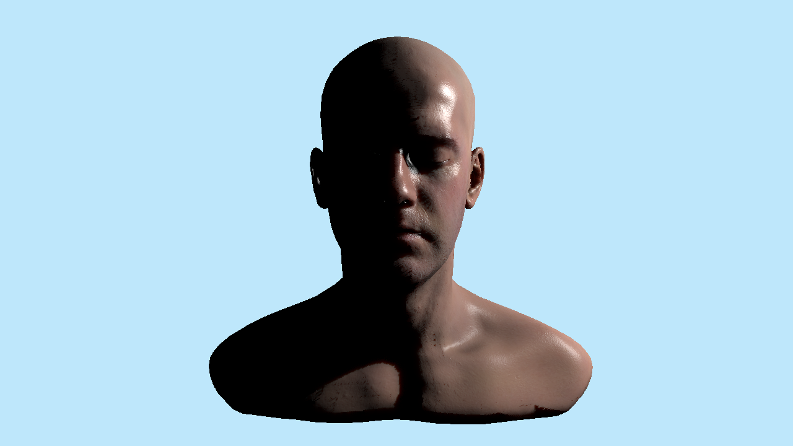

# Skin reference audit

[Open the human sample](../../examples/subsurface-human-demo/README.md) · [Actual GPU evidence](data/skin-reference-gpu.json) · [Material controls](../manual/material-diffusion-msaa-hiz.md)

The first human sample verified screen-space diffuse redistribution. It did **not** reproduce the original Shadows Skin renderer. Its smooth appearance and self-shadow bands were visible defects, despite the narrower diffusion assertions passing.

## Corrected native result

The corrected macOS Vulkan/MoltenVK run rendered **76 frames**, passed **142 GPU assertions**, reported **zero Vulkan/Metal validation problems**, and preserved checkout INI/editor preferences. The actual face was visually reviewed after correcting capture self-shadow acne. The result includes the source skin detail and glossy highlights; it is not a pixel match for the original tone-mapped demo.

[Skin transport OFF](images/skin-reference/human-off.png) · [UV without diffusion/transmission](images/skin-reference/human-uv-unfiltered.png) · [Diffusion with transmission disabled](images/skin-reference/human-transmission-off.png) · [Half weight](images/skin-reference/human-half-weight.png)

## Reference and implementation

Reference: [`scahp/Shadows`, Skin `51249d3`](https://github.com/scahp/Shadows/tree/51249d3d4d9ea1c3320741077aaa5335b28c3418). The scan/maps have their own [attribution](../../examples/subsurface-human-demo/Assets/InfiniteHead/ATTRIBUTION.md), separate from the engine license.

| Component | Initial human sample | Corrected path |
| --- | --- | --- |
| Surface detail | Generated smooth mesh normals | Original 6000x6000 linear baked normal; explicit object basis and RH-to-LH Z conversion |
| Specular | Constant GGX roughness | Optional SkinKelemen/Beckmann material; original linear specular/roughness/AO map |
| Energy | Standard PBR diffuse | Shared 64x64 hemispherical energy LUT with the source 80x80 quadrature |
| Diffusion | Two screen-space filters | Optional UV-space six-lobe RGB profile and five incremental Gaussian pairs |
| Albedo split | Full albedo before filtering | Material exponent before transport and complementary exponent after transport |
| Transmission | Authored surface thickness only | Light capture records real entry distance, UV, identity and geometric normal |
| Comparison scene | Different scale, camera, directional key and ambient fill | Source-scale head, frontal camera and finite side key; material OFF/ON controls retain skin normals and BRDF |

The material switch is explicit. StandardPBR retains its existing BRDF. SkinKelemen interprets roughness as Beckmann `m` and specular weight as `rho_s`, rather than GGX alpha or dielectric F0. Specular and emission are kept outside diffuse transport.

## Intentional corrections and limits

- The original TSM code overwrote its entry normal, cancelling its back-facing correction. The new path retains the captured geometric entry normal.
- The original final shader applied unattenuated white specular beside attenuated coloured diffuse. The engine applies the actual light radiance consistently to both lobes.
- Incremental blur uses square roots of variance differences, with explicit world-unit/mm conversion. The original demo used variance differences directly as artistic sample distances.
- Original auto-exposure, filmic bloom/tone mapping and sampling quirks are not a pixel-equivalence contract. The partly occluded reference roughness control is not a reliable calibration measurement.
- UV transport initially supports Skin profile 0, up to four undeformed, non-instanced, uniquely unwrapped surfaces and one directional or point key. Unsupported geometry, profiles, additional diffuse writers, invalid coverage and work budgets preserve screen-space fallback with a reason. Ambiguous eye-chart UV texels use local fallback rather than disabling the unambiguous face.
- The transport settings are persisted in the project. Generic units default to one world unit per millimetre; the scale-300 reference preset explicitly selects 0.3.
- Raw data JPEGs are decoded without sRGB conversion. The 6K map requires an explicit 36-million-texel limit and a bounded 256-MiB decoded-data cache. Two workers can temporarily hold decoder and copied image buffers in addition to the cache.

## Remaining shadow-boundary calibration

The user subsequently reported that the red scattering at shadow boundaries is still too weak. The native assertions above establish execution, finite transport, controls and diffuse/specular composition. They do **not** establish that the original demo's shadow-boundary appearance has been reproduced. The remaining difference is broader than tone mapping.

TSM is enabled in the delivered ON project. Its contribution and the local UV diffusion profile both need reference calibration. Before filtering, angular corrections and clamps, for a raw light-entry distance difference `D` and the reference model scale300:

| Quantity | Original Shadows demo | Current human preset |
| --- | --- | --- |
| Stored transmission alpha | `exp(-20 * D / 300)` | `exp(-0.2 * D / 0.3)` |
| Thickness reconstructed with `-log(alpha)/0.2` | `D / 3` | `D / 0.3` |

Thus the current base reconstructed thickness is ten times larger at equal geometric distance. The later squared-thickness Gaussian fade can strongly suppress transmission. The engine's entry-normal correction and alpha filtering also differ, so this is an algebraic scale comparison, not a claim of a constant tenfold image difference.

The local diffusion step also changed: the original passes variance differences directly as spatial sample steps; the engine uses square roots of variance differences and an explicit world-unit/mm conversion. Equal numeric quality settings therefore do not preserve the original effective per-channel profile.

Next quality work must separately compare UV diffusion and TSM at the same shadow boundary, preserve a neutral OFF control, and tune or explicitly version a reference-compatible preset. Increasing blur merely to hide a shadow defect, or citing the142 transport checks as proof of perceptual parity, is not an adequate fix. No such calibration change is included in this publication.

## Actual source UV audit

A CPU raster of the real Assimp 6.0.5 triangulation found **208 genuinely overlapping texels** at 1024x1024, all inside the two isolated eye charts (104 each). The central head chart has no detected overlap. Sixteen triangles have degenerate UVs. Pixel-centre/top-left ownership, reversed winding and coincident-layer controls distinguish this from shared-edge double counting; 8-bit subpixel quantization produced the same counts.

See [raw UV audit](data/skin-reference-uv-audit.json). The engine preserves the source assets and uses conservative local screen fallback where a four-tap UV footprint is not uniquely covered. Invalid blur taps return energy to their centre; ambiguous texels cannot donate transmission.

## Correctness and practical scope

Six saved controls retain the same source mesh, skin BRDF, normal/specular maps, camera and finite key. UV-unfiltered versus transmission-off isolates Gaussian transport using the same UV light capture. ON versus transmission-off isolates measured front-entry transmission. OFF versus global-strength-zero is byte-identical; half weight produces 0.50064 of the full HDR change.

Across 218,037 checked channel samples, final HDR matched `C_OFF + mask * strength * (CompletedDiffuse - OriginalDiffuse)` with maximum error 0.001465 and mean error 0.00000510. There were 6,027 actual specular witness pixels. The original diffuse layer was unchanged. Transmission increased diffuse at 173 visible eligible pixels with no unexpected loss. This verifies the bounded implementation; it does not establish a volumetric BSSRDF or anatomical eye model.

The ON atlas had 961,180 covered texels, the same 208 real eye-chart overlap texels found by the independent CPU audit, no fatal capture/nonfinite flags, and 5,197 visible pixels taking conservative local screen fallback. Thin-surface entry distances are measured from captured geometry. A unit-conversion setting, rather than an implicit mesh-scale guess, converts them to millimetres.

The new production code also exposed and fixed two integration defects. A monolithic compute parameter set exceeded the engine's 15-entry inline binding array; the pass now uses actual 8/13/12-binding sets with checked inline-resource capacity and an oversized negative control. Nearest light-texel radial depths caused false self-shadow stripes on sloped skin. The corrected pass reconstructs the captured triangle plane, intersects the actual receiver light ray and locally falls back for invalid/grazing cases. This preserves real occlusion and measured thickness instead of hiding acne by disabling shadows.

The linked feature CPU suite passed, including actual runtime coverage publication/Undo, Kelemen math39 and UV math64 checks. The latest UV shader check compiled38 actual DXIL/SPIR-V variants and reflected the464-byte transport UBO; material/scene52 variants and7 layouts passed, and per-sample/skin production122 variants were checked separately. The R32F energy UAV and atomic R32ui flags use explicit Vulkan storage formats. Native Windows DX12 execution was not performed.

The separate generic Screen/MSAA/Hi-Z evidence remains127frames/183assertions. After the shared material changes, the Screen group was rerun:39frames/140checks passed with zero validation problems. The new76/142human receipt is independent and does not silently extend the older binary's performance measurements. No skin-pass speedup or GPU frame-time claim is made.

## Source and verification identity

- Source head/normal/specular maps: pinned Shadows Skin51249d3; five file hashes are retained in the sample provenance.
- Corrected native executable SHA-256: `abf07d491289c3300ad7b2173dac91c6a6da47e1a1303833f9542b078e8880f3`.
- Native directory: `build/skin-shading/human-plane-native/` (ignored generated evidence); portable raw receipt is linked above.
- Unsupported lighting/geometry retains a visible screen fallback. UV transport currently requires one shadow-enabled directional/point key and no diffuse GI/environment. Partial/mixed MSAA coverage pixels retain screen transport; the human native receipt uses1x.
