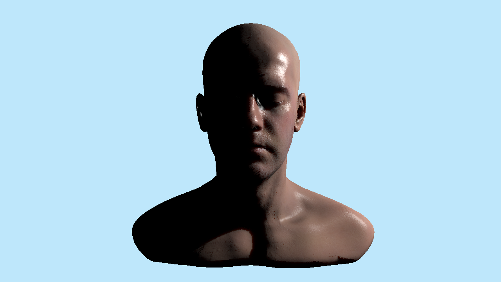

# Human-head subsurface material sample

This sample uses the **Infinite / Lee Perry-Smith human head scan** from the Shadows Skin source, with its original diffuse, normal and specular/AO maps and a small portable MTL adapter. The reference path combines explicit object-space normals, the Skin Kelemen BRDF and texture-space surface transport.

The corrected human path passed **76 rendered frames / 142 checks** on native macOS Vulkan/MoltenVK, with no Vulkan/Metal validation problems and preserved checkout preferences. See the [Skin reference audit](../../docs/reports/skin-reference-audit.md) and [portable native evidence](../../docs/reports/data/skin-reference-gpu.json). The earlier 127-frame / 183-check suite remains separate generic Screen SSS/MSAA/Hi-Z evidence. This demonstrates the source normal/BRDF/UV/transmission components, without claiming pixel-identical rendering of the original GL demo or a performance gain.



[Full ON frame](../../docs/reports/images/skin-reference/human-on.png) · [Same skin material with transport OFF](../../docs/reports/images/skin-reference/human-off.png)

## Small portable download

The small downloadable sample ZIP omits only the 18.3 MB original 6K normal to fit the attachment limit. Inside the extracted sample folder, run [fetch-assets.command](fetch-assets.command) once on macOS, or `python3 fetch-assets.py`. The [fetch script](fetch-assets.py) restores missing pinned assets and checks their exact size/SHA-256; it preserves existing files and stops if one differs. The full repository/local example already contains the normal and needs no fetch. This restores the original map without downsampling or rewriting it.

## Open the project

Use an already-built engine containing the material diffusion feature. Opening this project does not require rebuilding the engine.

On macOS, double-click [open-macos.command](open-macos.command) in this folder. It launches the existing `build/macos-debug/jEngine`, retains an explicitly configured Vulkan driver environment, and uses the local Homebrew MoltenVK manifest as its fallback. It does not change global driver settings or rebuild the executable.

From the repository root, launch the current Debug executable from the engine resource directory, with the same configured Vulkan driver environment used for the verified renderer:

```sh
JENGINE_HUMAN_PROJECT="$PWD/examples/subsurface-human-demo/project.jproject"
(cd jEngine && ../build/macos-debug/jEngine -vulkan --project "$JENGINE_HUMAN_PROJECT")
```

The existing `scripts/run-macos.sh --project <full-project-path>` forwards the project argument but executes `build/macos/jEngine`. It does not automatically select the newer Debug artifact or build it. Use that runner only when its own executable contains this feature.

In an already-running editor, choose **File → Open project**, enter the full path to [project.jproject](project.jproject), and click **Apply**. Save or discard previous unsaved edits when prompted. Wait for **Project tools → Imports** to finish before inspecting the model. The default startup scene is **human-on**.

The model source stays inside the project at `Assets/InfiniteHead/Infinite-Level_02.OBJ`. Keep the entire project, including its MTL, maps, `.jmaterial` graphs and attribution, when moving it. The uppercase `.OBJ` and relative filename spelling are intentional. Assets use project-relative paths; a scene file alone does not contain the model or textures.

## Compare the saved OFF and ON scenes

1. Use **Renderer → Deferred** above the Scene viewport.
2. Open **Window → Project settings → Renderer defaults → Surface diffusion (SSS)**. Keep **Enable Deferred SSS** on and **Global SSS strength = 1**, then click **Save and Apply**. These settings belong to the project, not an individual scene.
3. Open [human-off.jproject](human-off.jproject) through **File → Open project**. Select the human Model and inspect **Material → Subsurface material** and **Skin shading**. OFF stores an explicit **Subsurface weight = 0**.
4. Open [human-on.jproject](human-on.jproject) with the same menu. OFF and ON retain the same **Skin Kelemen** BRDF, normal map, specular/AO maps, camera, transform and key light; only transport weight changes. This compares diffusion rather than changing the BRDF and lighting at the same time.
5. Keep the camera and lighting fixed while comparing. If you need a closer view, select the model and use **F** while the Scene viewport has keyboard focus, then keep that view consistent between controls.

An enabled project switch alone does not make an OFF material scatter. A missing authored value can inherit a source material; the saved OFF control therefore uses an explicit zero.

If you try a global-strength-zero control, set **Global SSS strength = 0** in Project settings and apply it. Restore it to **1** before returning to the other scenes; opening a scene does not restore project-level strength.

Each control below is an actual saved project with its own startup scene and global settings. Prefer opening the **project**, since **File → Open scene** alone does not restore Gaussian/transmission/global-strength settings.

| Project | Control | Actual capture |
| --- | --- | --- |
| [human-off](human-off.jproject) | Material weight 0; same Skin BRDF/maps/key | [OFF](../../docs/reports/images/skin-reference/human-off.png) |
| [human-on](human-on.jproject) | Weight 1, Gaussian step 1, transmission on | [ON](../../docs/reports/images/skin-reference/human-on.png) |
| [human-half-weight](human-half-weight.jproject) | Material weight 0.5 | [Half](../../docs/reports/images/skin-reference/human-half-weight.png) |
| [human-global-zero](human-global-zero.jproject) | Global strength 0, material weight 1 | [Global zero](../../docs/reports/images/skin-reference/human-global-zero.png) |
| [human-uv-unfiltered](human-uv-unfiltered.jproject) | Gaussian step 0 and transmission off; same UV capture | [Unfiltered UV](../../docs/reports/images/skin-reference/human-uv-unfiltered.png) |
| [human-transmission-off](human-transmission-off.jproject) | Gaussian step 1, transmission off | [Transmission off](../../docs/reports/images/skin-reference/human-transmission-off.png) |

## Edit the material

The Inspector exposes **Subsurface weight**, **Subsurface color**, **Thickness (world)** and **Diffusion profile**. This UV reference uses **Skin profile 0**; other profiles retain Screen fallback. The [material diffusion guide](../../docs/manual/material-diffusion-msaa-hiz.md) lists the eight Screen presets and global controls.

For generic **Screen** diffusion, thickness/profile radii use world units and thickness bounds the blur radius; it is not a measured distance through the head. **Texture (UV)** transport has its own explicit world-to-millimetre project setting. Use **Undo/Redo** for instance edits and **File → Save As** for your own comparison. **Inherit subsurface** and **Inherit skin shading** restore source/shared values; they are different from explicitly setting zero weight.

Under **Skin shading**, choose **Skin Kelemen** and **Texture (UV)** for the reference path. Standard PBR retains its existing GGX meaning for Roughness; Skin Kelemen interprets that input as **Beckmann m**, clamped to 0.02–1 by the BRDF. **Specular weight** is the Kelemen lobe weight, not dielectric F0. **Diffuse occlusion** affects diffuse lighting separately from specular.

**Pre-scatter weight** applies only to UV transport: irradiance receives `albedo^p` before transport and the result receives destination `albedo^(1-p)` afterward. Use `p=0.5` for the source's square-root split; 1 puts all color weighting before transport and 0 puts it afterward. The Screen fallback uses full albedo before filtering and does not implement this split.

Open **Project settings → Surface diffusion (SSS) → Texture-space transport** to set UV tile/light-capture resolution, Gaussian step scale, **World units per millimeter**, transmission enable/extinction/thickness scale and capture bias. Generic units default to **1 world unit/mm**. The human preset explicitly stores **0.3**, rather than changing that default for every project. Apply project edits with **Save and Apply**; scene switching does not restore them.

The UV integration supports **one contributing directional or point key with Cast shadows enabled, and no active diffuse SH/environment, SSGI or SurfelGI**. This fixture uses one point key at `(273,117,45)` and an opaque emissive blue background. Spot lights, multiple/missing or non-shadowing keys, diffuse GI and unsupported surfaces retain Screen fallback with a visible reason. The human scene's scale is 300; camera and lighting are saved with the controls.

The shared [reference-skin.jmaterial](Materials/reference-skin.jmaterial) contains an explicit **Surface settings → Alpha mode = Opaque** declaration. It is published as real canonical coverage after material cloning; SSS/Skin scalar metadata alone is not an opaque declaration. Mask/Blend and ambiguous legacy textured coverage cannot use opaque UV transport.

**Skin Kelemen requires Deferred:** the renderer selector rejects switching this scene to Forward or Path Tracing while the Skin model is present, including weight-zero controls. Standard PBR retains its existing BRDF and renderer behavior; active mapped graphs keep their separate ray-tracing restriction. Generic Screen SSS filters direct+SH diffuse while leaving other GI unchanged, which is separate from the one-key UV contract.

## Normals, texture and eye limitations

The OBJ has no stored `vn` records. Import generates smooth geometric normals and tangents. The MTL keeps only the diffuse binding; the graph binds the detailed normal explicitly. The file named `Infinite-Level_02_World_NoSmoothUV.jpg` contains the source-rest/object-space bake for this mesh. It must not be dropped into the Inspector's native **Normal texture** slot, which still assumes Tangent space.

In **Material graph**, use **Texture Object → Sample Normal** with the shared UV and **Normal space = Object**, source signs **`(+1,+1,-1)`**, and **Flip normal Y = off**. Connect it to **Normal**. The Z sign adapts this source's right-handed bake to the engine basis. Object normals follow the actual mesh/parent transform; **World** would mean already-engine-world directions and would stay world-fixed. UV V flip, source-axis signs and normal Y flip are independent. The map is read as linear data with no color gamma conversion.

Read `SpecularAOMap.png` as **Linear (height / data)**. The saved graph uses **R/0 × 1.99 → Specular Weight**, **G/1 × 0.5 → Roughness** (Beckmann m), and **B/2 → Diffuse Occlusion** through Channel/Scalar/Multiply nodes. The roughness multiplier is provisional: the partly occluded original UI is not a reliable calibration measurement. These saved values are visible/editable, not a claim of unique screenshot calibration. Do not apply color gamma or multiply these channels into Base Color. The diffuse JPEG remains **Color (sRGB)**.

The source uses one material group/submesh, with eye appearance baked into the diffuse texture. A real source-UV audit found **208 overlapping texels at 1024×1024**, inside the two eye charts, rather than shared-edge raster artifacts. Ambiguous eye footprints, silhouette/coverage footprints and missing front-light capture retain Screen diffuse **locally**; the rest of the face keeps UV transport. Invalid taps cannot donate transmission from unrelated geometry. No anatomical mask or rewritten source mesh is introduced.

Measured entry/exit geometry drives the bounded transmission approximation. It is not an anatomical eye model, volumetric BSSRDF or animation rig. The current engine exposure/tone mapping and intentional source corrections differ from the original GL demo. The [audit](../../docs/reports/skin-reference-audit.md) explains those limits and the corrected surface-plane capture intersection.

## Attribution and source integrity

Read and retain [ATTRIBUTION.md](Assets/InfiniteHead/ATTRIBUTION.md) and [provenance.json](Assets/InfiniteHead/provenance.json). The scan and diffuse, normal and specular/AO maps are credited under **CC BY 3.0 Unported**, separately from the engine's MIT code license. Source geometry/maps are copied unchanged; the MTL adaptation leaves explicit normal-space handling to the graph.
